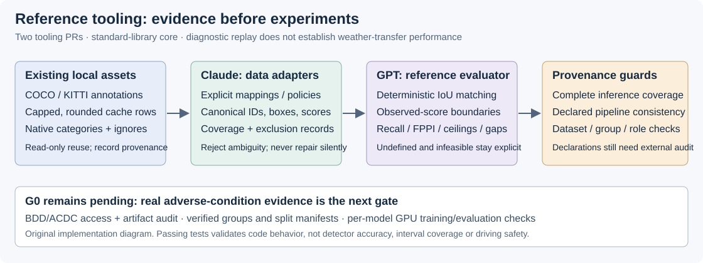

# Threshold Transfer Under Distribution Shift

I'm studying whether confidence thresholds selected on clear-day images preserve pedestrian recall under night and adverse-weather shift.

My focus is real-time object detectors, their operating points, and object-detection calibration. I want a rigorous, reproducible research contribution. Novelty, detector comparisons, and safety implications remain hypotheses until verified against primary sources and real experiments. Detection recall alone does not establish driving safety.

## Research questions

1. How much recall and false-positive burden change when a clear-day threshold is frozen and transferred to a shifted condition?
2. Do calibration metrics add predictive value beyond accuracy and attainable recall?
3. Which apparent improvements survive independent evaluation, class-policy controls, and uncertainty estimates?

My original [research plan](RESEARCH_PLAN.md) is a starting point whose literature claims require verification. This is personal research without a course timeline; [my project charter](docs/PROJECT_CHARTER.md) supersedes the original course requirements.

## Collaboration

- `main`: reviewed work, integrated through PRs.
- `gpt-research`: GPT evidence, methodology, and reproducibility work.
- `claude-research`: independent Claude evidence and critique.

I'm using two research subagents, GPT and Claude, to investigate independently and discuss disagreements before opening PRs. Each PR includes a compact summary, source-backed decisions, and relevant images or SVG diagrams. I review and explicitly approve the PRs on GitHub before they merge: GPT first, then Claude after updating against `main`. AI review is recorded separately from my approval.

## Status

The reference evaluator is implemented with a standard-library core, strict input/provenance checks and synthetic regression tests. Start with [the usage guide](docs/evaluator_usage.md), [the implementation and direct peer exchange](docs/gpt/tooling_implementation.md), and [the existing local-asset inventory](docs/local_assets.md). Data/cache adapters are developed on the separate Claude research branch.

```powershell
$env:PYTHONPATH = 'src'
uv run --no-project --python 3.11 python -m unittest discover -s tests
uv run --no-project --python 3.11 python -m threshold_transfer.evaluate --help
```



Phase 0 source audits and the GPT–Claude discussion are complete. My review starts with the [GPT research summary](docs/gpt/research_summary.md), its [protocol](docs/gpt/protocol.md) and [review resolution](docs/gpt/review_resolution.md). Claude's independently prepared audit, reply and cross-review are available on the [separate Claude research branch](https://github.com/adv-11/autonomous-sys-research/tree/claude-research/docs/claude).

The proposed design separates calibration fitting, threshold selection and held-out testing; distinguishes candidate-ceiling failures from threshold-related misses; and treats architecture comparisons as comparisons of complete pipelines. The diagrams explain proposed choices, not measured results.


ACDC's seven official archives are downloaded, verified and extracted. BDD image, legacy-label and Info candidates are downloaded, with release/checksum discrepancies; revised Detection 2020 JSON remains unacquired through the checked routes. See [the acquisition record](docs/data_acquisition.md) and [review resolution](docs/reviews/2026-11-06_bdd_acquisition_resolution.md).

No new detector training or night/weather evaluation has been performed. Existing COCO/KITTI caches support development-only adapter validation. G0 remains pending: verified BDD releases, annotation policies, defensible group allocation, checkpoint/environment pins and actual GPU smoke tests. See [the gate log](docs/gate_log.md), [workflow](CONTRIBUTING.md) and [task-drift reports](docs/collaboration/task_drift_log.md).
