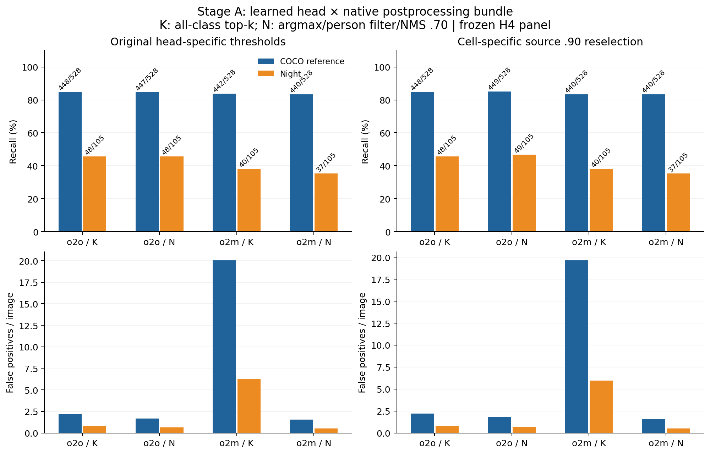
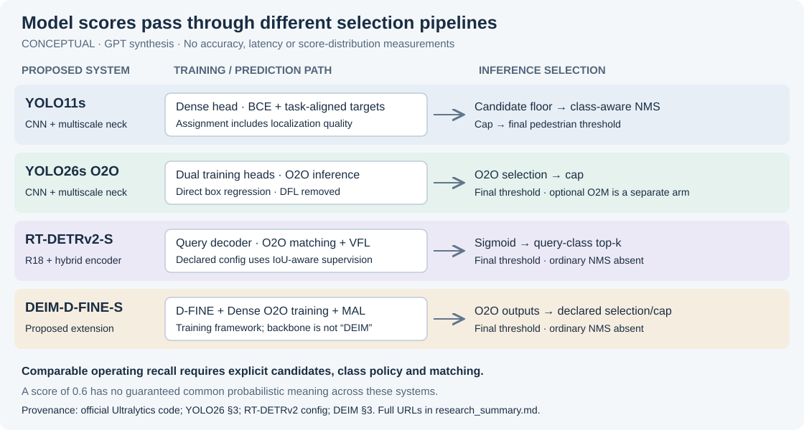

# Threshold Transfer Under Distribution Shift

studying whether confidence thresholds selected on clear-day images preserve pedestrian recall under night and adverse-weather shift.

My focus is real-time object detectors, their operating points, and object-detection calibration. I want a rigorous, reproducible research contribution. Novelty, detector comparisons, and safety implications remain hypotheses until verified against primary sources and real experiments. Detection recall alone does not establish driving safety.

## Research questions

1. How much recall and false-positive burden change when a clear-day threshold is frozen and transferred to a shifted condition?
2. Do calibration metrics add predictive value beyond accuracy and attainable recall?
3. Which apparent improvements survive independent evaluation, class-policy controls, and uncertainty estimates?

My original [research plan](RESEARCH_PLAN.md) is a starting point whose literature claims require verification. This is personal research without a course timeline; [my project charter](docs/PROJECT_CHARTER.md) supersedes the original course requirements.

## Collaboration

- `main`: reviewed work, integrated through PRs.
- `gpt-research`: GPT evidence, methodology, and reproducibility work.
- `claude-research`: independent Claude evidence and critique.

I'm using two research subagents, GPT and Claude, to investigate independently and discuss disagreements before opening PRs. Each PR includes a compact summary, source-backed decisions, and relevant images or SVG diagrams. I review and explicitly approve the PRs on GitHub before they merge: GPT first, then Claude after updating against `main`. AI review is recorded separately from my approval.

## Status

The reference evaluator and data/cache adapters are implemented, with a standard-library core, strict input/provenance checks and synthetic regression tests. Start with [the usage guide](docs/evaluator_usage.md), [the implementation and direct peer exchange](docs/gpt/tooling_implementation.md), and [the existing local-asset inventory](docs/local_assets.md).

**Latest empirical checkpoint:** GPT Sol ran real frozen-model Colab experiments on explicit COCO/ACDC development panels. Independent Sol review reproduced the four-cell YOLO26 head/postprocessing result: night operating differences persist under common selection bundles, while candidate-ceiling counts become much closer. Large false-positive costs, dependent scenes and source-selection limits remain. This is a mechanism finding, not a new method or a passed G0 gate. See the [compact checkpoint](docs/research/2026-11-13_checkpoint.md), [research report](docs/gpt/2026-11-13_sol_head_policy_mechanism.md) and [independent review](docs/reviews/2026-11-13_head_policy_review.md).

**Next external dataset:** NightOwls validation annotations are privately acquired under the accepted licence. The [corrected inventory](docs/gpt/2026-11-13_nightowls_annotations.md) separates five known recording keys from null-key frames. The [minimal adapter](docs/gpt/2026-11-13_nightowls_adapter.md) is independently approved by Opus. The authorized access pilot [stopped during index retrieval with zero images](docs/gpt/2026-11-13_nightowls_image_access_result.md). Its disabled supervision correction is independently reviewed; [one recovery attempt](docs/decisions/2026-11-13_nightowls_access_recovery.md) remains proposed and requires renewed explicit authorization under the original cumulative byte caps. No NightOwls detector results exist; G0 remains pending.



```powershell
$env:PYTHONPATH = 'src'
uv run --no-project --python 3.11 python -m unittest discover -s tests
uv run --no-project --python 3.11 python -m threshold_transfer.evaluate --help
```


Phase 0 source audits and the GPT–Claude discussion are complete. My review starts with the [GPT research summary](docs/gpt/research_summary.md), its [protocol](docs/gpt/protocol.md) and [review resolution](docs/gpt/review_resolution.md). Claude's independently prepared audit, reply and cross-review are available on the [separate Claude research branch](https://github.com/adv-11/autonomous-sys-research/tree/claude-research/docs/claude).

The proposed design separates calibration fitting, threshold selection and held-out testing; distinguishes candidate-ceiling failures from threshold-related misses; and treats architecture comparisons as comparisons of complete pipelines. Conceptual diagrams explain proposed choices; measured figures are labelled separately.



ACDC's seven official archives are downloaded, verified and extracted. BDD image, legacy-label and Info candidates are downloaded, with release/checksum discrepancies; revised Detection 2020 JSON remains unacquired through the checked routes. See [the acquisition record](docs/data_acquisition.md) and [review resolution](docs/reviews/2026-11-06_bdd_acquisition_resolution.md).

Mechanical GPU smoke tests on COCO are recorded in the reviewed feasibility note. Later Colab experiments measured ACDC performance on development panels; the original BDD primary study remains blocked. Expanded ACDC train inference was not completed after repeated transfer failures, and the KITTI capture prototype remains disabled. G0 is pending: the primary scope, trustworthy BDD labels or an explicitly revised study, annotation/group policies and suitable independent target evidence remain unresolved. See [the gate log](docs/gate_log.md), [workflow](CONTRIBUTING.md) and [task-drift reports](docs/collaboration/task_drift_log.md).

For the complete CPU regression suite, install the declared audit extra in an isolated test environment (`python -m pip install ".[audit]"`), set `PYTHONPATH=src`, then run `python -m unittest discover -s tests`. CI does this on Python 3.11/3.12. Existing research environments remain unchanged.
