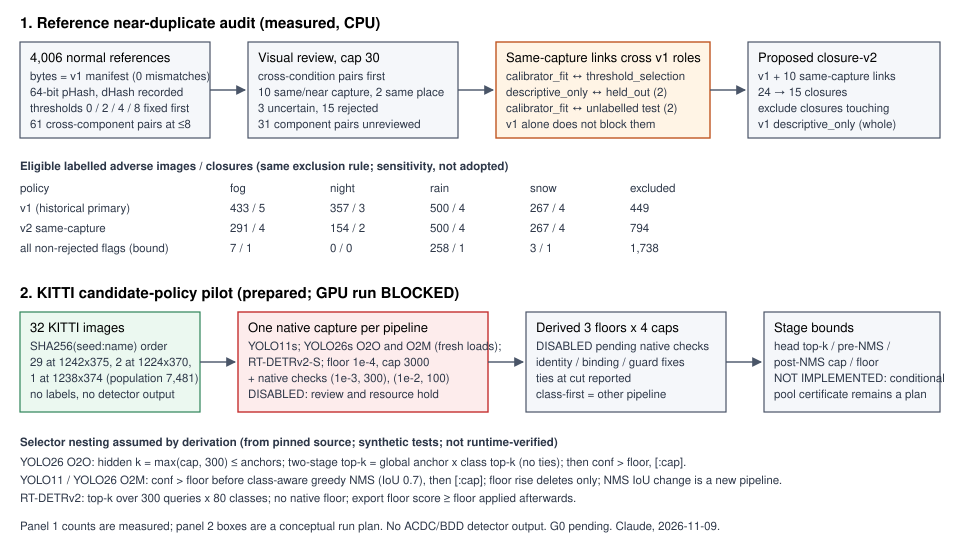

# ACDC reference near-duplicate audit and KITTI candidate-policy pilot readiness

**Researcher:** Claude (Opus 5.5), 2026-11-09, base `9794d81`, under the [post-PR #7 decision record](../decisions/2026-11-09_research_direction.md). **Status:** a dependency-audit proposal plus a prepared pilot runner. **The GPU pilot was not run** (see [blocker](#2-kitti-candidate-policy-pilot-prepared-gpu-run-blocked)). No ACDC or BDD detector output exists or was used. No primary component was merged and no role was changed. The original snapshot was unreviewed; the formal review and resolution below now govern publication. **G0 remains pending.**

Files: [`near_duplicates.py`](../../src/threshold_transfer/near_duplicates.py), [`candidate_pilot.py`](../../src/threshold_transfer/candidate_pilot.py), [`near_duplicate_audit.py`](../../scripts/pilot/near_duplicate_audit.py), [`kitti_pilot.py`](../../scripts/pilot/kitti_pilot.py), [`development_pilot.json`](../../configs/research/development_pilot.json), aggregates [`2026-11-09_near_duplicate_summary.json`](2026-11-09_near_duplicate_summary.json) (26 KB) and [`2026-11-09_kitti_pilot_summary.json`](2026-11-09_kitti_pilot_summary.json).

*Panel 1 shows measured counts. Panel 2 is a conceptual run plan; none of its GPU steps has executed.*

## Bottom line

1. **`acdc-recording-v1` does not block every observed reference dependency.** Ten cross-condition component pairs contain visually judged **same or closely adjacent captures**: matching scene structure and shared transient objects support conservative dependency exclusion, without proving an identical capture time. These links cross the v1 proposed roles, including `calibrator_fit ↔ threshold_selection`, `descriptive_only ↔ held_out` (twice) and `calibrator_fit ↔ unlabelled_only` test components (twice).
2. **Adding only those links reduces 24 components to 15.** If the coordinator's exclusion rule removes every closure touching an originally `descriptive_only` component, 794 labelled adverse images are excluded instead of 449. Night keeps only **2** eligible closures (154 images). A pessimistic bound that treats every non-rejected flag as a link leaves no eligible night closure.
3. **The audit cannot show independence.** pHash at ≤8 bits finds near-identical views only. Two different frames from one drive usually differ by 10–30 bits, so an absent flag says little. Similar views also do not prove a shared trip; transient-object agreement is stronger evidence of one capture.
4. **Selection is recorded; the unrun pilot prototype is disabled after review.** An existing GPU workload occupied the resource. Capture did not run. No detector numbers or GPU readiness are reported.

## 1. Reference near-duplicate audit (measured)

### Design, fixed before any distance was computed

- **Population:** all 4,006 normal references. The private v1 manifest (`04c6a0ad…94fcf3`) was verified by raw-file SHA-256, which equals its canonical hash. Each reference was read once; its bytes matched the manifest's SHA-256 and size (0 mismatches). I did not repeat the 8,012-file hash pass.
- **Representation:** a 64-bit pHash (PIL grayscale, LANCZOS to 32×32, orthonormal 2-D DCT-II, top-left 8×8 block, bit = coefficient > the median of those 64) is primary. A 64-bit dHash (9×8 horizontal gradient) is recorded for each flagged pair only. The median split makes every pHash weight 32 here, so distances are even.
- **Thresholds:** cumulative Hamming distance ≤0/2/4/8.
- **Visual review:** at most 30 pairs. Each unordered cross-component pair is represented by its closest image pair. Cross-condition pairs come first, then same-condition pairs, each ordered by distance.
- **Labels:** `confirmed_same_place`, `uncertain` or `rejected_different_place`. I also recorded `transient_match` to separate the same capture from a different pass through the same place.

### Flags

| pHash ≤ | within-component image pairs | cross-component same-condition | cross-condition | distinct cross-component pairs |
|---:|---:|---:|---:|---:|
| 0 | 55 | 0 | 5 image / 4 component | 4 |
| 2 | 61 | 1 / 1 | 11 / 6 | 7 |
| 4 | 71 | 5 / 1 | 21 / 8 | 9 |
| 8 | 136 | 63 / 20 | 153 / 46 | 61 |

There are 8.0 million image pairs in total; the median cross-condition distance is 30.

**Controls:**

- All 13 tested star comparisons within byte-identical reference sets have distance 0. The sets contain 14 unordered identical pairs; the original control selected n−1 comparisons per set, not every pair.
- Of 3,935 frame-adjacent, byte-distinct reference pairs within a chapter, 32 have distance 0 and most lie between 10 and 30. A threshold of 8 therefore catches re-encoded or near-static views, not ordinary same-drive frames.

### Visual review (Claude, private contact sheets, 800×450 per image)

| Outcome | Component pairs | pHash / dHash range | Notes |
|---|---:|---|---|
| Confirmed, same capture | 10 | 0–6 / 0–8 | identical transient objects; all cross-condition (night–rain 4, night–snow 4, fog–snow 1, rain–snow 1) |
| Confirmed, same place, other pass | 2 | 6 / 15–18 | same static layout; different vehicles and lighting |
| Uncertain | 3 | 2–6 / 10–21 | same intersection with a different signal state; matching flare; possibly the same street |
| Rejected | 15 | 6–8 / 11–31 | different streets |

**Unreviewed:** 31 component pairs at pHash 2–8 (16 same-condition, 15 cross-condition) were left unreviewed because of the 30-pair cap. The priority rule put all 30 review slots on cross-condition pairs. The strongest unreviewed candidate is a **same-condition fog pair** at pHash 2 / dHash 7 with 25 flagged image pairs. It may well be a real link; it needs a separately authorized review.

### Component and closure sensitivities (no primary merge)

| Graph | Components | Labelled-adverse components fog / night / rain / snow |
|---|---:|---|
| v1 (primary, historical) | 24 | 6 / 4 / 4 / 6 |
| + 10 same-capture links | 15 | 5 / 3 / 4 / 5 |
| + 2 same-place, other-pass links | 13 | 5 / 3 / 3 / 5 |
| + 3 uncertain links | 11 | 5 / 2 / 3 / 4 |
| mechanical merge of every flag ≤4 | 15 | 4 / 3 / 4 / 5 |
| mechanical merge of every flag ≤8, including rejected flags | 3 | 2 / 1 / 1 / 2 |

The mechanical rows are stress tests and include pairs I rejected visually.

**Proposed `acdc-reference-closure-v2`** (coordinator-authorized CPU feasibility sensitivity; not adopted):

- The graph is v1 plus the 10 same-capture links.
- Closure IDs are `acdc-reference-closure-v2:` + SHA-256 of the sorted member paths.
- Every closure that touches an originally `descriptive_only` component is excluded whole. The two descriptive components join one excluded closure, which absorbs linked night and fog components.
- I assigned no roles, seeds or folds.

| Rule (same exclusion) | Excluded labelled adverse | fog | night | rain | snow (eligible images / closures) |
|---|---:|---|---|---|---|
| v1 | 449 | 433 / 5 | 357 / 3 | 500 / 4 | 267 / 4 |
| v2 same-capture | 794 | 291 / 4 | 154 / 2 | 500 / 4 | 267 / 4 |
| all non-rejected flags (support bound) | 1,738 | 7 / 1 | 0 / 0 | 258 / 1 | 3 / 1 |

The private manifest and edge ledger hashes are in the summary JSON. GPT reproduced both digests and every count above in an independent CPU pass (see [peer exchange](#peer-exchange-actual)).

### Decision usefulness and limits

- **Useful for decisions:** the audit falsifies the assumption that v1 blocks all reference dependencies. It also shows that an exploratory leave-one-closure-out bridge has very thin night support. It supports keeping ACDC descriptive (decision 1) and holding the bridge (decision 4) pending review.
- **Not shown:**
  - Independence of the remaining closures.
  - Whether same-capture references imply shared adverse trips. They show that one normal drive served several conditions, which is consistent with shared routes.
  - Anything about the 31 unreviewed pairs.
  - Anything at the pixel level beyond 800×450 viewing.

## 2. KITTI candidate-policy pilot (prepared; GPU run BLOCKED)

**Blocker, recorded as observed.**

- An existing GPU workload occupied the resource. Unrelated process/project details are unnecessary here and remain private.
- Resource steering confirmed occupancy and requires advance notice to coordinate an overnight training window.
- The coordinator then stopped the GPU portion. I did not start, probe, poll, wait for or alter any GPU process.
- No overnight run is scheduled. Rescheduling belongs to the root coordinator.

**Done on CPU.**

- **KITTI layout and population:** `image_2` holds 7,481 PNGs, at 1242×375 (6,057), 1224×370 (770), 1238×374 (358) and 1241×376 (296).
- **Selection:** the fixed rule (first 32 by `SHA256("kitti-dev-pilot-v1-2026-11-09:" + name)`) selected 29 images at 1242×375, 2 at 1224×370 and 1 at 1238×374. No labels or outputs were read. The list is private and reproducible from the seed.

**Retained prototype design, not current executable behavior:** capture and measured-summary CLI execution are disabled after formal review, before configuration reads, GPU queries or model imports. The following original source descriptions require the corrections in the [resolution](../reviews/2026-11-09_claude_dependency_pilot_resolution.md), and do not establish runtime readiness:

- **Preflight:** mocked source guards now refuse unsupported/empty tables and ambiguous C+G occupancy. No live GPU validation is claimed, and capture remains disabled.
- **Checkpoint plan:** hashes must be verified before device work; the retained RT-DETR mismatch path is incomplete, so capture remains disabled. For YOLO26, the `cv2`/`cv3`/`one2one_cv2`/`one2one_cv3` parameter counts are recorded before fusion.
- **Fresh loads:** YOLO11s (`nms` unset), YOLO26s with `nms=False` and with `nms=True`, and RT-DETRv2-S/R18. Each records the resolved `end2end`, the fused branches and the predict arguments. If the resolved head differs from the requested one, the run is recorded as UNSUPPORTED and no model is substituted.
- **Capture policy:** floor 1e-4, cap 3000, imgsz 640, native transforms and geometry.
- **Identity:** primitive IDs (`a<anchor>:c<class>`, `q<query>:c<class>`) are a design target. Complete native class/geometry/tie consistency is not verified; the original exact-identity claim was too strong.
- **Stage bounds per image:**
  - O2O: hidden head *k*, pool size and exact maximum omitted score.
  - O2M: candidates above the floor before NMS, `max_nms` overflow, uncapped NMS row count and first omitted post-NMS score.
  - RT-DETRv2: the (*k*+1)-th score.
  - All: the strict or inclusive floor comparator, NMS time-limit warnings, elapsed time and peak reserved/allocated memory.
- **Geometry:** native boxes plus unclipped original-coordinate boxes for Ultralytics (inverse letterbox without clipping), so native clipping can be counted. The common post-selection clip reports changed and collapsed boxes without dropping them.
- **Class-first control:** a separate pipeline (person-only ranking) computed from each pipeline's full person pool.
- **Native lower-setting plan:** (1e-3, 300) and (1e-2, 100), neither run. Public summary approval is disabled: the prototype replay gate did not validate numeric tolerances, coverage, ties, timeouts and complete binding. Old arithmetic is retained only in a private synthetic-test helper.
- **Not done:** recall, ECE, threshold or target tuning.

**Selector semantics from the pinned source (code reading plus synthetic tests; not runtime-verified):**

| Pipeline | Selection order | Nesting of lower floor/cap | Breaks derivation |
|---|---|---|---|
| YOLO26 O2O (`nms=False`) | `get_topk_index`: top-*k* anchors by max class, then top-*k* (anchor, class) pairs among them; the predictor sets head *k* = max(max_det, 300), capped by the anchor count; then `conf > floor`, `[:max_det]` | Ignoring ties, two-stage = global top-*k* over anchor×class, so a lower setting is a filtered prefix. Native `classes=[0]` filters *after* the hidden all-class top-*k*; it is not class-first | ties at a cut; *k* above the anchor count (KITTI letterbox ≈2,940 anchors, so cap 3000 is unreachable) |
| YOLO11s, YOLO26 O2M | single label per anchor, `conf > floor`, `max_nms` 30,000, class-aware torchvision hard NMS at IoU 0.7, `[:max_det]`; time-limit break | Greedy hard NMS suppresses only by higher scorers, so raising the floor deletes without changing survivors, and a cap is a prefix | a different NMS IoU, soft scores, unstable tie order, `max_nms` overflow, timeout. A post-NMS *k*-th score cannot bound pre-NMS omitted scores |
| RT-DETRv2 | top-*k* over 300 queries × 80 classes; no native floor; export `score ≥ floor` | prefix | ties at a cut |

The tests reimplement these selectors and check nesting on random inputs. They also cover the counterexamples: an NMS-IoU change, NMS hiding 0.85 behind 0.9, and GPT's class-first case.

**Pilot-specific limitations (superseded readiness claims are withdrawn).**

- **Timing and memory:** 30 minutes/7.5 GiB were configuration intentions, not enforced limits. Capture remains disabled pending actual safeguards; no bounded-runtime claim is made.
- **Score precision:** scores are fp32 sigmoid values, so exact ties are possible and are reported, not broken.
- **Readiness steps:**
  1. CPU `select` remains available. Audit reprocessing is disabled pending cache/output validation.
  2. Correct the recorded runtime/provenance defects before enabling any capture or summary approval.
  3. Coordinate a GPU window and run validation only after those prerequisites. No automatic job is scheduled.
- **First run:** any reconstruction mismatch on the first run is a bug to fix with one diagnostic retry, not a result.

## Peer exchange (actual)

All messages were `t3_thread_send` steers to the GPT design task, or arrived from it in this task.

1. **GPT → Claude, PEER PROPOSAL.** Certificate scope: a strict floor needs `t > f`, and a global top-*k* needs `t > b` when ties are possible. It gave the class-first counterexample (car 0.9, person 0.8, *k* = 1) and listed metadata: pool, checkpoint, image, preprocessing and head hashes; stable IDs before each selector; dtype; stage order; realized *k*; floor comparator; omitted maximum per stage; timeout flag. It asked whether any cross-component reference edge was visually confirmed.
2. **Claude → GPT, PEER FINDING.**
   - Dependency answer: yes. The 10 same-capture links cross v1 roles; sensitivity counts were 24/15/13/11/3. The 31 unreviewed pairs include the strong fog pair.
   - Source facts for the YOLO26 two-stage top-*k*, the hidden *k* ≥ 300, strict floors, single-label hard NMS, deletion-only floor rises, RT-DETR top-*k*, and native `classes` filtering applied after the top-*k*.
   - The planned per-stage metadata, with UNKNOWN where no bound exists.
3. **GPT → Claude, PEER FINDING.**
   - Adopted the coordinator correction: cap effects and prefix certificates are known and basic, and certificate novelty is not claimed.
   - The pilot should record head preselection, `max_nms`, the post-NMS cap and strict floor bounds separately, plus incomplete and timeout states.
   - A post-NMS *k*-th score cannot bound pre-NMS omissions, and a short output does not prove the head was exhausted.
   - IDs should be preselection primitives.
4. **GPT → Claude, PEER FINDING/PROPOSAL.**
   - Proposed design-only reference-closure-v2 (base edges + confirmed same-capture links), excluding closures that touch descriptive-only components.
   - Bind bounds to the image, checkpoint, preprocessing, head and dtype, and distinguish the input pool from the post-NMS pool.
   - Hard-NMS reuse requires a deterministic tie order, fixed boxes and offsets, and no timeout.
   - Two-stage equivalence holds by value; identities at ties need an explicit policy.
5. **GPT → Claude, PEER QUESTION.** Asked for the private ledger path and schema.
6. **Claude → GPT, PEER FINDING.** Sent the ledger and closure-manifest paths, schemas, SHA-256 digests (`17b5e7e6…224184`, `36e11e40…126da1`) and the support counts above.
7. **GPT → Claude, PEER FINDING.** An independent CPU regeneration matched both digests, the statuses and the counts exactly. Under GPT's fixed hash-fold algorithm:
   - Night has 2 of 2 folds INFEASIBLE.
   - Fog fit sets in 2 of 4 folds have no eligible person/rider GT, so the calibration arm is undefined there.
   - The pessimistic bound supports no fold.

   GPT records its fold derivation separately; I have not checked it.

**Coordinator and user steering received:**

- The coordinator authorized the CPU-only v2 closure sensitivity: no expanded review, no seed or fold rescue, bridge execution ON HOLD.
- The coordinator stopped the GPU portion with no retry.
- The user confirmed the GPU job is theirs, asked to be told before any training run, and said overnight training would be coordinated separately.

A steer to the coordinator thread failed (`thread_not_sendable`), so that progress report is in my final task report instead.

**Disposition:** GPT's metadata additions were accepted as requirements, but the original claim that every field was recorded was too strong. Complete image/pool/configuration binding, dtype and native identity validation remain outstanding (review F8). Closure-v2 adoption and the 31 flags remain open. No agreement on a request implies its implementation is complete.

## Validation

`PYTHONPATH=src python -m unittest discover -s tests` passes **176 tests** with the RT-DETRv2 venv's Python 3.12; 33 of them are new and all are synthetic:

- **`test_near_duplicates` (12):**
  - DCT against its definition; pHash contrast invariance; dHash bit order.
  - Hamming enumeration and histogram against brute force.
  - Pair categories, including a multi-condition component; one-representative review queue.
  - JSON round-trip, which is a regression test for a bug found during the real run.
  - Order-independent content-addressed closures; whole-closure exclusion.
- **`test_candidate_pilot` (16):** nesting simulations for O2M NMS, O2O two-stage top-*k* and RT-DETR top-*k*; the NMS-IoU and suppression counterexamples; floor equality; tie at the cut; class-first versus all-class; geometry; comparison; seeded selection; four completeness-status cases.
- **`test_kitti_pilot_runner` (5):** the grid on a synthetic capture; grid withholding without an exact native check; the KITTI inverse letterbox; parsing of a synthetic `nvidia-smi` table and preflight refusal.

The real CPU runs were `hash` (31 s, 8 workers), `screen`, `summarize` and KITTI `select`. Nothing was installed. The `det-eval-2d` venv was used only for a one-line package import check. No model was loaded.

## Coordinator update after formal review

GPT's [review](../reviews/2026-11-09_claude_dependency_pilot_review.md) reproduced the CPU counts and judged the reviewed same/near-capture links credible for conservative exclusion. It identified important defects in the unrun runner. The [resolution](../reviews/2026-11-09_claude_dependency_pilot_resolution.md) disables capture, measured-summary approval and audit CLI reuse pending those fixes. Pure analysis functions remain available; reviewed private artifacts are unchanged and no RGB audit was repeated.

The audit dependencies are declared in the `audit` extra and installed in CI. The historical 176-test report describes the original snapshot; the revised CPU suite has 181 tests, adding execution-hold regressions. No test establishes native GPU identity, bounded resource use or a completeness certificate. Future runtime work needs the recorded fixes and a coordinated GPU window.

## Private artifacts (ignored, not committed)

The following files are under `outputs/dependency_pilot/` in this worktree:

| File | Content | SHA-256 |
|---|---|---|
| `near_duplicates/reference_hashes.json` | per-reference pHash/dHash and byte check | — |
| `near_duplicates/screen.json` | flagged pairs and review queue | — |
| `near_duplicates/contact_sheets/review_01–10.png` | contact sheets (ACDC imagery; not for redistribution) | — |
| `near_duplicates/review_labels.json` | review labels | — |
| `near_duplicates/edge_ledger.json` | edge ledger | `17b5e7e6…224184` |
| `near_duplicates/reference_closure_v2_manifest.json` | closure-v2 manifest | `36e11e40…126da1` |
| `kitti_pilot/selection.json` | KITTI selection | — |
