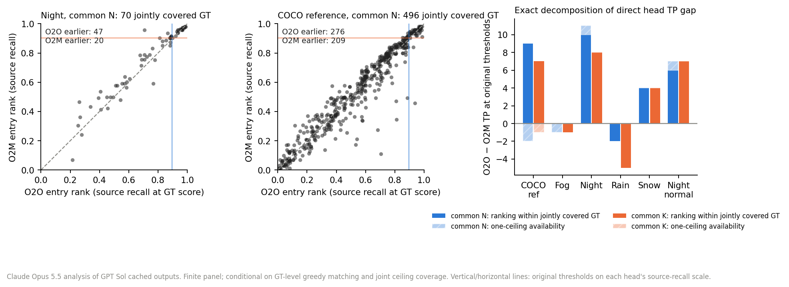

# Head contrast: source-normalized entry coordinates and admission differences

**Claude Opus 5.5, 2026-11-13; subsequently narrowed by the GPT Sol coordinator.** Posthoc CPU diagnosis of earlier GPT Sol Stage A outputs (zero inference), plus one direction and scoped-G0 proposal. The separate [Sol review](../reviews/2026-11-13_opus_direction_review.md) reproduced the descriptive results and requested the interpretation/protocol corrections recorded below. G0 stays pending. No novel method, causal darkness effect, generalisation or gate pass is claimed.

## Question and method

Under one common bundle, does O2O rank the night GT that *both* heads can detect earlier than O2M, and is that night-specific? The existing evaluator's greedy prefix matching gives each GT an **entry score**: the GT is a TP at threshold *t* exactly when its entry score is at least *t*. Two frozen maps put each head on a common scale:

- *r*: source recall at that score. It comes from the COCO `source_selection` panel only, is monotone and involves no reselection, so no single-head operating set changes.
- *f*: target-panel FPPI at that score. It is descriptive only.

The direct head TP gap at the original thresholds (.0383/.0757) splits exactly into **ranking** and **availability**. These are operational components: ranking counts jointly ceiling-covered GT that one head admits and the other covers only below its threshold; availability counts GT absent from the other head's ceiling. They do not identify learned ranking causally. All 80 saved Stage A TP/FP/ignored counts reproduce, and the identity is asserted for every panel. Under common N the original thresholds attain unequal source recall: O2O 519/579=.89637305699 versus O2M 522/579=.90155440415. Source-reselecting O2O/N to .03190162405371666 instead gives 522/579; that is a separate policy already reported in the factorial, not silently substituted here.



## Result (common N; the [aggregate](2026-11-13_opus_cached_mechanism.json) adds K, native and all normal references)

| Panel | GT | Jointly covered | O2O−O2M TP = rank + avail | Earlier *r* O2O : O2M (ties) | Median *r* O2O / O2M | Lower *f* O2O : O2M (ties) | Median *f* O2O / O2M |
|---|---:|---:|---:|---:|---:|---:|---:|
| COCO ref | 528 | 496 | 7 = 9 − 2 | 276 : 209 (11) | .587 / .582 | 308 : 133 (55) | .102 / .090 |
| Fog | 46 | 42 | −1 = 0 − 1 | 34 : 8 (0) | .623 / .642 | 7 : 7 (28) | 0 / 0 |
| **Night** | 105 | 70 | **11 = 10 + 1** | 47 : 20 (3) | .829 / .877 | 28 : 18 (24) | .155 / .358 |
| Rain | 102 | 83 | −2 = −2 + 0 | 53 : 29 (1) | .803 / .788 | 29 : 31 (23) | .206 / .132 |
| Snow | 98 | 90 | 4 = 4 + 0 | 66 : 21 (3) | .692 / .710 | 39 : 17 (34) | .022 / .044 |
| Night-normal | 199 | 149 | 7 = 6 + 1 | **121 : 27** (1) | .667 / .710 | 52 : 35 (62) | .024 / .049 |

1. **Ranking, not availability, drives the night gap.** Under N, 10 of 11 night TP come from jointly covered GT that O2O admits and O2M covers only below its threshold; the reverse count is zero. K gives 8 = 8 + 0 and native 11 = 10 + 1.
2. **The earlier rank is not night-specific.** O2O ranks jointly covered GT earlier in every ACDC panel (65–82% of non-tied pairs), against 57% on the COCO reference. The paired daytime references show it at least as strongly: night-normal 121 : 27 versus night 47 : 20.
3. **Entry coordinates do not explain the larger gap.** Night's jointly covered GT have higher median source-recall entry coordinates in these panels: O2M .877 versus night-normal .710 and COCO reference .582. Lower coordinates mean earlier entry; .877 is on the admitted side of .90155, not evidence of scores just outside the cutoff. Medians and sign counts do not measure local boundary density or comparable paired shifts. The observed night gap is ten net joint admissions plus one net availability admission; why it exceeds other panels is not established here.
4. **Target FP cost is mixed.** Under N, O2O admits night GT at lower FPPI (28 : 18), and the COCO reference agrees (308 : 133), but rain reverses (29 : 31). Under K, the 75 : 1 count reflects O2M's 461-FP inflation. Matched-FPPI improvement is not supported.

**Conditioning limits.** Joint coverage excludes 35 of the 105 night GT. Entry scores depend on greedy neighbour competition and on each cell's candidate set. *r* resolves only to source-entry steps, so a rank-only count finds 8 of the 10 exact gains. The 74 night images come from overlapping ACDC recordings: there are no IID intervals and no independent-scene confirmation. The shift appearing in paired normal references argues against a darkness-specific account but cannot establish any causal account.

## Decision

Recommendation: stop treating this finite-panel pattern as a night-specific method signal. The descriptive earlier-entry pattern occurs across the observed ACDC panels, but domain-general behavior and a boundary-density explanation are unsupported. The scoped claim describes a frozen checkpoint:

> Across these observed ACDC panels under common N, O2O has more earlier than later source-recall entry coordinates among jointly ceiling-covered GT. On night, at the original frozen native thresholds (source recalls .89637/.90155), the TP gap is 11=10 jointly covered admissions+1 availability.

## One decisive experiment (conditional)

The experiment is a frozen replication on NightOwls validation. GPT Sol established that the official public validation JSON (10.7 MB) and image ZIP (57.5 GB) links exist. No terms have been accepted, and no payload, schema, sequence IDs or counts have been inspected. Acceptance is pending through the coordinator, so the experiment is **not yet available**.

- **Roles:**
  - Source: the unchanged COCO `source_selection` panel supplies the historical thresholds and frozen *r* maps; no new fitting or reselection occurs. Use exact thresholds .0383278951048851 and .07566013932228088, with the unequal common-N source recalls above.
  - Test: every frame selected by the frozen publisher-supported night/recording/cadence rule, including zero-eligible-GT frames, grouped by recording sequence. If night identity cannot be verified from authorized metadata, stop and amend the population before acquiring images or running inference.
  - References: COCO and ACDC, already seen and never used as test.
- **Baseline:** O2M with N at its original threshold. YOLOv10 dual assignments and H-DETR hybrid matching are unverified literature leads recalled by Opus, not verified closest-prior or novelty evidence.
- **H1:** pooled O2O-earlier strictly exceeds O2M-earlier among jointly covered eligible pedestrians. For each supported sequence (at least 10 jointly covered GT), an O2O win requires more earlier than later coordinates; equal coordinates remain recorded. Strictly more than half of all supported sequences must be wins, with tied sequences in the denominator as non-wins. A pooled tie does not meet H1.
- **H2:** the fixed-threshold TP gap is positive and its signed joint-admission component is at least the absolute availability component. Failing a testable H1 or H2 is failure of this replication criterion; it does not falsify the already observed ACDC counts.
- **Support:** proposed operational floors are 150 eligible GT and five recordings before image acquisition, and five supported sequences for H1 after inference. These prevent a tiny pool or one recording from determining the screen; they are not a power calculation, precision guarantee or proof of independence. Confirm them against metadata before freezing the external protocol. Inadequate support, no joint GT or all-sparse sequences yields INCONCLUSIVE for H1; report H2 wherever defined. Do not lower minima, relabel eligibility or add frames after seeing outputs to rescue the screen.
- **Stop:** one frozen pass with every outcome reported, nulls included. No NightOwls reselection, tuning or second pass. *f* is secondary because annotation completeness below the frozen height floor is not established and native ignore/rider handling changes the FP set. Later JSON inspection found 1,358 nonignored night pedestrians below 50 pixels, contradicting the original absence claim; that claim is withdrawn.

### Scoped G0 proposal (this claim only)

```json
{"claim":"frozen-checkpoint descriptive head contrast; not a method","checkpoint_sha256":"646f8bc3fe0a656803d95c294f7852321748cb29d13466a1af8862e2db384a1b","ultralytics":"8.4.197",
 "cells":["o2o_N","o2m_N"],"threshold_policy":"original native thresholds; unequal common-N source recall","thresholds":{"o2o":0.0383278951048851,"o2m":0.07566013932228088},"rank_map_source":"manifest_A cd966fb75c2fd5bbbe65e2aa9f10d7071f5af5b481d8f60a9ba8a601711ca5ea source_selection",
 "test":"NightOwls val: frozen night/recording/cadence selection including empty frames","primary_GT":"pedestrian; distinct from ACDC merged-human task; schema policy pending",
 "unit":"recording sequence","minimum_proposal":{"eligible_GT":150,"recordings":5,"joint_GT_per_supported_sequence":10,"supported_sequences_for_H1":5,"precision_guarantee":false},
 "controls":["exact native replay first batch","evaluator fa58a9e286fa1ef6baa03924547fb781c3c5191c92f9caa6931c5dd18699a931","JSON SHA pinned before images"],"G0":"PENDING"}
```

**Blocking prerequisites for this claim:**

1. My licence acceptance, recorded through the coordinator.
2. A CPU audit of the JSON (sequence IDs, night selection, classes, ignore regions), with all rules frozen before any images arrive.
3. A verified image-acquisition route. The JSON alone does not allow inference.
4. A coordinator-owned, bounded allocation for the two N cells.

**Task alignment prerequisite:** NightOwls pedestrian-only is a separate annotation task from ACDC person+rider, not an ontology-matched replication. Before images/inference, freeze native category mapping, pedestrian/rider and visible/amodal extents, height/occlusion/truncation criteria, ignored regions, excluded-rider treatment, unlabeled small-person handling and the image denominator. Document alignment with the unchanged COCO source task. If it remains unresolved, stop or record a protocol amendment before inference; do not silently change source GT or thresholds. Target FPPI remains descriptive under the adopted annotation policy.

**Historical primary-study blockers:** BDD revised-label provenance and training qualification are not prerequisites for this separate frozen-checkpoint claim. This does not replace or pass the original BDD-primary G0. ACDC and external recording/view dependencies, possible pretraining exposure and annotation limits still constrain generality; different dataset names do not establish independence. The specific input pending is the already-requested licence acceptance; any later image acquisition gets its own concrete size and resource proposal.

**Coordinator disposition:** the unsupported density explanation is withdrawn, fixed/source-reselected policies and source recalls are explicit, and the conditional external contract now includes empty frames, ties, sparse/unsupported outcomes, proposed minima rationale and separate task alignment. The measured counts, script and figure are unchanged. This is a coordinator correction following independent review, not a new Opus analysis or an approved/frozen external protocol.

## Exchange and provenance

The [exchange record](2026-11-13_opus_direction.exchange.json) holds the actual messages: the Opus data-contract question and Sol's two findings. Opus adopted the findings as a conditional dependency. To reproduce, run `python -B experiments/2026-11-13_opus_cached_mechanism.py ROOT` with `PYTHONPATH=src` and ROOT set to the private `head_policy_20261113` root; the run takes 8.6 CPU seconds. The JSON records the SHA256 of the script, evaluator, manifest, evidence and private rows, and per-GT rows stay under the ignored `outputs/opus_cached_mechanism_20261113/`. No GPU, download, install or paid compute was used.
