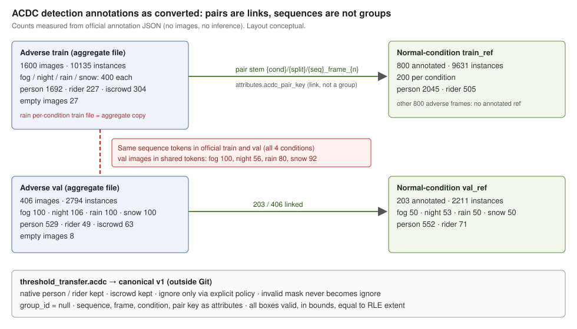

# ACDC annotation adapter and annotation-only inventory — Claude implementation note

**Author:** Claude (Opus 5.5), implementation peer, 2026-11-06. **Parent:** `63ab281`. **Peer:** GPT, BDD acquisition task (live exchange below). This note covers implementation, real annotation-only inspection and the actual peer exchange. It is not a formal review, not my approval and not an evaluation. No images, models or inference were used. **G0 remains pending.**

Files: [`src/threshold_transfer/acdc.py`](../../src/threshold_transfer/acdc.py), [`tests/test_acdc.py`](../../tests/test_acdc.py), compact evidence [`acdc_inventory_summary.json`](acdc_inventory_summary.json), diagram [`acdc_annotation_structure.svg`](acdc_annotation_structure.svg). I did not edit any shared file (`data.py`, `schema.py`, `docs/data_contract.md`, `docs/data_acquisition.md`) or any GPT file.

*Counts are measured from the official JSON. The layout is conceptual.*

## Sources and licence

The inputs are the six official archives that the parent task acquired and verified (official MD5, ZIP CRC, separate extraction under the ignored `data/acdc/extracted/`; see [`docs/data_acquisition.md`](../data_acquisition.md)). All six ship the same `README.md` (MD5 `7a2d72e6…`) and `License.pdf`. I read both. The licence permits non-commercial research use of data obtained directly from ETH. It forbids sharing the dataset or modified versions (§2.3). It allows only abstract derivatives that cannot recover the data. The repository therefore holds code, synthetic fixtures and aggregate counts only. Canonical converted files contain boxes, so they are modified dataset artifacts. The `convert` CLI refuses to write them into the repository or the extraction tree.

## Observed schema (real files)

| Item | Observation |
|---|---|
| Files used | The four aggregate files: `instancesonly_{train,val}_gt_detection.json` and `instancesonly_{train,val}_gt_ref_detection.json`. The per-condition files are only checked against them, so nothing is double-counted. |
| Per-condition files | 7 of 8 are exact subsets of the aggregate file. **`rain/instancesonly_rain_train_gt_detection.json` is byte-identical to the 4-condition aggregate train file** (sha256 `33be9416…`: 1600 images, 1200 from other conditions). This is a packaging defect. Condition is therefore parsed from `file_name`. |
| Categories | Identical 8-entry table everywhere: person 24, rider 25 (`human`), car, truck, bus, train, motorcycle, bicycle. The converter refuses any other table. |
| Images | Keys `id, file_name, width, height` plus `segm_file` for adverse images only. All are 1920×1080 according to the JSON; the image archive was not used. IDs are unique across conditions and across adverse/ref (ref starts at 4006). |
| Annotations | Exactly `id, image_id, category_id, iscrowd, bbox, area, segmentation`. `segmentation` is a JSON object `{"size":[h,w],"counts":str}` holding compressed COCO RLE. |
| File names | `{condition}/{split}[_ref]/{seq}/{seq}_frame_{nnnnnn}_rgb[_ref]_anon.png`. Ref files reuse the adverse image's sequence and frame stem. |

## Inventory results (real, annotation-only)

| | train | val | train_ref | val_ref |
|---|---:|---:|---:|---:|
| images | 1600 | 406 | 800 | 203 |
| instances | 10135 | 2794 | 9631 | 2211 |
| person / rider | 1692 / 227 | 529 / 49 | 2045 / 505 | 552 / 71 |
| iscrowd (all classes) | 304 | 63 | 32 | 18 |
| person iscrowd | 35 | 11 | 0 | 0 |
| empty images | 27 | 8 | 1 | 0 |

Person counts by condition: train fog 176, night 671, rain 242, snow 603; val fog 62, night 158, rain 134, snow 175. The full per-condition, per-class and per-crowd counts are in the JSON summary.

- **Geometry:** none of the 24,771 boxes is degenerate, nonfinite or outside 1920×1080. No box was repaired. **Every bbox equals the extent of its decoded RLE mask, and every `area` equals the RLE pixel count.** The boxes are therefore tight mask boxes, which is relevant to extent comparisons with BDD.
- **Crowd:** `iscrowd=1` boxes exist for person, rider, car, bicycle and motorcycle. Person and bicycle crowd counts match the panoptic thing segments (train person 35, bicycle 48; val person 11). Car crowd counts differ slightly (train detection 207, panoptic 209).
- **Detection vs panoptic:** the detection JSON is not a 1:1 copy of the panoptic thing segments. Adverse train has 10135 detection instances and 10481 panoptic segments: 9615 match exactly on (frame, class, crowd, bbox, area) and 505 more match with bbox IoU ≥ 0.9, typically differing by one pixel. That leaves 15 unmatched detections and 361 unmatched panoptic segments, of which 327 are under 100 px. Val: 2653 exact matches, 140 near matches, 1 unmatched detection and 85 unmatched panoptic segments, all under 100 px. Refs agree almost exactly (6 detection / 5 panoptic unmatched in train_ref). Following the protocol, the detection `bbox` stays the source, and these differences are reported rather than reconciled.
- **Reference pairing:** under the README stem convention, annotated refs cover 800/1600 train and 203/406 val adverse frames: exactly half in each condition (night val 53/106). There are no orphan or duplicate refs. The link is recorded as `attributes.acdc_pair_key`. It is a viewpoint correspondence, **not a group**. It has not been checked against the RGB archive, which is still downloading.
- **Sequences and splits (substantive):** official train and val share identical sequence tokens in all four conditions. Val images inside shared tokens: fog 100/100, night 56/106, rain 80/100, snow 92/100. The gap from each such val image to the nearest train frame of the same token is: fog min 4 / median 212, night 12 / 88, rain 12 / 158, snow 8 / 101 frame indices. The frame rate is unverified, so these are index distances only. GoPro chapter names (`GOPRnnnn`, `GP01nnnn`, …) also share recording numbers across splits, which suggests more sharing, but this is unverified. **Official ACDC val is not sequence-disjoint from train.**
- **Invalid masks (`gt_invIds`, all 2006 adverse frames, 8-bit PNG decoded with the standard library):** every adverse frame contains some invalid pixels. Mean invalid fraction in train: fog 0.041, night 0.340, rain 0.032, snow 0.043; val is similar (night 0.393). I counted labelled people by the fraction of their mask pixels that are invalid, using descriptive bins (0, ≤0.1, ≤0.5, >0.5) that are not frozen strata. In train, persons with >0.5 invalid number fog 26/176, night 66/671, rain 33/242 and snow 56/603; night riders 15/142. **Many legitimately labelled people lie mostly inside invalid regions, so treating invalid as void/ignore would remove real ground truth.** The converter does not do that. Val histograms are in the JSON summary.

## Converter policy (`convert_acdc`)

| Rule | Implementation |
|---|---|
| IDs | `acdc:{role}:img{id}` and `acdc:{role}:a{id}` with role ∈ {train, val, train_ref, val_ref}. Native integer IDs must be unique. Bool, string and duplicate IDs fail. |
| Categories | Native names verbatim. `person` is never aliased to BDD `pedestrian` and never merged with `rider`. The native `category_id` and `area` are kept in `attributes.native`. |
| Ignore | `ignore_policy` is required with no default: `no_ignore_declared` (ignore false, iscrowd kept) or `acdc_iscrowd_v1_provisional` (ignore := iscrowd). Both carry `official_evaluator_equivalent: false`. |
| Invalid mask | Never converted to ignore. It is only measured descriptively (`invalid_overlap_native`). |
| Geometry | Strict validation: finite, positive, inside the JSON dimensions. RLE must decode to the full image, with `area` equal to the pixel count. A bbox/mask disagreement is counted, not repaired. |
| Groups | `group_id = null` always. Sequence, frame, condition, reference flag and pair key are image attributes only. `check_roles(..., mode="held_out")` therefore fails on ACDC, which is the intended fail-closed behaviour. |
| Output | Validated with `schema.validate_documents`. Provenance holds source relative path + sha256, policy, dropped `segmentation`, group/pair/condition status and the summary. |

The parent acquisition records archive authenticity (package ID, official MD5, archive sha256), and I did not duplicate it into converter output. GPT and I agreed to use the same provenance key names in both adapters (exchange 1).

## Peer exchange with GPT (actual messages, summarised faithfully)

1. **GPT → Claude, PEER PROPOSAL:** keep native category names with no alias or union; keep recording/sequence fields as attributes, with `group_id` null unless independently justified; keep archive authenticity, JSON hash, schema inspection and provisional ignore policy separate in provenance. **Claude → GPT:** agreed, and proposed shared provenance key names, native condition attribute names (no harmonisation) and an explicit ignore-policy choice. **GPT:** accepted the keys as adapter conventions (not a contract change). GPT will use an explicit `ignore_policy` with no default, and `source_files.relative_path` is relative to a documented extraction root.
2. **Claude correction:** my first message wrongly called ACDC `segmentation` a Python-repr string, because my inspection script printed it through `str()`. I corrected this, and GPT confirmed it will record the correction rather than the erroneous claim.
3. **Claude → GPT, PEER FINDING:** the train/val sequence overlap above, with a proposal to record it as an open protocol issue. **GPT:** no objection, with the note that GPT has not independently rechecked the counts. GPT's view is that the overlap disproves sequence-disjointness of the official split, but without trip metadata it does not establish exact recording boundaries. `group_id` stays null, explicit grouping is required before held-out adaptation claims, and pair linkage is preserved. Neither task edits the protocol or chooses a grouping.
4. **GPT findings relayed for context:** the BDD candidate archives do not provide the 2020 detection labels. The legacy labels have no trip or sequence fields and contain real nonpositive boxes (train 395, val 52, test 107). GPT will not repair or substitute them.

## Open issues for the coordinator

1. **ACDC train/val leakage:** `docs/gpt/protocol.md` uses ACDC train for target adaptation (calibrator fit and selection) and val for evaluation. Because val shares sequences with train, at frame-index gaps as small as 4, any adaptation-arm held-out claim needs a declared sequence-level (or stricter GoPro-number-level) grouping. The source-only arm does not use target labels, but selection-to-test independence inside ACDC still depends on this. I propose no grouping here.
2. Pair linkage needs to be checked against the RGB archive once its transfer completes and its MD5 is verified.
3. The ignore/crowd policy for the evaluator remains provisional. Whether ACDC crowd boxes (person 35 in train, 11 in val) are excluded or IoA-absorbed is still an evaluator decision.
4. Only half the adverse frames have an annotated normal reference, so any matched normal/adverse contrast is restricted to that subset.

## Tests

`PYTHONPATH=src python -m unittest discover -s tests` → **88 tests OK** on Python 3.11.16 and 3.12.14. Of these, 21 are new ACDC tests on synthetic fixtures (no ACDC data):

- RLE: encode/decode round trip, column-crossing extent, truncated/invalid/wrong-size rejection, and a string `segmentation` rejected.
- File names: parsing, pair-key equality, `_ref` marker mismatch, sequence/stem mismatch.
- Converter: ID namespacing for adverse vs ref, native person/rider, crowd retained, both ignore policies and no default, empty images kept, `group_id` null, bbox/mask disagreement counted and not repaired.
- Fail-closed cases: degenerate, NaN, negative and out-of-bounds boxes; area/RLE mismatch; duplicate, string and bool IDs; unknown image/category; unexpected keys; altered category table; duplicate frame; split/reference mismatch; `segm_file` mismatch; no input mutation.
- Cross-file checks: pairing coverage and orphan rejection, detection of the aggregate-copy defect, shared GoPro numbers, panoptic exact/near matching.
- PNG and invalid masks: decoding of all five PNG filters, CRC rejection, invalid overlap kept descriptive.
- CLI: inventory/convert, missing policy, refusal to write into the data root or the repository.

Without `PYTHONPATH=src`, one pre-existing GPT CLI test fails because its subprocess cannot import the uninstalled package. That is environmental and unrelated to this change. The real integration command was `PYTHONPATH=src python -m threshold_transfer.acdc inventory --root <abs>/data/acdc/extracted --invalid-images -1 --out <scratch>/inventory.json`, which ran for about 9.5 minutes. A second run without invalid masks, using the final code, added the frame-gap diagnostic. The two runs agree on every overlapping section, and both were merged into the committed summary.
