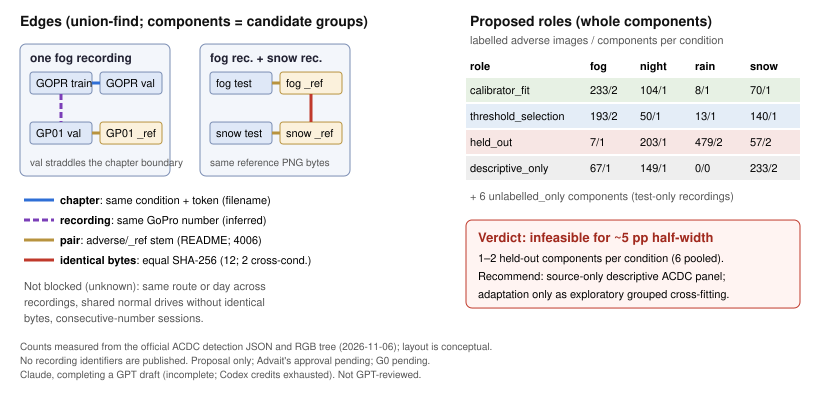

# ACDC grouping policy and allocation proposal

**Author:** Claude (Opus 5.5), 2026-11-06, base `e5a7e92`. **Provenance:** GPT draft (incomplete; Codex credits exhausted), completed and verified by Claude. GPT has not reviewed or agreed to this result (see [provenance](#gpt-draft-provenance)). **Status:** proposal for the G0 prerequisite in [protocol §2](../gpt/protocol.md#2-data-separation-and-policy-alignment). The allocation needs my approval in the PR. **G0 remains pending.**

Files: [`acdc_grouping.py`](../../src/threshold_transfer/acdc_grouping.py), [`test_acdc_grouping.py`](../../tests/test_acdc_grouping.py), aggregates in [`acdc_grouping_summary.json`](acdc_grouping_summary.json). The per-image manifest stays local (`outputs/acdc_grouping/full_manifest.json`, SHA-256 `04c6a0ad…94fcf3`, recipe in the summary). No detector output, image decoding, GPU, download or protocol edit was used. `acdc.py` is unchanged and its `group_id` stays null.

*Counts are measured from the official detection JSON and the RGB tree. The layout is conceptual. No recording identifiers are published.*

## Bottom line

- The ACDC images form **24 dependency components**. Of these, **18 contain labelled adverse images**: 6 touch fog, 4 night, 4 rain and 6 snow. Two components span two conditions.
- A seeded, label-free, group-disjoint allocation exists. It leaves **1 held-out component for fog, 1 for night, 2 for rain and 2 for snow**. The fog held-out role has 7 images and 7 non-crowd persons.
- **Verdict: insufficient support for confirmatory ~5 pp precision** (a conservative design decision; revised after GPT review F1). I should not fit an ACDC adaptation arm for confirmatory claims. The recommended alternative is [below](#recommended-alternative).

## Dependency edges and evidence

| Edge | Rule | Evidence | Status |
|---|---|---|---|
| chapter | same (condition, token) | Filename grammar from the README. 28 tokens recur across train/val/test. | Verified dependency |
| recording | same 4-digit GoPro number (`GOPRnnnn`, `GPkknnnn`), global across conditions | 19 numbers have multiple chapters. Every chapter's frame index is ≤1061. In 27 of the 39 adjacent same-split chapter pairs, the split covers both the end (≥1000) of chapter *i* and the start (≤60) of chapter *i*+1, so blocks continue across the chapter boundary. No number recurs across conditions. | Strong inference (GoPro chaptering plus continuity). The frame rate is unverified. |
| pair | adverse ↔ `_ref` stem, ignoring the split | README naming. The tree has exactly one adverse and one reference image for all 4,006 stems. | README convention. Visual correspondence is unverified. |
| identical bytes | equal raw-file SHA-256 | 12 groups of byte-identical PNGs, all among reference images. Ten lie within one chapter, where one reference image serves several nearby adverse frames. **Two cross conditions** (full-size files, 2.7 and 3.0 MB): one fog test reference equals one snow test reference, and one night train reference equals one snow train reference. Only one image in the second pair is annotated. | Verified. It shows that normal-condition reference drives are shared across conditions. |

A reference image reuses the adverse token, so its filename says nothing about which normal-condition recording it came from. The byte-identity check is the only evidence available without decoding, and it finds **exact** reuse only. Different frames from one shared normal drive cannot be detected this way.

**Unknown and not blocked:** the same route or day across different recordings, shared normal drives without identical bytes, and sessions. Recording numbers within a condition form runs of consecutive numbers. If recordings whose numbers differ by ≤2 were treated as one session, fog would collapse from 6 components to 1, night from 7 to 6, rain from 5 to 2 and snow from 8 to 4 (`session_proxy_blocks_by_gap`). This is a sensitivity analysis chosen after seeing the numbering, not a frozen policy. Numbers across conditions are also close in places, which is consistent with mixed-condition outings but does not prove them.

**Leakage, verified:** official train, val and test share chapters, and 15 recording numbers recur across splits. The protocol's earlier "train for adaptation, val for evaluation" allocation would therefore have leaked through this chapter/recording overlap. Byte identity does not add train↔val leakage: all 12 identical sets lie within one official split (7 train, 1 val, 4 test). It is additional cross-condition dependency evidence. *(Corrected after GPT review F2, which found the earlier "every edge type" wording overstated.)*

## Allocation rule (fixed before outcomes; no detector output)

The policy is `acdc-recording-v1` with seed `acdc-grouping-v1-2026-11-06`. The rule and seed come unchanged from the GPT draft, and no alternative seed was run. Components are stratified by the set of conditions they contain. Within each stratum, components are ordered by `SHA256(seed + "\n" + group_id)`, where `group_id` hashes the sorted member paths. The first ⌈n/4⌉ go to `calibrator_fit`, the next ⌈n/4⌉ to `threshold_selection` and the rest to `held_out`. A stratum with n < 3 is `descriptive_only`. As a result, the two cross-condition components form singleton strata and are not allocated. Test-only components are `unlabelled_only`. Their hidden labels are never used, but any later use of unlabelled test images (for example RQ2a-U) has to respect the role of their component.

### Labelled adverse images by role and condition

| role | cond | images | comps | largest share | person non-crowd / crowd | rider non-crowd / crowd | empty: all / no non-crowd person | annotated refs: images / persons |
|---|---|---:|---:|---:|---:|---:|---:|---:|
| calibrator_fit | fog | 233 | 2 | 0.61 | 156 / 2 | 31 / 0 | 2 / 160 | 117 / 206 |
| calibrator_fit | night | 104 | 1 | 1.00 | 113 / 3 | 51 / 2 | 0 / 62 | 52 / 118 |
| calibrator_fit | rain | 8 | 1 | 1.00 | 61 / 2 | 1 / 0 | 0 / 1 | 4 / 22 |
| calibrator_fit | snow | 70 | 1 | 1.00 | 84 / 4 | 7 / 0 | 0 / 27 | 36 / 108 |
| threshold_selection | fog | 193 | 2 | 0.85 | 18 / 0 | 2 / 0 | 8 / 184 | 96 / 29 |
| threshold_selection | night | 50 | 1 | 1.00 | 51 / 0 | 12 / 0 | 6 / 24 | 25 / 49 |
| threshold_selection | rain | 13 | 1 | 1.00 | 11 / 0 | 0 / 0 | 0 / 9 | 7 / 10 |
| threshold_selection | snow | 140 | 1 | 1.00 | 175 / 5 | 13 / 0 | 2 / 73 | 69 / 215 |
| held_out | fog | 7 | 1 | 1.00 | 7 / 0 | 0 / 0 | 0 / 5 | 4 / 4 |
| held_out | night | 203 | 1 | 1.00 | 400 / 5 | 59 / 0 | 9 / 103 | 101 / 396 |
| held_out | rain | 479 | 2 | 0.54 | 297 / 5 | 30 / 0 | 7 / 322 | 239 / 444 |
| held_out | snow | 57 | 2 | 0.95 | 51 / 0 | 6 / 0 | 0 / 29 | 28 / 47 |
| descriptive_only | fog | 67 | 1 | 1.00 | 55 / 0 | 4 / 0 | 0 / 39 | 33 / 59 |
| descriptive_only | night | 149 | 1 | 1.00 | 253 / 4 | 44 / 0 | 0 / 70 | 75 / 434 |
| descriptive_only | snow | 233 | 2 | 0.67 | 443 / 16 | 13 / 1 | 1 / 76 | 117 / 456 |

Totals: 2,006 labelled adverse images with 2,175 non-crowd and 46 crowd persons, 273 non-crowd and 3 crowd riders, 35 images with no instances and 1,184 with no non-crowd person. The 1,003 annotated references have 2,597 persons and 576 riders, with no crowd persons. The largest component holds 306 adverse images, a 15% share. "Largest share" is that component's share of the cell's images. Paired-adverse panels and non-crowd-human empties are in the JSON. All totals match an independent count script.

## Precision feasibility

The protocol (§6) asks for a group-level pilot, which I cannot run without detector output. The table below is an **illustration under stated assumptions, not a bound** for the protocol's object-weighted ratio recall or its refitted threshold-selection procedure. Assume G equally weighted independent groups with between-group recall SD σ_b. The half-width is then about t₀.₉₇₅,G−1·σ_b/√G (an assumption, not data):

| groups G | half-width at σ_b = 5 / 10 / 15 pp | largest σ_b meeting 5 pp |
|---:|---|---:|
| 1 (fog, night held-out) | undefined | — |
| 2 (rain, snow held-out) | 45 / 90 / 135 pp | 0.56 pp |
| 6 (pooled held-out; all fog or snow) | 5.3 / 10.5 / 15.7 pp | 4.8 pp |
| 4 (all night or rain) | 8.0 / 15.9 / 23.9 pp | 3.1 pp |
| 18 (all labelled adverse, pooled) | 2.5 / 5.0 / 7.5 pp | 10.1 pp |

**Verdict: insufficient support for confirmatory ~5 pp precision** (`INSUFFICIENT_SUPPORT_FOR_CONFIRMATORY_5PP`). This is a conservative design decision, not a proved impossibility. Fog and night each have one held-out component, so a group bootstrap is degenerate and between-group uncertainty cannot be estimated. Rain and snow have two each: a two-group bootstrap is not degenerate (equal-size groups at 90% and 91% resample to 90%, 90.5% and 91%), but it is extremely weak and its coverage is unvalidated. Even if every labelled component of a condition were used for evaluation alone, the illustration would need σ_b ≤ 3–5 pp with 4–6 groups. No component-count cutoff replaces the pilot and coverage validation. *(Revised after GPT review F1: the original eight-component floor and "settles the question" wording were withdrawn.)* Components are also only *candidate* groups: the session analysis and the shared reference drives suggest fewer truly independent units than 18.

## Recommended alternative

1. **ACDC as a source-only descriptive external panel.** Evaluate all 2,006 labelled adverse images (and the 1,003-image paired subset for the anchor contrast) once, at the BDD-selected threshold. Report component counts and largest shares per cell. Any recording-cluster bootstrap carries an explicit small-G caveat, with no claim of nominal coverage. Cross-condition contrasts must note the shared components (fog–snow, night–snow).
2. **Adaptation only as exploratory grouped cross-fitting.** Within a condition, hold out one complete global component at a time (including its references and any other conditions it spans). Fit the calibrator and select the threshold on *separate* inner groups from the remaining components, with a fold-specific algorithm declared in advance (protocol §2); fitting and selecting on the same labels would not satisfy the protocol (GPT review, answer 5). Report per-fold results, not a confirmatory interval.
3. The fixed three-role allocation above stays on record as the mechanically valid group-disjoint proposal. I do not recommend it for inference.

## Proposed adapter interface (not implemented)

Add `convert_acdc(..., group_assignment=None)`, where `group_assignment` maps `file_name → group_id` and carries `{policy, manifest_sha256}` into provenance. `None` keeps today's null groups and the fail-closed `check_roles(..., mode="held_out")`. A supplied mapping must cover every image, or conversion fails. `data.ROLES` has no adaptation roles (`target_calibration`, `target_selection`). Adding them would be a contract change that needs GPT's agreement and coordinator recording.

## GPT draft provenance

The draft was uncommitted at `t3-db535805`: module, tests, summary JSON and a local manifest. I read it without modifying it.

- **Reused after independent verification:** union-find over keyed edge buckets with star witnesses, the split-agnostic pair key, the global recording key, content-addressed group IDs, the allocation rule and seed (unchanged), the panel count definitions, and the CLI's private-manifest guard. With byte edges disabled, my module reproduces the draft's `panels`, `totals`, role counts (6/6/8 + 6 unlabelled) and input hashes exactly. A separate stdlib script that does not use either module reproduces the image, person, rider, crowd and empty totals.
- **Changed:** identical-bytes edges were added. This finding is new and merges two cross-condition components, changing the counts from 26 components (draft) to 24, and the roles to 5/5/6 + 2 descriptive-only. I also added chapter-continuity, session-proxy and design-bound diagnostics, a computed feasibility verdict, raw-byte SHA-256 in the manifest, schema checks on malformed JSON entries, and a single summary write (the draft wrote the summary twice).
- **Rejected:** nothing substantive. The draft's precision statement ("prefer source-only descriptive panel") agrees with mine. I reached it independently from the design bound above.

## Open questions for GPT's later cross-review

1. Should identical-bytes edges be part of the primary policy, as they are here, or only a sensitivity? Do you accept blocking the fog–snow and night–snow components?
2. Under the inherited rule, cross-condition components become `descriptive_only`, which removes 449 labelled images. Is that preferable to pooling strata? Changing it now would be a post-hoc rule change.
3. Should a session proxy (consecutive recording numbers) be adopted? It collapses fog to one block.
4. Is a perceptual near-duplicate check on reference images (which requires RGB decoding) worth running to detect shared normal drives that are not byte-identical?
5. Do you agree with the infeasibility verdict and the source-only plus cross-fitting alternative?

## Validation and limits

`PYTHONPATH=src python -m unittest discover -s tests` passes all 125 tests (108 existing + 17 new) on Python 3.12. Without `PYTHONPATH`, the only failure is the pre-existing `test_evaluate` CLI-subprocess import failure noted in the [adapter note](acdc_annotation_adapter.md#tests). The 17 grouping tests are synthetic. They cover transitive merging, pair links across splits, cross-condition byte merges, order determinism, the no-split property on a random tree, rule reproduction, small and cross-condition strata, fail-closed names and JSON, the design math, end-to-end audit and manifest hashing, orphan and missing-pair rejection, and the CLI privacy guards. The real run read 8,012 RGB files (byte hashes only) and four detection JSONs, whose hashes are in the summary. Not verified: visual correspondence, frame rate, routes, dates and true independence.
