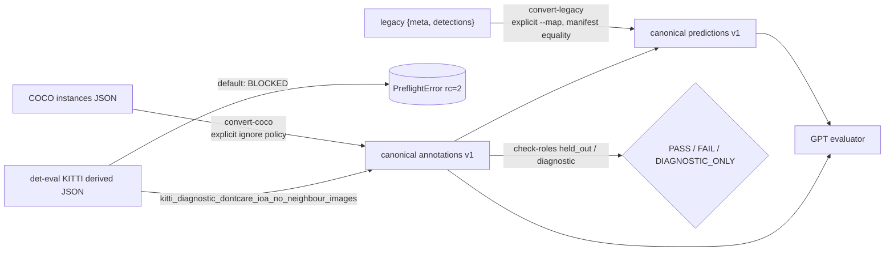

# Data/cache preflight and canonical conversion — Claude implementation note

**Author:** Claude (Opus 5.5), implementation peer, 2026-11-05. **Base:** `4fa07a7`. **Peer:** GPT reference-evaluator task (branch `t3/threshold-transfer-evaluator`). This note covers implementation, real read-only validation and the actual peer exchange. It is not a formal review and not my approval. **G0 remains pending.**

Files: [`src/threshold_transfer/data.py`](../../src/threshold_transfer/data.py), [`tests/test_data.py`](../../tests/test_data.py), compact evidence [`data_preflight_inventory_summary.json`](data_preflight_inventory_summary.json), acquisition note [`dataset_acquisition_preflight.md`](dataset_acquisition_preflight.md). No shared path (`docs/data_contract.md`, `pyproject.toml`, `__init__.py`, GPT files) was edited.

## Design

Standard library only. CLI: `PYTHONPATH=src python -m threshold_transfer.data {inventory, convert-coco, convert-kitti-derived, convert-legacy, check-roles}`.

| Rule | Implementation |
|---|---|
| IDs | Native int/str → `str`; bool/float/empty rejected; collision after canonicalisation (`1` vs `"1"`) rejected. Annotation IDs `<dataset_tag>:a<native>`. |
| Candidate IDs | `<run>:<original row index zero-padded>`; sorting by (score desc, ID asc) reproduces the cache's original row order inside tie groups. |
| Categories | Native names verbatim. Predictions need explicit `--map vocab=category`; mapping keys must exist in the vocabulary and be unique there; targets must exist in the manifest. `person` is never aliased to `Pedestrian`. Unmapped rows are dropped and counted. |
| Empty images | All manifest images and all `meta.image_ids` are retained; `provenance.evaluated_image_ids` carries the full evaluated list. |
| Population | Agreed with GPT: `set(evaluated_image_ids) == set(manifest images)`. A mismatch fails unless `--restrict-to-manifest` is explicit, which records excluded image/row counts and a manifest hash. |
| Boxes | `[x1,y1,x2-x1,y2-y1]` in float. Zero/reversed/non-finite → reject (default) or `exclude_and_report`. No clipping or repair. Out-of-bounds boxes are counted only. |
| Cache policy | Floor, raw cap, unapplied eval cap, NMS IoU, multi-label, 2 dp coordinates and 5 dp scores (from `run_inference.py` line 115). Rows below the floor, over the cap and exceeding the declared rounding are counted. |
| Ignore | COCO: `coco_iscrowd_v1_provisional` (ignore := iscrowd) or `no_ignore_declared`; neither claims COCOeval equivalence. A COCO-converter call on KITTI-flagged input fails closed. |
| KITTI | Default conversion is **blocked**. DontCare (IoA, unlimited absorption), neighbour classes (IoU, one-to-one) and difficulty filtering cannot be represented by one flag. The labelled diagnostic policy drops every image containing a neighbour record. DontCare per-class copies become `ignore=iscrowd=true`; no difficulty filter is applied. Native flags stay in `attributes.native`; `official_kitti_equivalent=false`. |
| Groups/roles | `group_id=null`, `attributes={}` everywhere (no weather or groups fabricated). `check_roles(..., mode="held_out")` fails on any unknown group, a group spanning roles, unknown roles/images. `diagnostic` returns `DIAGNOSTIC_ONLY`, never independence, and still fails on known-group leakage. Roles: `source_selection`, `clear_test`, `target_test` (GPT's names). No random split creation exists. |

## Tests (synthetic fixtures; not real results)

`python -m unittest tests.test_data` → **26 tests OK** (det-eval-2d `.venv` Python 3.12.14, stdlib only). Coverage: empty images; int/string IDs and collisions; duplicate annotation/image references; unknown image/category references; malformed legacy rows (length, unknown image, non-numeric coordinate, score > 1, bad/boolean vocabulary index, reversed box); duplicate `N/A` vocabulary; explicit mapping and person≠Pedestrian; score ties and zero-padded ID order; floor/cap/rounding gap counts; zero/negative/NaN boxes; KITTI default block, DontCare preservation, flag inconsistency and unsupported `difficulty>` reasons; manifest equality and restriction; role leakage, unknown groups and a clean grouped PASS; PNG/JPEG header parsing; CLI exit codes (0 / 2 preflight error / 3 role FAIL).

## Real read-only validation on det-eval-2d@39c6f6d

Commands were run from this worktree with `--asset-root C:/Users/Advait/det-eval-2d`. Full outputs went to gitignored `outputs/data_preflight/` (about 55 MB). `git status` in det-eval-2d was clean before and after. The compact aggregate is committed as `data_preflight_inventory_summary.json`. These are inventory and conversion checks, not detection results.

| Asset | Observed |
|---|---|
| COCO val2017 | 5,000 images (48 without annotations), 36,781 annotations, 446 `iscrowd`. 0 invalid or out-of-bounds boxes. 5,000/5,000 files present; stdlib JPEG header dimensions match all 5,000 records. Only `person` is a human category; no `pedestrian`. |
| KITTI raw | 7,481 PNG / 7,481 label files, 0 malformed lines, 0 reversed boxes. Earlier split files: 3,712 train / 3,769 val, no overlap. This is the earlier project's own image-level split, **not grouped by drive**. |
| KITTI derived val | 37,029 records = 17,558 native-class + 17,688 DontCare (= 5,896 raw regions × 3 copies, verified against raw labels) + 1,617 `neighbour:Van` + 166 `neighbour:Person_sitting`. 3,823 eligible-class records fail every official difficulty level. PNG dimensions match all 3,769. |
| KITTI diagnostic subset | 2,427 images; **1,342 (36%) excluded** for neighbour records, a non-random, scene-dependent removal. 22,238 records; 11,646 DontCare ignore copies. |
| Legacy caches (25) | All parse. 6 torchvision caches (faster_rcnn/fcos/retinanet on COCO and KITTI) use a 91-slot list with ten duplicate `N/A`; COCO torchvision runs have `max_raw_det=None` and 100 rows per image. 11 caches hit the 300 cap on every image, so their candidate ceiling is cap-censored. Zero-area rows after clipping/rounding: fcos 2, retinanet 90, yolo11m 3, yolo11s 26, yolo_world 8 (COCO). 0 rows below the floor or exceeding the declared rounding. |
| Conversion C | `coco__yolo11s`, `person=person`, `exclude_and_report` (the default reject fails on 26 rows, e.g. `y1==y2==334.0`): 123,897 predictions over 5,000 images, 3,811 same-image exact-score tie groups (max 4), 0 outside bounds. |
| Conversion D | `kitti__yolo11s_640_ft`, native Car/Pedestrian/Cyclist, restricted to the diagnostic manifest: 101,660 predictions, 2,427 images, 99,392 rows excluded with the 1,342 images. |
| Expected refusals | KITTI default conversion; `N/A=person`; `person=Pedestrian` against the COCO manifest; unrestricted KITTI cache against the diagnostic manifest (1,342 extra images). Each exited with rc=2 and an exact reason. |

Weight and annotation SHA-256 values match [`docs/local_assets.md`](../local_assets.md). Image directories carry a name+size listing digest, not content hashes.

## Peer exchange (actual messages, condensed faithfully)

1. **GPT → Claude, PEER PROPOSAL:** the evaluator consumes canonical dicts without importing `data.py`. It requires unique string IDs, eligible-GT-first IoU ≥ 0.50 and an explicit `ignore_policy` (`reject` default, `same_category_ioa`, `all_categories_ioa`; IoA ≥ 0.50, unlimited absorption). It uses role-based CLI policy, rejects selection/test overlap and returns UNDEFINED/INFEASIBLE with null. GPT asked whether IDs, names, native provenance or roles need another boundary.
2. **Claude → GPT, PEER PROPOSAL:** proposed the ID rules, native category names with an explicit map, `attributes.native` as opaque, the KITTI block/diagnostic policy with exact record counts, prediction provenance fields and `evaluated_image_ids`. Asked about role names and `split`/`area`.
3. **GPT → Claude, PEER FINDING:** no `area`/`split` required. Native names are used verbatim. Roles are `source_selection`/`clear_test`/`target_test`. GPT proposed **equality** of `evaluated_image_ids` and the manifest image set, not a subset.
4. **Claude → GPT, PEER FINDING:** accepted equality and added `--restrict-to-manifest` with recorded provenance. Mapping targets are checked against `provenance.categories`. **Disposition: agreed and implemented on both sides.**
5. **GPT → Claude, PEER FINDING:** `ReferenceEvaluator(annotation, prediction, categories, ignore_policy, bounds_policy='strict_known'|'allow_outside')`. CLI `python -m threshold_transfer.evaluate` uses `--{source-selection,clear-test,target-test}-{annotations,predictions}`, `--policy`, `--target-recall`. Policy roles carry `dataset_id` (checked against `provenance.dataset`), `group_namespace`, `population` and `group_provenance`. Diagnostic mode tolerates missing groups; held_out requires them. No real-cache evaluation was run.
6. **Claude → GPT, real-run findings and Q1–Q4 — NOT DELIVERED.** The GPT task had completed (01:12:55Z) and `t3_thread_send` returned `thread_not_sendable`. Per protocol I did not restart it. The open questions are left for the coordinator below. Silence is not treated as agreement.

## Open issues for the coordinator / cross-review

- **Q1 (to GPT):** with `ignore_policy='reject'` both real manifests fail (COCO has crowd, KITTI has DontCare). Diagnostic runs must pass `same_category_ioa` explicitly. Confirm this is intended.
- **Q2:** the KITTI diagnostic subset keeps 3,823 records that fail all official difficulty levels as eligible GT. I propose leaving a difficulty-filtered variant out of scope and flagged. Its IoU one-to-one ignore semantics would also be unsupported.
- **Q3:** `exclude_and_report` leaves gaps in candidate IDs. Evaluator outputs should surface `provenance.cache_policy` and `validation.invalid_rows`, so ceilings read as conditional on floor, cap, rounding and exclusion.
- **Q4:** does `strict_known` check prediction boxes? C/D have 0 outside, so this does not matter now.
- A reviewer should confirm that the GPT evaluator accepts docs A–D unchanged (integration test on the regenerated outputs).

## Limitations

COCO/KITTI have no verified group IDs or condition metadata. Every role check on them can only be FAIL or DIAGNOSTIC_ONLY. The KITTI drive mapping (`train_mapping.txt`/`train_rand.txt`) is not present locally and was not inferred. KITTI val and the cached runs are previously inspected development data. Excluding zero-area cache rows is a declared policy; rows are not repaired. Scalar caches cannot reconstruct full-vector OCE. The inventory does not establish licensing or the official origin of checkpoints.
