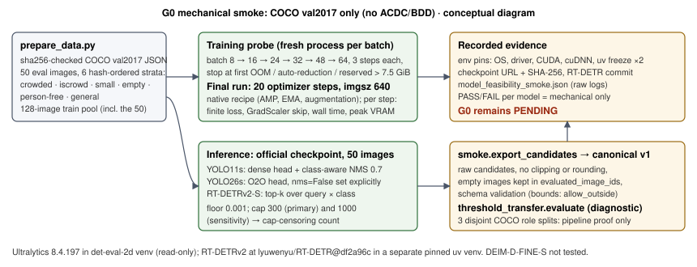

# Model feasibility smoke on the RTX 5060 (G0 prerequisite)

**Researcher:** Claude, 2026-11-06, from `main` at `e5a7e92`. **Status:** these are mechanical feasibility measurements on local COCO val2017 development images. They are not performance results. **G0 remains pending**, because the data, grouping, allocation and annotation prerequisites are still open. No detector was run on ACDC or BDD images. No paid compute, cloud run or full training took place.

Raw values are in [`model_feasibility_smoke.json`](model_feasibility_smoke.json), environment pins in [`configs/smoke/env/`](../../configs/smoke/env/), and the run configuration in [`configs/smoke/smoke_config.json`](../../configs/smoke/smoke_config.json).



## Results

| Core model | Verdict | Batch (largest fitting) | Steps / finite | AMP-skipped steps | Peak VRAM alloc / reserved (GiB) | s/iter (median after 1st; 1st) | Eval peak reserved (GiB); s/img | Candidates per image (all; person) at cap 300 | Cap 300 censoring |
|---|---|---|---|---|---|---|---|---|---|
| YOLO11s | **PASS** | 24 (32: 8.09 GiB reserved) | 20 / all finite | 5 (15 effective updates) | 5.69 / 6.25 | 0.31; 12.1 | 0.14; 0.031 | 149.7; 67.6 | binds on 10/50 images; removes 2,178 candidates incl. 1,096 person (exact vs cap 1000) |
| YOLO26s (O2O) | **PASS** | 24 (32: 9.58 GiB) | 20 / all finite | 6 (14 effective) | 6.83 / 7.36 | 0.58; 13.7 | 0.19; 0.032 | 167.3; 72.1 | binds on 17/50; removes ≥4,628 incl. ≥1,810 person (lower bound; 1 image still binds at 1000) |
| RT-DETRv2-S (R18-vd) | **PASS** | 16 (24: 9.46 GiB) | 20 / all finite | 4 (16 effective) | 5.70 / 6.45 | 0.68; 3.8 | 0.22; 0.032 | 300.0; 82.3 | fixed top-k binds on 50/50 at 300 and at 1000; removes ≥35,000 incl. ≥3,361 person |
| DEIM-D-FINE-S | not tested | — | — | — | — | — | — | — | extension; outside this smoke |

**PASS** means four things held. The final run completed exactly 20 optimizer-step calls at the chosen batch with every loss finite. The memory fit rule held. Both evaluation runs exported schema-valid canonical candidates for all 50 images, empty images included. The reference evaluator CLI exited 0. VRAM is `torch.cuda.max_memory_allocated/reserved` in the training process. It excludes the CUDA context and does not show the total driver usage.

## Findings that affect later stages

1. **The fit rule matters on this laptop.** Every batch-32 probe reserved more than the device's 7.93 GiB and did not raise OOM. Windows sysmem fallback spilled to host memory and slowed training about 9–34× (median s/iter: YOLO11s 0.29 → 3.57, YOLO26s 1.03 → 9.66, RT-DETRv2 0.80 at batch 16 → 27.0 at batch 24). An OOM-only criterion would have picked a batch that does not really fit. My rule therefore also requires reserved memory ≤ 7.5 GiB. YOLO26s at batch 24 reserved 7.36 GiB, a narrow margin. Denser driving scenes may need batch 16.
2. **Under AMP, only 14–16 of the 20 optimizer steps update weights.** GradScaler starts at scale 65,536 and halves on each overflowing step: YOLO11s ends at 2,048, YOLO26s at 1,024, RT-DETRv2 at 4,096. The losses themselves stayed finite. The protocol should count effective updates, not step calls. YOLO26s skipped the last two steps (19, 20); a 20-step window is too short to say whether the scale had settled.
3. **YOLO26 needs an explicit head setting.** The official `yolo26s.pt` (saved by Ultralytics 8.3.222) contains both heads, with 496,892 parameters in each branch. Under 8.4.197 the head's `end2end` reads False after loading.
   - With `nms` unset (the default) or `nms=True`, prediction fuses away the O2O branch and runs **O2M + NMS**. Only `nms=False` selects O2O.
   - Every YOLO26 evaluation must therefore pass `nms=False` explicitly; my smoke does.
   - The O2M output is accessible from a separately loaded copy, so the protocol's conditional same-checkpoint O2M arm is mechanically possible (inspected, not built).
   - Training uses `E2ELoss` (O2M weight 0.8 decaying to 0.1, O2O 0.2 rising), so fine-tuning trains both branches whichever head inference uses (runtime-checked: `init_criterion()` returns `E2ELoss` for YOLO26s and `v8DetectionLoss` for YOLO11s).
   - A fine-tuned YOLO26 checkpoint may load in the same O2M-default state; this was not run.
4. **Caps censor the candidate pool for all three models; floors decide nothing for RT-DETRv2.**
   - **RT-DETRv2.** It takes a fixed top-k over 300 queries × 80 classes, so k alone sets the pool. At k=300 the per-image lowest kept score ranged from 0.0071 to 0.112, and at k=1000 from 0.0041 to 0.046. The 0.001 floor never acted. A threshold sweep below the k-th score is censored per image.
   - **YOLO26 O2O.** It ranks top-k with k = max(max_det, 300), then applies `conf > floor`. The cap bound in 17/50 images.
   - **YOLO11s.** Its NMS output hit the 300 cap in 10/50 images, mostly the crowded stratum.
   - These measurements support the protocol's requirement to set and freeze floors and caps on development/fit groups. They also support its point that one shared maxDet number does not equalize pipelines. Values must be re-measured on driving data.
5. **Geometry conventions differ.**
   - **Ultralytics:** letterboxes (auto=True for a single image) and clips boxes to the image.
   - **RT-DETRv2:** resizes to 640×640 without keeping aspect ratio and does not clip. 868 of its 15,000 kept boxes at cap 300 extend outside the image (3,519 of 50,000 at cap 1000).
   - My exporter neither clips nor rounds; the evaluator run used `bounds_policy: allow_outside`. Before measured comparisons, a clipping policy must be declared per pipeline.
6. **Empty and crowded cases work mechanically.**
   - Every model returned candidates on all 8 empty images (YOLO11s 3–62, YOLO26s 3–77, RT-DETRv2 always 300). All 50 images stay in `evaluated_image_ids`.
   - RT-DETRv2 training batches contained 0–4 images with empty targets (after its random IoU crop) and produced finite losses. The Ultralytics pool contains 9 background images; with mosaic, I did not record how often they formed whole training images.
   - No NMS time-limit warning occurred, and no degenerate boxes were dropped.
7. **Smart App Control is On and is an environment risk.** In the new RT-DETRv2 venv, the first load of several scipy extension DLLs (`_csparsetools`, `_minpack`, `_lsap`) was blocked intermittently ("An Application Control policy has blocked this file"). Later imports succeeded with no environment change, and both 3-step development runs then passed. Every new venv needs a warm import check.

## Test design

- **Images.** I used COCO val2017 (annotation SHA-256 `e8c7f790…10b6f`). The deterministic 50-image rule fills strata in order, each skipping images already chosen:

  | Stratum | Images | Ordering / criterion |
  |---|---|---|
  | crowded | 12 | most non-crowd persons; ties by `sha256(seed:image_id)` |
  | iscrowd person | 8 | hash-ordered |
  | small person (COCO `area` < 32²) | 10 | hash-ordered |
  | no annotations | 8 | hash-ordered |
  | objects but no person | 4 | hash-ordered |
  | general | 8 | hash-ordered |

  The set contains 304 non-crowd persons and 19 crowd regions; 14 images have no person. The image IDs are in the JSON.
- **Training pool.** The training pool has 128 images: the 50 eval images plus 78 hash-ordered others. Crowd regions are skipped in the YOLO labels, as in Ultralytics' own converter. Evaluation uses the unmodified official checkpoints, not the 20-step weights, so pool overlap does not contaminate any reported value.
- **Batch probing.** Batches 8, 16, 24, 32, … ran 3 steps each, each in a fresh process, stopping at the first batch that broke the fit rule. The rule: no OOM, no automatic batch reduction (Ultralytics silently halves on OOM), finite losses, and reserved ≤ 7.5 GiB.
- **Native recipes at imgsz 640.**
  - **YOLO11s:** SGD, lr0 0.01.
  - **YOLO26s:** MuSGD, as recorded in its checkpoint `train_args`.
  - **Ultralytics, both models:** `nbs=batch`, so accumulate = 1. Mosaic stays on (`close_mosaic=0`), with AMP.
  - **RT-DETRv2:** mirrors its `train_one_epoch`: AdamW, AMP, EMA, `clip_max_norm` 0.1 and linear warmup. Its r18 config already disables multiscale.
  - **Learning rates:** they are in warmup and tiny. This is a mechanical test.
- **Inference.** Batch 1, fp32, floor 0.001 and cap 300 (primary) or 1000 (sensitivity), class-aware with no class filter before top-k.
- **Repo evaluator.** `smoke.export_candidates` writes canonical v1 predictions. The repo evaluator runs once per model in diagnostic mode, using `person` with `same_category_ioa` crowd handling over three disjoint COCO role splits. The splits exist only because the CLI requires three roles.

## Native post-processing recorded

| Model | Head / selection | Score | NMS / k | Floor / cap interaction |
|---|---|---|---|---|
| YOLO11s | dense one-to-many | max class prob, single label per box | class-aware torchvision NMS IoU 0.70, `max_nms` 30,000, time limit 2.0 + 0.05·bs s | `conf > 0.001` before NMS; post-NMS truncation to `max_det` |
| YOLO26s | one-to-one (`nms=False`) | per anchor × class sigmoid; an anchor can appear once per class | no NMS; top-k with k = max(max_det, 300) | `conf > 0.001` after top-k, then `[:max_det]` |
| RT-DETRv2-S | 300 queries, focal sigmoid | per query × class; multilabel | no NMS; `num_top_queries` = k (config 300, set explicitly) | no native floor; export `score ≥ 0.001` never active |

The evaluator CLI reported `DIAGNOSTIC` role status, `g0_status: PENDING`, and five limitations per run (missing group IDs, unverified independence). Candidate-ceiling recall on these COCO images is in the JSON only as a pipeline sanity check. COCO-pretrained models evaluated on COCO val are not findings.

## Environment and checkpoints

| Item | Value |
|---|---|
| OS / GPU / driver | Windows 11 10.0.26200; RTX 5060 Laptop (sm_120, 8,151 MiB); driver 616.64; VBIOS 98.06.45.40.18 |
| Ultralytics environment | existing `det-eval-2d/.venv`, used **read-only**: Python 3.12.14, torch 2.11.0+cu128, torchvision 0.26.0+cu128, CUDA 12.8, cuDNN 9.19.0, Ultralytics 8.4.197; 69-package freeze identical before and after; `det-eval-2d` clean at `39c6f6d` |
| RT-DETRv2 environment | new uv venv `ar-work/venv-rtdetrv2` (outside Git): same Python/torch/torchvision/CUDA, faster-coco-eval 1.8.0, scipy 1.18.1, numpy 2.5.4; full freeze committed; onnx/onnxruntime-gpu omitted (export only) |
| YOLO11s | `det-eval-2d/weights/yolo11s.pt`, SHA-256 `85a76fe86dd8afe384648546b56a7a78580c7cb7b404fc595f97969322d502d5` (re-verified; matches `docs/local_assets.md`) |
| YOLO26s | <https://github.com/ultralytics/assets/releases/download/v8.4.0/yolo26s.pt>, SHA-256 `646f8bc3fe0a656803d95c294f7852321748cb29d13466a1af8862e2db384a1b`, AGPL-3.0, saved by Ultralytics 8.3.222 |
| RT-DETRv2-S | `lyuwenyu/RT-DETR@df2a96c8c3a098567a1149bf0248da6efe6d495d`, `rtdetrv2_pytorch/configs/rtdetrv2/rtdetrv2_r18vd_120e_coco.yml`; <https://github.com/lyuwenyu/storage/releases/download/v0.2/rtdetrv2_r18vd_120e_coco_rerun_48.1.pth>, SHA-256 `2ace52184b620204004509b72752ac7bfe64aadaf7fc1d076b18df8ab5a5c77e`; EMA weights load with 0 missed, unmatched or unexpected keys; `PResNet.pretrained=False` avoids the ImageNet backbone download |

Hashes identify the bytes I used. They do not prove the official training provenance beyond the release URLs.

## Limitations

- **Data and duration.** All runs use COCO only, mostly with 4:3 aspect ratios. Wide driving frames (KITTI 1242×375, ACDC 1920×1080) and driving-scene instance densities were not tested. Twenty steps cannot show convergence, long-run stability or the memory peaks of later epochs.
- **Recipe scope.** Probes used 3 steps at fixed imgsz 640. Ultralytics' optional `multi_scale` and any BDD class head (nc ≠ 80) were not exercised. A class-count change re-initializes heads and may change memory slightly.
- **Timing.** Timing includes per-step synchronization. Ultralytics' first step includes cuDNN autotuning. Inference timing is batch-1 and includes pre- and post-processing. Its boundaries differ by pipeline: the Ultralytics timer wraps `model.predict(path)`, which includes image loading and decoding, while the RT-DETRv2 timer starts after the PIL image is opened and converted. The seconds/image values are therefore not comparable model latencies. *(Corrected after GPT review F3; measured values unchanged.)*
- **Censoring measures.** Cap censoring compares against cap 1000, which still binds for RT-DETRv2 on all images and for YOLO26s on one, so those values are lower bounds. Floor censoring below 0.001 was not measured.
- **Reproduction.** I did not repeat any run, so this report includes no run-to-run variance.
- **DEIM-D-FINE-S.** It was not tested; it remains an extension.

## Peer exchange (actual)

The coordinator's GPT ACDC-grouping task sent one message during this task:

> PEER FINDING / PROPOSAL (GPT grouping task, base e5a7e92): full ACDC RGB tree has 8,012 PNGs, 60 sequence tokens, 26 four-digit GoPro number families (fog 6/night 7/rain 5/snow 8), no cross-condition token/number recurrence. I propose conservative candidate components merging same condition+sequence, split-independent adverse/ref stem, and all GOPR/GPnn chapters with equal four-digit number (including refs and test tree). This blocks observed dependencies but does not prove trip/route independence. No acdc.py edits or canonical group_id attachment in this task: grouping outputs stay a separate local manifest pending Advait allocation approval; canonical group_id remains null. Does this boundary affect your current smoke outputs? Coordinator states smoke uses COCO/KITTI only; please confirm no ACDC/BDD detector use, and flag any objection to retaining the separate candidate-group manifest.

Claude's reply (`t3_thread_send`, steer, sent before any smoke code existed):

> PEER FINDING (Claude model-feasibility smoke, base e5a7e92, no commits yet). Confirmed: the smoke uses only COCO val2017 + KITTI training images under det-eval-2d/datasets. No detector is run on any ACDC or BDD image, and no ACDC/BDD file is read by the smoke scripts. Your boundary does not affect my outputs. The smoke's canonical annotation docs carry group_id=null (COCO/KITTI have no verified groups) and the evaluator runs in diagnostic mode only. No objection to keeping the candidate-group manifest separate and leaving the canonical group_id null until Advait approves an allocation. One interface note for later, not a request now: my candidate exporter takes the annotation manifest's image list as the evaluated population and copies each image's group_id unchanged. A later ACDC smoke on approved fit-group images would therefore need only a canonical manifest with group_id attached, and no adapter change. I am not planning that run; it needs separate authorization after allocation approval.

**Corrections to my reply:**

- The final smoke used COCO val2017 only; KITTI was not used.
- My interface note described the design before I implemented it. In the committed code, `export_candidates` takes the evaluated image IDs explicitly and writes no `group_id`. Group IDs stay in the canonical annotation manifest; `canonical_subset` preserves them unchanged, and the evaluator reads them from there. The practical conclusion is unchanged: a fit-group ACDC smoke would need a canonical manifest with group IDs and no adapter change.

The coordinator later reported that the GPT task had stopped (out of credits), so no further messages were sent. GPT did not reply to my message, and its silence is not taken as agreement.

**Open items for the coordinator or a later GPT task:**

1. **Floors and caps on fit groups.** Should floors and caps be set by inspecting raw outputs on approved ACDC/BDD fit groups? Finding 4 shows that caps bind and that RT-DETRv2's candidate pool depends only on k. That inspection needs separate authorization after allocation approval.
2. **Clipping policy.** Should the protocol declare one clipping policy across pipelines (Ultralytics clips; RT-DETRv2 does not), or keep native geometry with `allow_outside`?
3. **Counting updates.** Should the protocol count effective (non-skipped) AMP updates when it specifies training budgets?

## Reproduction

```text
uv venv --python 3.12 C:/Users/Advait/ar-work/venv-rtdetrv2  # plus the install recorded in configs/smoke/env/env_pins.json
python scripts/smoke/prepare_data.py --config configs/smoke/smoke_config.json
python scripts/smoke/run_smoke.py   --config configs/smoke/smoke_config.json
python scripts/smoke/env_pins.py    --out-dir configs/smoke/env
python scripts/smoke/summarize.py   --config configs/smoke/smoke_config.json
python -m unittest discover -s tests
```

`src/threshold_transfer/smoke.py` holds the GPU-free logic for selection, YOLO labels, candidate export and censoring, covered by 18 synthetic tests in `tests/test_smoke.py`. Datasets, weights, venvs, clones and run outputs stay under `C:/Users/Advait/ar-work/`, outside Git.
