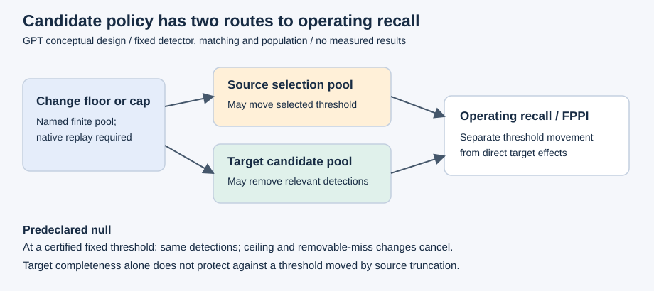

# Research program: candidate policy and threshold transfer

**GPT scientific-design researcher, 2026-11-09; base `9794d81914d43cfbb44d4aa3d127e57145385d42`.** This is my proposed research program under the [coordinator decisions](../decisions/2026-11-09_research_direction.md), not an amended shared protocol or experimental result. GPT performed the source audit and derivations. **G0 remains pending.** The [audit](2026-11-09_novelty_audit.md) contains source versions, access limits, counterexamples and actual peer messages; the [matrix](../../configs/research/ablation_matrix.json) specifies the staged design.

**Premise change:** Claude found visually confirmed same/near-capture references crossing old allocation roles. The authorized CPU regeneration confirms that the **complete four-condition bridge is not supported**: night has only two eligible closures, insufficient for the declared separate-inner-group calibration procedure; two fog calibration folds have zero fit GT. This does not prove every raw-threshold procedure impossible. Both formal cross-reviews are complete; execution remains on hold because the grouping and runtime prerequisites remain unresolved. My unrelated training occupies the GPU: all current research work is CPU-only; no GPU probe, inference, training, polling or automatic overnight launch is authorized.

I want to measure the frequency, condition association and operating consequences of truncation exposure, separating target candidate changes from source-induced threshold reselection. Frozen thresholds, risk–coverage curves, budget effects and cross-class competition have close precedents. Moving recall mass between ceiling and threshold-removable components alone is bookkeeping, not a scientific mechanism. A substantive contribution must survive the algebraic null below and established explanations. No such effect has been measured here.

## Contribution hypotheses and decision

| Candidate | Closest prior and proposed distinction | Disconfirmation and kill criterion |
|---|---|---|
| **A: mechanism audit; recommended** | Kuzucu evaluates threshold-dependent calibration under shift; Dave studies cap-induced class interactions. AegisBench is a low-weight unresolved-identity reference. Test source/target truncation exposure, boundary movement and operating consequences beyond the joint certificate null. | Kill the contribution if changes are only M/W bookkeeping, known class competition, geometry/cutoff effects, or negligible/unstable across seeds. Stop null development contrasts before target compute. A cap effect or rank reversal alone is insufficient. |
| **B: completeness-aware reporting; supporting fallback** | Dave and Hosang already establish selection-budget effects. A conditional finite-pool certificate can identify which operating subsets are unaffected by specified truncations. | Reject standalone novelty now: the bound is elementary. Keep a reproducibility checklist only if real selector metadata supports it; otherwise report unknown. |
| **C: transfer warning; conditional later extension** | Ovadia studies uncertainty under shift; selective prediction/risk control already studies score-based selection. Test whether truncation exposure adds information beyond simple confidence/count/image features. | Kill predictive claims if it adds no held-out information over minimum score/cap-binding/count/confidence baselines, or needs target-label tuning. Lee's full method remains inaccessible; make no novelty/exclusion claim over it. |

The fallback is a transparent negative mechanism audit with explicit feasibility and policy limits. It is not a newly named calibration method.

## What the experiment would identify

For each frozen pipeline, let `M_c` be all-candidate recall, `r_c(t)` operating recall, and `W_c=M_c-r_c(t)`. Report recall, FPPI, all infeasible targets, and

`L_c=r_ref(t)-r_c(t)=(M_ref-M_c)+(W_c-W_ref)`.

Also retain the protocol's nonnegative target-shortfall decomposition. These identities are diagnostics, not causal weather attribution; `M` is a finite pipeline ceiling. Population, matching, ignore rules and geometry stay fixed within each contrast.

Use two policy contrasts: hold the maximal-policy source threshold fixed while changing only candidates; then reselect the source threshold separately for each policy. Track stable IDs and TP transitions. **Predeclared null:** at a fixed threshold on a certified image, operating TP/FP and recall are unchanged, while policy changes to `M` and `W` cancel exactly. Transfer loss is unchanged when both reference and target panels are certified at that common threshold. If every source-selection image is certified at the maximal-policy source boundary, highest-observed-boundary reselection also stays unchanged. These statements require the fixed-pool/selector assumptions, not merely an unchanged output count.

Source and target exposure must be reported separately. If source certification fails, the selected threshold can move and change recall even on a target image certified at both thresholds. For smaller policy `q` and maximal policy `p`, decompose `r_q(t_q)-r_p(t_p) = [r_q(t_q)-r_q(t_p)] + [r_q(t_p)-r_p(t_p)]`: source-reselection effect plus direct target candidate effect. A failed certificate is unknown, not proof of missing above-threshold candidates. Report native replay, threshold movement, image/GT-weighted exposure and FPPI. Low image-level exposure alone is not an effect bound, because source boundary leverage and crowding can be large.

If a future development pilot establishes the joint certificate null for an axis/objective, stop that axis as null on that development population before spending ACDC compute. If uncertifiable exposure is negligible and neither source-boundary movement nor a material operating effect remains, deprioritize it under an explicitly reported resource heuristic; do not claim a population theorem from a low flag rate. A global strict scalar map with observed-boundary reselection is an additional selection-level negative control. Its fit failures affect probability-calibration diagnostics, not new selection power; every metadata-supported calibrator here would fit on one closure. The common bridge split is not changed to rescue raw night folds.

The certificate asserts only equality of above-threshold selections relative to a named finite pool, conditional on complete selector evidence. It cannot certify unseen objects, recall, correctness or weather robustness. Missing stage bounds/timeouts yield unknown. No certificate module is proposed before the native metadata interface is settled.

## Staged experiments

The planned 32-image KITTI pilot is **GPU-blocked and its prototype capture is disabled after cross-review**. Safeguards, native candidate identities and evidence bindings need a separately scoped correction before use; there is no runnable overnight job ready. Once corrected and separately coordinated, it would establish native cap/floor/head/geometry semantics without ACDC/BDD performance claims. Development capture is floor `1e-4`, cap `3000`; neither implies exhaustion. Native geometry is primary; common final clipping before matching is a sensitivity, preserving IDs and reporting collapsed boxes. YOLO26 heads use separately loaded copies of the same checkpoint; their contrast changes trained branches and post-processing together.

The initial six policy settings are the development baseline, caps 100/300/1000 at floor `1e-4`, and floors `1e-3`/`1e-2` at cap 3000. Do not cross all factors. At each policy, use targets .80/.90/.95 and source F1; add monotone/fixed-cutoff controls and clipped geometry at the baseline. Compare acquisition bounds with actual native lower-cap replay before cache reuse. Post-NMS caches cannot regenerate a different NMS or class-first policy. The matrix specifies second-tier NMS, class order, population and warning baselines. Repeat useful core findings across seeds before adding model families. Future training budgets count successful updates, with the coordinator's attempt ceiling, scheduler/EMA rules and exposure logs; this assignment authorizes none.

## Exact exploratory bridge: `acdc-normal-loco-v1-proposal`

BDD Detection 2020 clear-day source training/threshold selection remains the primary question and is blocked on verified access. This additional bridge is **normal-reference-to-adverse transfer** using frozen COCO checkpoints and a merged-human population (ACDC person+rider; COCO person outputs). Normal references are not verified clear daytime. A separate person-only panel needs its own thresholds and denominator.

1. **Dependency prerequisite changed by Claude's actual finding:** confirmed same-capture references cross the old fit/selection roles. Propose `acdc-recording-reference-closure-v2-proposal`: take the `acdc-recording-v1` graph plus visually confirmed same-capture edges, close transitively across all views/conditions, and hash sorted member paths using the existing ID recipe. Freeze its edge ledger/hash and resolve the audit's unreviewed flags before adoption/inference. Similarity alone never merges primary groups. Exclude every closure touching an original `descriptive_only` component; all 449 labelled adverse images remain descriptive-only, possibly with additional related images excluded. Components with no labelled adverse images are ineligible.
2. For each eligible outer component `g` and condition `c` it touches, hold out **all** of `g` globally. Let `H` be other eligible components touching `c` with annotated references. Sort by `(SHA256(seed+"\n"+g+"\n"+c+"\n"+h), h)`, seed `acdc-normal-loco-v1-2026-11-09`, UTF-8, lowercase hexadecimal hashes. First `floor(len(H)/2)` are inner fit; remainder inner selection. Fewer than two components makes the fold infeasible. Do not search seeds or borrow another condition.
3. Source-only raw thresholds use annotated normal references of selection components. A prespecified positive-slope scalar calibrator uses normal references of fit components, then reselects on selection references. Detector weights/policy are fixed externally. Fit labels never select thresholds. The optional target-labelled exploratory arm fits on adverse fit components and selects on adverse selection components; it always includes a raw target-threshold baseline using exactly those selection labels. Never call monotone reselection a recall improvement.
4. Evaluate the fold threshold on the outer component's paired annotated references/adverse images, using the same pair subset and weights in the anchor contrast. Report the larger adverse-only panel separately. Pairs identify views, not pedestrian identities; acquisition and annotation differences remain confounders.
5. Zero eligible selection GT gives undefined recall; ceiling below target gives infeasible; empty candidates with positive GT give ceiling zero. A degenerate calibrator fit is undefined for that arm, while the raw arm remains reportable. Zero outer GT gives undefined recall and defined FPPI. Keep every failure, never repair folds or substitute thresholds. Aggregate each outer image once by total TP/GT only when all required folds are defined/feasible; otherwise report incomplete coverage and separately labelled feasible-fold summaries with denominators.

This is an explicit **new allocation overlay**, replacing the earlier fit/selection/held-out roles only within the proposed bridge, never silently changing canonical roles. The original allocation and descriptive panel remain recorded. Coordinator-recorded fold adoption and the dependency audit are prerequisites to later inference; this document runs no ACDC model.

The single regeneration leaves 12 eligible labelled closures and 1,212 adverse/606 reference images after excluding 794 adverse/397 reference rows. Keep all 14 outer condition cells/statuses. Claude's independent review found one fog cell with 29 adverse/14 reference images but zero outer human GT: recall is undefined in both arms, with FPPI retained. Nine cells have positive fit, selection and outer GT; fog has one calibrated and three raw cells with defined outer recall, still subject to empirical feasibility. No selective complete-case benefit claim follows. The all-non-rejected-flags sensitivity supports no declared LOCO fold and is not verified dependency evidence. No further regeneration, seed search or fold rescue follows. Groups block observed dependencies, not proven IID trips; no nominal-coverage or five-point precision claim is available.

Promotion requires a reproducible mechanism beyond the known effects, sensible FPPI costs, stable conclusions across prespecified sensitivities/seeds, and a source-backed distinction. Otherwise narrow or stop the contribution claim. No held-out target recall selects the candidate policy.
