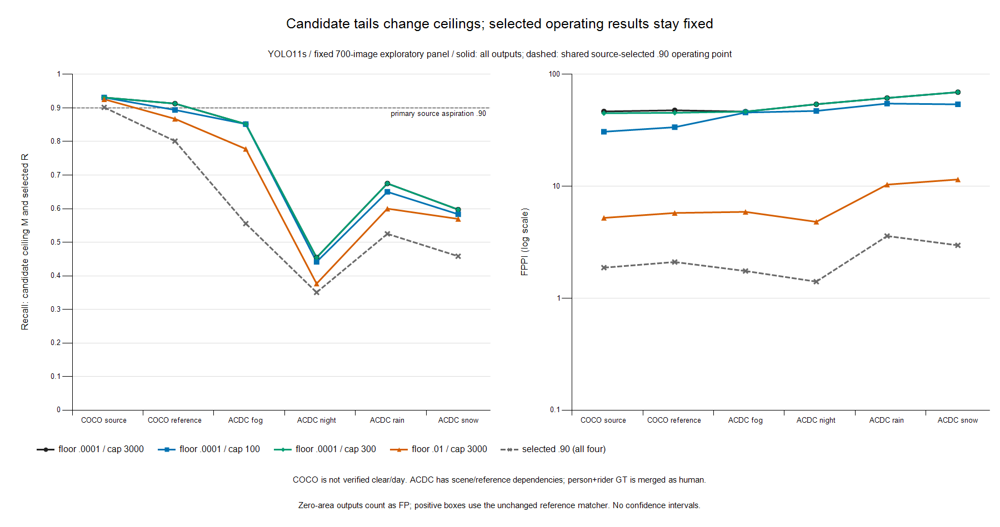

# Fixed-panel native inference completion

**GPT Sol completed execution, 2026-11-10; base `3d2244e1495106594e0c16781f5fb71066a9e185`. G0 pending.** All four native policies completed 700/700 images. **H1 has no support on this finite panel:** all three .90 contrasts are testable and fail both strict inequalities with zero B/D recall and TP/FP changes. This is a separate completion assignment. The [earlier failed attempt](2026-11-10_sol_results.md) and its aggregate remain historical evidence; its missing raw box is not retrospectively classified as zero area. GPT Astra's [prospective H1](2026-11-10_astra_research.md) is unchanged. No Claude work, peer restart, training, local GPU operation, new sample, push, PR or merge is part of this assignment.

I want an actual result on whether native candidate policies change source-selected threshold transfer enough to motivate further research. GPT Sol owns the correction, Colab execution, retrieval and interpretation under the [prospective zero-area decision](../decisions/2026-11-10_native_zero_area.md). My approval still governs merges.

## Prospective execution record

Before allocation or any completed policy result, GPT Sol adopted explicit native-zero-area accounting: save raw native batches before validation; preserve finite unreversed zero-width/height detections separately with native coordinates, candidate IDs and scores; append FP rows to the unchanged positive-area `ReferenceEvaluator`, sorted by `(-score, candidate_id)`. Inclusive score thresholds, ties, FPPI and binary TP-ECE include these rows. Zero-area detections receive no crowd absorption; undefined zero-denominator IoA is not computed. No coordinate repair, epsilon expansion or clipping is introduced. Reversed/nonfinite/wrong-class outputs, censoring/timeouts and incomplete coverage still fail. This is provisional diagnostic accounting, not official AP.

The tiny deterministic CPU example passed before allocation: one TP plus one zero-area FP, at equal and unequal scores, two images including an empty image, a crowd region, inclusive boundaries, whole ties, FPPI .5 and ECE count two. This is a synthetic accounting check, not a research result; no regression suite or qualification programme was run.

The unchanged 700-image packet supplies 256 COCO selection, 256 disjoint COCO reference, 32 ACDC adverse val images per condition and 60 annotated normal references. All empty images remain. The four native YOLO11s policies remain floor .0001/cap3000 (`maximal`), floor .0001/cap100, floor .0001/cap300 and floor .01/cap3000. Each runs directly, totaling 2,800 forward images; no training or additional model is required. Person-only outputs and COCO person / ACDC person+rider human mapping, matching, objectives .80/.90/.95, batch eight and 640 input remain unchanged.

**Estimate recorded before allocation:** allow 40 minutes for chunk transfer, setup, 2,800 forward images, retrieval and teardown. Previous successful chunk/setup operation occupied approximately 11 minutes; valid inference throughput was unmeasured. At the previous L4 rate 1.94 CU/hour, this allowance is `40/60*1.94 = 1.293333 CU`. The hard wall is 60 minutes including retrieval/cleanup, admission rate at most 6 CU/hour, cumulative empirical envelope 10 CU less prior .31 displayed CU and .20 CU reserved for meter lag. Sole operator GPT Sol uses one named owned L4 session and isolated state under ignored `outputs/colab/empirical_completion_20261110/`. No top-up or other session teardown is authorized.

The original 490,741,760-byte packet and its 118 chunks remain unchanged. After reconstruction and SHA verification, only the corrected script/config are uploaded separately. The manifest and image bytes are reused without a dataset rescan or selection. Original packet identity does not describe the overwritten working directory. Exact separate delivery hashes and execution outcomes are recorded below after retrieval.

## Measured result: source selection is feasible; H1 fails

Every policy selects exactly `t = 0.043987125158309937` for .90, attaining **522/579 = 90.1554%** on COCO selection with **480 FP / 256 images = 1.875 FPPI**. The next lower observed source score is `0.04389350861310959`, boundary gap `0.0000936165452003479`, and boundary tie count one. Thus no policy induces source-boundary movement. This is a measured operating null, not missing coverage or source infeasibility.

| Native policy | Complete coverage | Source ceiling TP/GT (M) | All-output source FP (FPPI) | Native candidates / zero area | H1 at .90 |
| --- | --- | --- | --- | --- | --- |
| maximal | 700/700 | 539/579 (93.09%) | 11929 (46.597656) | 44104 / 118 | baseline |
| cap100 | 700/700 | 539/579 (93.09%) | 7859 (30.699219) | 28954 / 97 | testable; no support |
| cap300 | 700/700 | 539/579 (93.09%) | 11503 (44.933594) | 39894 / 118 | testable; no support |
| floor01 | 700/700 | 536/579 (92.57%) | 1336 (5.218750) | 6869 / 0 | testable; no support |

The .80 sensitivity is feasible for all four policies at the identical boundary `0.24039360880851746`: source 464/579, and night 21/77 with four FP (.125 FPPI). All .80 panel operating TP/FP counts and B/D components are identical across policies. The .95 objective is **INFEASIBLE in all four policies**, with no threshold or transferred operating metric substituted. Source .90 headroom is 3.0915 percentage points for the first three policies and 2.5734 points for floor01; these are empirical selection margins, not guarantees.

| H1 contrast q versus maximal p | B night | D night | B COCO reference | Signed TP/FP changes B and D | Verdict |
| --- | --- | --- | --- | --- | --- |
| cap100 | 0 | 0 | 0 | 0 TP, 0 FP for both components | Both strict inequalities fail |
| cap300 | 0 | 0 | 0 | 0 TP, 0 FP for both components | Both strict inequalities fail |
| floor01 | 0 | 0 | 0 | 0 TP, 0 FP for both components | Both strict inequalities fail |

H1 requires `|B_night| > |D_night|` and `|B_night| > |B_COCOref|`. Here both are `0 > 0`, false for every q. All 14 reported panels, including normal and paired subsets, have zero operating B/D recall and TP/FP changes at .90. No winning policy is selected. This is familiar prefix/floor-null behavior measured on real data, not a new mechanism or method.

## Absolute transfer and candidate ceilings

The following .90 operating results are shared by **all four policies**. W is the baseline ceiling minus the selected recall, in percentage points; policy-specific W and all decompositions remain in the aggregate.

| Panel | Images / eligible GT / empty | Operating TP/GT | Recall | FP | FPPI | Baseline M | Baseline W (pp) |
| --- | --- | --- | --- | --- | --- | --- | --- |
| COCO selection | 256 / 579 / 116 | 522/579 | 90.16% | 480 | 1.875000 | 93.09% | 2.94 |
| COCO reference | 256 / 528 / 120 | 423/528 | 80.11% | 539 | 2.105469 | 91.29% | 11.17 |
| ACDC fog | 32 / 27 / 16 | 15/27 | 55.56% | 56 | 1.750000 | 85.19% | 29.63 |
| ACDC night | 32 / 77 / 13 | 27/77 | 35.06% | 45 | 1.406250 | 45.45% | 10.39 |
| ACDC rain | 32 / 40 / 22 | 21/40 | 52.50% | 115 | 3.593750 | 67.50% | 15.00 |
| ACDC snow | 32 / 72 / 11 | 33/72 | 45.83% | 95 | 2.968750 | 59.72% | 13.89 |

All-output counts below retain every native candidate within the named policy. Each cell is **TP/eligible GT; FP (FPPI)**. This is a ceiling diagnostic, not an alternative deployment threshold or official AP. Ignored predictions remain in candidate counts but not FP totals.

| Panel | maximal | cap100 | cap300 | floor01 |
| --- | --- | --- | --- | --- |
| COCO selection | 539/579; 11929 (46.598) | 539/579; 7859 (30.699) | 539/579; 11503 (44.934) | 536/579; 1336 (5.219) |
| COCO reference | 482/528; 12206 (47.680) | 472/528; 8622 (33.680) | 482/528; 11598 (45.305) | 458/528; 1478 (5.773) |
| ACDC fog | 23/27; 1486 (46.438) | 23/27; 1458 (45.562) | 23/27; 1486 (46.438) | 21/27; 189 (5.906) |
| ACDC night | 35/77; 1729 (54.031) | 34/77; 1507 (47.094) | 35/77; 1729 (54.031) | 29/77; 154 (4.812) |
| ACDC rain | 27/40; 1966 (61.438) | 26/40; 1753 (54.781) | 27/40; 1966 (61.438) | 24/40; 331 (10.344) |
| ACDC snow | 43/72; 2216 (69.250) | 42/72; 1726 (53.938) | 43/72; 2216 (69.250) | 41/72; 368 (11.500) |

Signed all-output changes relative to maximal are shown separately from operating B/D. Each cell is **delta TP, delta FP; delta M in percentage points**. Operating TP and FP changes remain zero.

| Panel | cap100 | cap300 | floor01 |
| --- | --- | --- | --- |
| COCO selection | +0, -4070; +0.00 | +0, -426; +0.00 | -3, -10593; -0.52 |
| COCO reference | -10, -3584; -1.89 | +0, -608; +0.00 | -24, -10728; -4.55 |
| ACDC fog | +0, -28; +0.00 | +0, +0; +0.00 | -2, -1297; -7.41 |
| ACDC night | -1, -222; -1.30 | +0, +0; +0.00 | -6, -1575; -7.79 |
| ACDC rain | -1, -213; -2.50 | +0, +0; +0.00 | -3, -1635; -7.50 |
| ACDC snow | -1, -490; -1.39 | +0, +0; +0.00 | -2, -1848; -2.78 |

**Figure:** solid curves show actual all-output recall/FPPI; the dashed curve is the identical .90 operating point for all four policies. Lines connect descriptive panels for readability, not an ordering or temporal trend. The right axis is logarithmic. No CI is reported. The PNG was exported using CPU-only .NET Charting; its source numbers are in the public aggregate and the plotting recipe is retained privately.

At night, keeping the full baseline tail increases recall from 27/77 to 35/77: **eight additional TP, 10.3896 recall points, and 1,684 additional FP**, or **52.625 extra FPPI**. The remaining 42/77 eligible objects are unmatched even at this finite-pipeline ceiling. The .90 target shortfall at the source-selected boundary is 54.9351 points: 44.5455 points of candidate-ceiling shortfall below .90 plus 10.3896 threshold-removable points. Lowering a threshold within these candidates cannot attain .90 on this night panel.

COCO-reference minus night operating recall is **45.0487 points**. The ceiling difference is **45.8333 points**, with a signed W difference of **-0.7846 points**, giving the same loss. This identity describes the measured gap; it does not establish why candidates are absent or isolate a weather effect. Floor01 reduces the night ceiling by six TP and 7.7922 points while leaving the operating result fixed. Its smaller W is therefore not an operating improvement. Cap100 removes one night ceiling TP; cap300 changes no adverse ceiling TP or FP here despite changing the COCO tail.

## Matched normal-reference response

All four policies again share these .90 operating results. Adverse counts use only the corresponding reference-eligible subset; normal and adverse GT counts differ, and correspondence is at scene/view level, not person identity. Each count includes all selected empty images.

| Condition | Pairs | Adverse TP/GT (R) | Adverse FP (FPPI) | Normal TP/GT (R) | Normal FP (FPPI) | Normal - adverse R (pp) |
| --- | --- | --- | --- | --- | --- | --- |
| fog | 16 | 6/13 (46.15%) | 25 (1.562500) | 11/32 (34.38%) | 18 (1.125000) | -11.78 |
| night | 12 | 9/25 (36.00%) | 24 (2.000000) | 13/35 (37.14%) | 70 (5.833333) | +1.14 |
| rain | 15 | 14/22 (63.64%) | 66 (4.400000) | 16/27 (59.26%) | 49 (3.266667) | -4.38 |
| snow | 17 | 15/37 (40.54%) | 52 (3.058824) | 19/60 (31.67%) | 52 (3.058824) | -8.87 |

For the 12 night pairs, normal recall 13/35 is close to adverse 9/25, despite the large full-night versus COCO gap. Baseline paired night ceilings are adverse 13/25 (52%) and normal 16/35 (45.71%). The corresponding normal reference therefore does not support reading the full-panel COCO/night difference as a causal night penalty. Other pairs also have negative normal-minus-adverse operating recall. Sparse denominators, scene mix, human ontology and acquisition/annotation differences remain alternatives; no independence, population interval or person-level paired effect is claimed.

## Geometry evidence, resources and provenance

The new run actually emitted finite native zero-area detections: maximal 118, cap100 97, cap300 118, floor01 zero, across the 700 unique images. They all occur in COCO here. Baseline/cap300 contributions are source 44 FP / 256 = .171875 FPPI and reference 74 / 256 = .2890625 FPPI; cap100 has the same source contribution and reference 53 / 256 = .20703125 FPPI. All are below the .90 and .80 operating boundaries, where their FP contribution is zero. Positive boxes use the unchanged reference matcher. This observation does not reconstruct the earlier lost raw box or establish its cause.

Actual validation required direct child exit zero, `yolo11s_status.json` COMPLETE, and four complete policy artifacts with exactly the unchanged 700 manifest IDs each. Retrieved raw capture contains **352 batches** (88 per policy), with exact native image population and candidate-count agreement. All 366 result files and the compressed archive have private hash records. Raw batches precede validation; validated partial evidence would remain invalid on an exception. No new inference/infrastructure failure occurred and no corrective GPU rerun was used. Ultralytics emitted deprecation warnings for the frozen `half=False` argument; it was not changed mid-experiment. A local Matplotlib launcher was blocked by Windows application control; no install or policy change was attempted, and the figure instead uses built-in CPU Charting.

| Policy | Measured policy loop (s) | Peak allocated / reserved bytes | Images at native cap |
| --- | --- | --- | --- |
| maximal | 25.191635 | 425910784 / 595591168 | 0 |
| cap100 | 17.125560 | 425874944 / 595591168 | 123 |
| cap300 | 17.540231 | 425885696 / 595591168 | 22 |
| floor01 | 17.238564 | 425866240 / 595591168 | 0 |

Loop timings include prediction, native raw capture and geometry processing, not pure device-forward latency. The entire model process lasted **79.5074 seconds**; the allocation interval includes transfer, setup, inference, retrieval and teardown. Actual runtime: **NVIDIA L4, 23,659,151,360 bytes; Python 3.13.16; torch 2.14.1+cu130; Ultralytics 8.4.197**. Native Detect head has `end2end=False`, O2M cv2/cv3 present, no O2O branch; no YOLO26 inference was attempted.

Sole owned session `sol-completion-20261110-225924` allocated **2026-11-10T22:59:26.030051+00:00** and completed retrieval/teardown verification **2026-11-10T23:10:23.036884+00:00**. Outer elapsed **657.000 seconds (10.95 minutes)**, admitted rate **1.94 CU/hour**. Displayed balance **299.66 -> 299.42 CU**, decrement **.24 CU**, plus the prior .31 = **.55 cumulative displayed CU**, inside the 10-CU envelope with meter-lag allowance. This is a displayed balance difference, not an itemized settled charge. Named owned teardown succeeded; final server usage **0 CU/hour, zero active assignments**, with no other session stopped.

The sent script is an immutable private snapshot. Subsequent committed-script edits concern aggregation/coverage accounting only: exact source comparison confirms the sent and final `infer` and `pilot_evaluator` functions are identical. Original packet hash describes the unchanged tar; the remote working script/config have the separate hashes below.

| Artifact | SHA256 |
| --- | --- |
| Original packet (490,741,760 bytes) | `d2cd1a7f669c401417f06e9b712dbc32b20b2f8b54055b18a1b9adcc8e938a24` |
| Unchanged private manifest | `21c5a2c738a22c5e6e6bff535c1122a8fdc3cbac69216ce9e9ba07c3e3b1156a` |
| Original packet config | `704dbfbba0085e6ca69632c584820b246fcbb017f7669079e8993220009a5bf1` |
| Separately delivered completion config | `1761f61350a38f2d0d94322bc7d6ea2a23254a8c0d0416882616e720e88fc382` |
| YOLO11s checkpoint | `85a76fe86dd8afe384648546b56a7a78580c7cb7b404fc595f97969322d502d5` |
| Actually delivered script | `63f2b2659b4ee3f6b4d044e54cb41c3baec0e166ed72daed1c7a16ff167a0628` |
| Final aggregate-producing script | `04cd37e75a811b0e43b6d26d40434cf2cd09afd878e83101e7730466bdf8c647` |
| Unchanged positive-area ReferenceEvaluator | `fa58a9e286fa1ef6baa03924547fb781c3c5191c92f9caa6931c5dd18699a931` |
| Inference function UTF-8 source | `11cf78be91de7a7584cda05c2ed5093a4d2131b4d657d082e4e416d874e6e1fd` |
| Scientific figure PNG | `457dfafd81bba095240212bc025ab9e83f9884f178d53ce38c5b9faba887f022` |
| Private CPU plotting recipe | `bea06880240f17469694d236b1cb89972829de7f2e72928ceb427e9f71c058ad` |
| Retrieved compressed final evidence | `2ab45acd0a456d1364e311099053a84606a9b6cbc94e3575aa4ffd9042c32f60` |

Captured pinned predictor, head, NMS and fusion source hashes are in the [public aggregate](2026-11-10_sol_completion_aggregate.json). Frozen annotation hashes and exact settings are in the [config](../../configs/research/transfer_pilot_20261110.json). The private packet, raw boxes/scores/IDs, annotations, inspected images, install logs, direct process status, operation logs/history, native sources, artifact hashes and plotting recipe remain ignored under `C:/Users/Advait/autonomous-sys-research/outputs/colab/empirical_completion_20261110/`. No raw identity or annotation is published.

## Scientific decision and limits

**I would stop this candidate-policy/source-boundary amplification direction on the present panel.** GPT Sol interprets the completed result as a clear operating null for every prespecified q, consistent with the prospective floor null. GPT Astra’s conditional fresh-source repeat is not triggered. No source block, model sweep, objective reduction, calibrator or training run follows from these results.

The useful next scientific question, if separately assigned, is why this frozen human detector has low candidate coverage on both ACDC adverse views and their normal references. The current run cannot distinguish localization, ontology/annotation and scene/acquisition explanations. That question needs its own design and authority; it is not a new audit or allocation here. Cap/floor effects, an algebraic decomposition and a negative pilot do not by themselves establish novelty.

COCO is not verified clear/day, and pretrained checkpoint exposure remains possible. Image-disjoint source/reference sets do not establish independence from training. ACDC has known scene/reference dependencies; independent-group counts are unknown and no CI is claimed. Human mapping and crowd accounting are provisional; these are not official AP, primary BDD results, a replacement for BDD, a safety guarantee or evidence of general detector capacity. No new peer dialogue or agreement is implied. G0 remains pending; the coordinator handles separate publication review, and my explicit approval governs merges. No push, PR or merge occurred.
