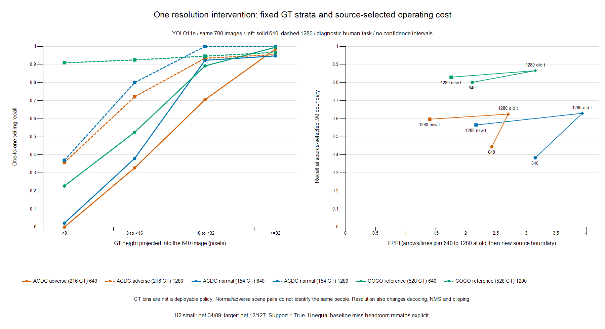

# Fixed-panel resolution intervention

**GPT Sol, 2026-11-10; base `a2072cef6bf2e020a77c1ee54cd8de432d8508a4`. G0 pending.** One fresh native YOLO11s maximal-policy run completed **700/700 images at 1280**, compared with the retained actual 640 baseline. **H2 meets its prospective finite-panel criterion:** small-object net ceiling gain is **34/89 = 38.20 percentage points**, larger-object gain **12/127 = 9.45 points**. This supports an ordinary input-resolution/pipeline coverage explanation. It does not establish a new method, preferential recovery per baseline miss, isolated architecture effect or causal darkness effect.

I want to determine whether the low frozen-pipeline coverage is sensitive to input resolution before developing a method. The [coordinator decision](../decisions/2026-11-10_coverage_resolution.md) fixed H2 before any 1280 outputs. H1 remains killed; its fresh-source repeat was not triggered. This run adds no policy sweep, model, training or sample change. Colab execution, evidence retrieval and teardown finished before a workspace-credit interruption; the resumed assignment performed CPU aggregation/reporting only. Historical baseline documents and peer files were not edited.

## Controlled intervention and H2

The [config](../../configs/research/resolution_probe_20261110.json) retains checkpoint SHA `85a76fe86dd8afe384648546b56a7a78580c7cb7b404fc595f97969322d502d5`, Ultralytics 8.4.197, native `classes=[0]`, floor .0001, cap 3000, NMS IoU .7, class-aware NMS, `rect=False`, `half=False`, batch eight, native geometry, human mapping and crowd/zero-area accounting. Only input size changes from 640 to 1280. The 700 images remain 256 COCO selection, 256 disjoint COCO reference, 128 ACDC adverse and 60 annotated normal references, including empty images. No rescan/reselection occurred.

The new [wrapper](../../experiments/2026-11-10_resolution_probe.py) imports the completed pilot's `infer` and `pilot_evaluator` unchanged. Native raw batches are persisted before validation. Finite unreversed zero-area outputs remain explicit FP without repair or crowd absorption; positive-area detections use the unchanged one-to-one reference matcher. Reversed/nonfinite output, time-limit censoring and incomplete coverage remain failures. This is provisional human/crowd accounting, not official AP.

Small means eligible GT `bbox_height * 640 / max(original_width, original_height) < 16`, fixed at the baseline geometry. H2 uses all **128 adverse images / 216 GT**, comparing net one-to-one matched GT-ID changes divided by eligible GT. It requires positive small gain strictly exceeding the complement; no cutoff/seed rescue is permitted. These GT bins are diagnostic, not a deployable policy. Counts retain gained and lost matches:

| Adverse stratum | Ceiling TP 640 → 1280 / GT | Gained / lost | Net gain / GT (pp) | Residual misses | Net gain / baseline misses |
|---|---|---|---|---|---|
| Small <16 | 20 → 54/89 | 35 / 1 | 38.20 | 35 | 34/69 = 49.28% |
| Larger ≥16 | 108 → 120/127 | 15 / 3 | 9.45 | 7 | 12/19 = 63.16% |
| All | 128 → 174/216 | 50 / 4 | 21.30 | 42 | 46/88 = 52.27% |

**Interpretation:** 35 of the 42 remaining adverse ceiling misses are small. However, baseline small objects had 69 misses available to recover, versus only 19 larger misses. The descriptive net gain per baseline miss is **49.28% small versus 63.16% larger**. Thus H2 success must not be rewritten as preferential recovery of already-missed small objects. This extra diagnostic, suggested by GPT Astra, does not alter H2. All four adverse ceiling losses remain in the result.

## Reference, size and human-task controls

Each cell below gives **640 TP → 1280 TP / fixed GT**. The full aggregate retains gained/lost counts for every bin, person/rider intersection and panel; no subgroup was selected to improve H2.

| Panel | <8 px | 8–<16 px | 16–<32 px | ≥32 px |
|---|---|---|---|---|
| ACDC adverse | 0 → 10/28 | 20 → 44/61 | 43 → 57/61 | 65 → 63/66 |
| ACDC annotated normal | 1 → 17/46 | 19 → 40/50 | 36 → 39/39 | 18 → 19/19 |
| COCO reference | 5 → 20/22 | 21 → 37/40 | 66 → 70/74 | 390 → 379/392 |

| Panel | Small <16: net / GT (gained, lost) | Larger ≥16: net / GT (gained, lost) | Person ceiling 640 → 1280 / GT | Rider ceiling 640 → 1280 / GT |
|---|---|---|---|---|
| ACDC adverse | 34/89 (35, 1) | 12/127 (15, 3) | 122 → 166/201 | 6 → 8/15 |
| ACDC normal | 37/96 (38, 1) | 4/58 (4, 0) | 70 → 109/137 | 4 → 6/17 |
| COCO reference | 31/62 (31, 0) | -7/466 (5, 12) | 482 → 506/528 | 0 → 0/0 |

Normal small-object gain is **37/96 = 38.54 points**, comparable to adverse 38.20; its larger complement gains 4/58 = 6.90 points. COCO-reference small objects gain 31/62 = 50 points, while larger objects lose a net 7/466. Normal coverage and its response challenge a night-specific story. The COCO larger-object losses also prevent a monotone “more pixels always helps” interpretation. Zero rider denominator in COCO stays undefined. FP cannot be allocated to a GT size or person/rider stratum; all panel FPPI totals include empty images.

## Source thresholds and actual operating cost

Threshold selection uses only the unchanged COCO selection set at each resolution, observed boundaries, inclusive scores and whole ties. Infeasible cases remain explicit. Each source operating cell is **TP/579; FP (FPPI)**.

| Source objective | 640 status / boundary | 640 operating | 1280 status / boundary | 1280 operating |
|---|---|---|---|---|
| 0.8 | FEASIBLE / `0.24039360880851746` | 464/579; 71 (0.277) | FEASIBLE / `0.2718588709831238` | 464/579; 110 (0.430) |
| 0.9 | FEASIBLE / `0.043987125158309937` | 522/579; 480 (1.875) | FEASIBLE / `0.08221367746591568` | 522/579; 405 (1.582) |
| 0.95 | INFEASIBLE / `None` | unavailable | FEASIBLE / `0.01611722819507122` | 551/579; 1479 (5.777) |

Source ceiling rises from **539/579 (93.09%) to 570/579 (98.45%)**. The old .95 objective stays infeasible; there is no old .95 threshold or signed resolution/reselection contrast to substitute. The new .95 operating result is a distinct source-selected policy, not a rescue of H1.

The table compares .90 at the old boundary, then the new source-selected boundary. Each operating cell is **TP/GT; FP (FPPI)**. Ceilings use every candidate within the finite policy.

| Panel | Ceiling TP 640 → 1280 / GT; ΔM (pp) | 640 old t | 1280 old t | 1280 new t |
|---|---|---|---|---|
| COCO selection | 539 → 570/579; 5.35 | 522/579; 480 (1.875) | 534/579; 678 (2.648) | 522/579; 405 (1.582) |
| COCO reference | 482 → 506/528; 4.55 | 423/528; 539 (2.105) | 457/528; 807 (3.152) | 438/528; 449 (1.754) |
| ACDC fog | 23 → 26/27; 11.11 | 15/27; 56 (1.750) | 23/27; 55 (1.719) | 21/27; 33 (1.031) |
| ACDC night | 35 → 50/77; 19.48 | 27/77; 45 (1.406) | 34/77; 65 (2.031) | 32/77; 29 (0.906) |
| ACDC rain | 27 → 34/40; 17.50 | 21/40; 115 (3.594) | 26/40; 124 (3.875) | 25/40; 68 (2.125) |
| ACDC snow | 43 → 64/72; 29.17 | 33/72; 95 (2.969) | 52/72; 102 (3.188) | 51/72; 49 (1.531) |
| Pooled adverse | 128 → 174/216; 21.30 | 96/216; 311 (2.430) | 135/216; 346 (2.703) | 129/216; 179 (1.398) |
| Pooled normal | 74 → 115/154; 26.62 | 59/154; 189 (3.150) | 97/154; 236 (3.933) | 87/154; 130 (2.167) |

For pooled adverse .90, the signed direct resolution effect at the old boundary is **+39 TP (+18.06 recall points), +35 FP**: 44 GT gained and five lost. With the 1280 pipeline fixed, source reselection removes six TP and 167 FP (**−2.78 points**, −1.3047 FPPI). Total change is **+33 TP (+15.28 points), −132 FP (−1.03125 FPPI)**: 40 gained, seven lost. These sum exactly. All .80/.90/.95 panels and GT transitions are retained, including unavailable contrasts.

All-output adverse FPPI rises from **57.789 to 146.945** (7,397 → 18,809 FP) for +46 ceiling TP. At 1280, lowering the new .90 threshold to retain all outputs adds 45 TP but **18,630 FP**. COCO-reference all-output FPPI rises 47.680 → 97.992; normal 54.800 → 134.517. These tails do not constitute a deployment improvement. At source-selected .90, the present panel does show higher pooled adverse recall with lower FPPI; this finite observation is not a population guarantee or a calibrated risk claim.

The figure plots actual one-to-one ceiling recall by fixed projected-height bin and .90 operating recall/FPPI at the old and reselected boundaries. Lines join descriptive bins or successive policy points; there is no temporal ordering or confidence interval. The figure uses CPU-only .NET Charting; its private recipe and hash are retained.

## Annotated scene-reference pairs

Normal/adverse correspondence is at scene/view level, never person identity. Denominators differ. Cells give **640 → 1280 TP / GT**, operating at each resolution's own .90 source boundary; FPPI is **640 → 1280**.

| Condition / pairs | Adverse ceiling | Normal ceiling | Adverse operating | Normal operating | Adverse FPPI | Normal FPPI |
|---|---|---|---|---|---|---|
| fog / 16 | 12 → 13/13 | 16 → 25/32 | 6 → 8/13 | 11 → 16/32 | 1.562 → 0.812 | 1.125 → 1.125 |
| night / 12 | 13 → 17/25 | 16 → 23/35 | 9 → 9/25 | 13 → 19/35 | 2.000 → 1.250 | 5.833 → 3.917 |
| rain / 15 | 17 → 19/22 | 17 → 24/27 | 14 → 13/22 | 16 → 18/27 | 4.400 → 3.200 | 3.267 → 2.067 |
| snow / 17 | 20 → 32/37 | 25 → 43/60 | 15 → 26/37 | 19 → 34/60 | 3.059 → 1.647 | 3.059 → 2.000 |

At night, reference-eligible adverse operating TP stays **9/25**, while normal rises **13/35 → 19/35**. The already-low normal baseline and different people/denominators preclude causal attribution of the COCO-to-night difference to darkness. Resolution also changes anchors, decoding, suppression and native clipping. This intervention isolates none of those components or physical scale alone. Best-candidate-IoU oracle coverage belongs to Astra's separate CPU diagnosis and can reuse candidates; it is not the one-to-one recall computed here.

## Execution, evidence and actual peer exchange

Before allocation, the private operation record specified one named L4, 40 minutes including transfer/retrieval/teardown, rate ≤6 CU/hour, cumulative ceiling 10 existing CU less .55 prior displayed use and .30 lag reserve. At the last 1.94 CU/hour quote, the 40-minute planning charge was **1.2933 CU**. Timing at 1280 was explicitly unmeasured; pixel area is 4× but no linear GPU-time claim was used. Memory planning allowance was **4 GiB**, compared with 595,591,168 bytes reserved at 640. Exact CLI commands, config and logs were saved before allocation in the private operation directory.

Actual commands were `colab --config <owned>/sessions.json new -s sol-resolution-20261110-232329 --gpu L4`, separate verified script/config uploads, then one blocking remote child `python /content/packet/experiments/2026-11-10_resolution_probe.py infer /content/packet`. Local orchestration used the connected Colab CLI and CPU Python; no local GPU query, install or training occurred. Retrieval preceded `stop -s sol-resolution-20261110-232329` in `finally`; only the owned session was stopped.

| Measured execution quantity | Result |
|---|---|
| Allocation request → verified teardown (UTC) | 2026-11-10 23:23:31.279899 → 23:37:08.558415 |
| Outer elapsed / admitted rate | 818.281 s (13.64 min) / 1.94 CU per hour |
| 1280 policy loop / 640 retained loop | 40.225153 s / 25.191635 s |
| 1280 peak allocated / reserved | 1,487,420,928 / 2,394,947,584 bytes |
| Native candidates / zero-area FP | 97,031 / 1,339 |
| Cap events / time-limit events | One COCO selection image at cap 3000 / no logged time-limit event |
| Child / coverage / raw capture | Exit 0; JSON COMPLETE; exact 700 manifest IDs; 88 raw batches |
| Displayed balance / decrement | 299.42 → 298.99 CU / .43 CU |
| Cumulative displayed empirical use | .55 prior + .43 = .98 CU; settlement/meter lag remains possible |
| Final active assignments / rate | Zero / 0 CU per hour; owned teardown verified |

The policy-loop timing includes prediction, native capture and geometry processing; it is not pure device latency. No throughput extrapolation is made. Runtime is L4 23,659,151,360 bytes, Python 3.13.16, torch 2.14.1+cu130, Ultralytics 8.4.197. No new inference failure or corrective rerun occurred. The retained `half=False` argument emitted deprecation warnings. The single capped source image limits the finite source candidate set; no adverse/reference/normal image hit the cap, and no particular GT loss is attributed to it.

Zero-area FP at 1280 total source 201, COCO reference 150, adverse 676, normal 312. They are counted prospectively without repair; none enter the reported .80/.90/.95 operating points. They contribute to extreme all-output FPPI. Native sources, raw batches, child status, hashes and candidate/GT IDs remain private under `C:/Users/Advait/autonomous-sys-research/outputs/colab/resolution_20261110/`; the 640 evidence remains untouched. Public artifacts contain aggregates only.

Delivery verification distinguishes the executed snapshot from later aggregation edits. Retrieved `delivery_verified.json` matches the preallocation code record, and actual sent wrapper, baseline-module, config and manifest hashes match those records. The sent wrapper contains inference only; the final wrapper adds CPU aggregation. The imported baseline module is byte-identical to delivery, so its inference and zero-area evaluator functions remain unchanged.

| Artifact | SHA256 |
|---|---|
| Original unchanged packet | `d2cd1a7f669c401417f06e9b712dbc32b20b2f8b54055b18a1b9adcc8e938a24` |
| Manifest | `21c5a2c738a22c5e6e6bff535c1122a8fdc3cbac69216ce9e9ba07c3e3b1156a` |
| Executed wrapper | `68a8c8085be7c53f4e4067693bf7e78f871af51633d2389348702d285d8762a2` |
| Unchanged baseline module | `04cd37e75a811b0e43b6d26d40434cf2cd09afd878e83101e7730466bdf8c647` |
| Delivered 1280 config | `0f4c7ca1181b70acc2d03d19cc83ba8dc6afc7dacea482dd33155e43a9434140` |
| Final aggregate-producing wrapper | `4d85bec967648f0cba2b80b7669e8ce66c9a19016230ab15a1ac47888f1e9dad` |
| Retrieved final archive | `4f2e495577cbda588a17b83729c210f75a16463f0b00bf7a665833892f7b73ce` |
| Figure PNG | `6dcefef6cffadbebe4eb64863d64e4cdc1b698c80af33286fb3648acc0b9a933` |
| Private figure recipe | `97254e0c5b26dedaf6f7096c2e06b5ee47abf1ce3fe7fef66f4225626b2172b8` |

CPU validation required exact manifest equality at both resolutions, complete native-batch/candidate counts and child status, then checked gained−lost = net TP and the signed direct + reselection = total decomposition. Fixed H2 denominators reproduce Astra's retained 640 counts (89/127). This is scientific result validation, not a new qualification framework or regression programme. No synthetic result is presented as empirical evidence.

Actual peer exchange, with no implied agreement from silence:

- Interrupted GPT Astra first proposed preserving both gained/lost one-to-one IDs and the normal/reference/FPPI controls; Sol accepted without changing H2. Astra then reported the retained 640 size counts and warned about unequal miss headroom; Sol added the descriptive net-gain/baseline-miss diagnostic. No new run or budget was requested.
- After interruption, the coordinator supplied a new active [GPT Astra task](<t3-thread://v2/078e1310-2800-4050-97ad-e275e9010680/thread:delegated-task:command%3Amcp%3Ad2d4a2ca-3a6c-4016-a7ab-f6812b7422e7%3Adelegate-task%3Aba726e2a-dcea-4737-a83c-83b9a67f5265>). The old peer was not restarted. Sol's actual `PEER FINDING` (send suffix `b5b31911-63d1-4a29-94bb-b5ed6b83a4d0`, delivered `steered`) supplied H2 counts, normal/COCO controls, old/new-threshold costs, .95 feasibility and resources from this aggregate.
- Astra responded: **“H2 passes its locked net/GT criterion”** and **“I agree with the narrow ordinary pipeline/coverage interpretation.”** Astra explicitly limited this to aggregate-level source verification, not independent evaluator reproduction or formal review of the 1280 implementation. The response warns against preferential recovery per missed small object and pure physical-scale attribution. Sol recorded that disposition and clarified the capped image is source-only (send suffix `311ed74b-c101-4c22-b76d-b6d1e670b3fa`). This resolves interpretation within the active tasks; it is not human merge approval or a formal implementation review.

## Next research decision and limits

**I would retain 1280 as a necessary ordinary-resolution baseline and stop short of method development or another allocation on the strength of H2 alone.** GPT Sol's result shows a useful operating improvement on this fixed panel, substantial normal-reference response, residual tiny-object failures and some large-object losses. The next scientific decision is whether a residual target-specific coverage problem survives independently designed scale/task/scene controls; this run does not establish that premise. An additional method or causal-night claim should be rejected if ordinary resolution and those controls explain the deficit. No further source replicate, tiling sweep, model zoo, calibration fit or training follows from this assignment.

COCO is not verified clear/day; pretrained exposure remains possible. ACDC scene dependencies and unknown independent groups preclude IID confidence intervals. GT height is not distance; normal/adverse views need not contain the same people. Person/rider mapping, uncertainty/crowd policies and localization remain alternative explanations. Resolution changes a complete finite pipeline, not isolated architecture, darkness or detector capacity. There is no primary BDD, novelty, safety or population-guarantee claim. **G0 remains pending.** My explicit approval still governs merges. GPT Sol performed this work; no Claude, child, push, PR or merge was used in this assignment. The coordinator handles any separate publication review.

Machine-readable evidence is in the [public aggregate](2026-11-10_sol_resolution_aggregate.json). Private packet, images, identities and raw predictions are excluded from Git.
