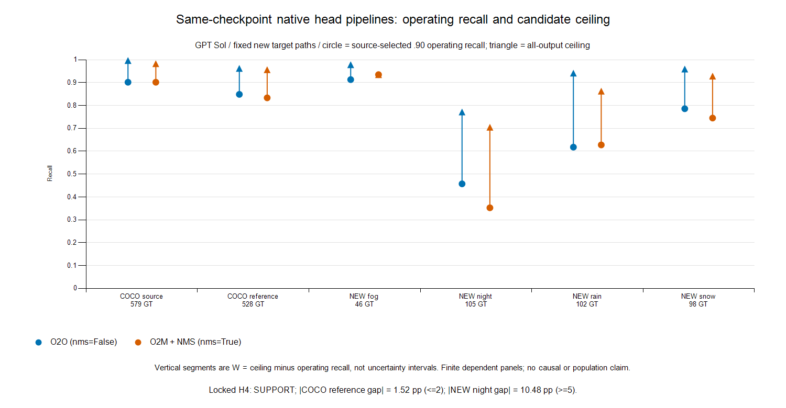

# Native YOLO26 head-pipeline transfer

**GPT Sol, 2026-11-11. H4: SUPPORT. G0 pending.** Both fresh head passes completed all 933 expected native image IDs (1,866 image-head evaluations); the owned L4 was released and verified. No further experiment, push, PR or merge followed. Independent Sol review is required before publication; I approve merges explicitly.

I want to test whether the two learned head pipelines transfer a source-selected recall boundary differently. GPT Sol froze the new panel/config, executed this experiment and prepared this report. Earlier model analyses retain their original attribution; this is new Sol empirical evidence.

The locked finite-panel screen requires both .90 source aspirations feasible, |COCO-reference head gap| ≤2 percentage points, and |NEW-night head gap| ≥5 points. Both feasible: **True**. Observed absolute gaps: **+1.52 pp** and **+10.48 pp**, respectively. This is not a statistical equivalence test. No objective, margin, condition, sampling or policy was changed in response to outputs; .80/.95 were omitted.

On new night, O2O recalled **48/105 (45.71%)** at **58 FP / 74 images = .784 FPPI**; O2M recalled **37/105 (35.24%)** at **37 FP / 74 = .500 FPPI**. The +11 TP comes with +21 FP. Source recall aspirations were matched, rather than FPPI.

The circles show operating recall; triangles show the finite candidate ceiling M. Their vertical difference is W=M−r, not an uncertainty interval. All paired adverse and normal-reference panels remain in the table and aggregate.

Frozen panel and pipeline

The original 256/256 COCO source/reference selections and eligibility were reused exactly. All 278 official ACDC adverse val image paths outside the prior 128-image development panel were selected without GT filtering: fog 68, night 74, rain 68, snow 68. The available annotated normal references contribute 34/41/35/33 unique paths. Each native path is counted once per panel; paired adverse rows are subsets, not extra inference.

These are previously unqueried target paths for this study, not independent scenes or guaranteed unseen pixels. Original annotations were inventoried; project-wide labels were not untouched. COCO source images are not verified clear/day, and pretrained checkpoint exposure remains possible. The task is COCO person versus explicitly merged ACDC person+rider human, with provisional crowd intersection/prediction-area ≥.50, IoU ≥.50 greedy matching, allow_outside coordinates and prospective zero-area outputs counted as FP. Raw native batches were saved before validation.

Both loads used official YOLO26s checkpoint SHA256 `646f8bc3fe0a656803d95c294f7852321748cb29d13466a1af8862e2db384a1b`, Ultralytics 8.4.197, native original-image predict/coordinates, imgsz1280, float32, batch8, rect=False, floor.0001, requested cap3000, classes=[0], no augmentation. Class-aware NMS IoU.70 applies to O2M; O2O uses its native NMS-free path. Common-canvas information-control geometry was not used.

| Head pipeline | Source threshold | Source feasibility / headroom (pp) | Box-branch calls through first batch O2O/O2M | Post-fusion O2O/O2M availability | Head max_det |
|---|---:|---|---:|---|---:|
| yolo26s_o2o | 0.0383278951 | FEASIBLE / 9.65 | 6/0 | True/False | 3000 |
| yolo26s_o2m | 0.0756601393 | FEASIBLE / 8.27 | 0/6 | False/True | 300 |

Before fusion, both learned box/class branches were present on each fresh load. First-batch module hooks, effective backend/head mode and the saved pinned AutoBackend/Detect/fusion/predict/NMS sources establish branch selection, rather than the API flag alone. O2O has an all-class head top-k before the downstream person/floor filter; O2M uses dense max-class selection, person filtering, max_nms=30000, class-aware NMS and the final cap. The head pipelines therefore have different candidate budgets/order. Native output clipping remains part of the pinned predictor; the evaluator did not repair boxes.

Hook counts include native warm-up and the first real batch. O2O's active head budget was 3000. O2M's `head.max_det=300` belongs to the inactive O2O postprocessor; its active NMS cap was 3000, reached on one source-selection image. The observed ceilings remain bounded by these finite policies; no uncensored candidate-completeness claim follows.

| Head | Native loop seconds | Emitted candidates | Maximum emitted/image | At requested cap3000 | Zero-area FP outputs |
|---|---:|---:|---:|---:|---:|
| yolo26s_o2o | 54.35 | 135649 | 2314 | 0 | 137 |
| yolo26s_o2m | 58.30 | 86202 | 3000 | 1 | 1585 |

Absolute counts and costs

Operating cells are **TP/FP; recall; FPPI**. M is candidate-ceiling TP/eligible GT; W is percentage points. All empty-human images are retained.

| Panel | Images / GT | O2O operating | O2M operating | O2O M; W | O2M M; W |
|---|---:|---|---|---|---|
| source_selection | 256 / 579 | 522/496; 90.16%; 1.938 | 522/345; 90.16%; 1.348 | 577/579; 9.50 | 569/579; 8.12 |
| coco_reference | 256 / 528 | 448/563; 84.85%; 2.199 | 440/400; 83.33%; 1.562 | 508/528; 11.36 | 505/528; 12.31 |
| fog | 68 / 46 | 42/68; 91.30%; 1.000 | 43/46; 93.48%; 0.676 | 45/46; 6.52 | 43/46; 0.00 |
| fog_paired | 34 / 20 | 20/30; 100.00%; 0.882 | 20/16; 100.00%; 0.471 | 20/20; 0.00 | 20/20; 0.00 |
| fog_normal | 34 / 53 | 35/41; 66.04%; 1.206 | 31/24; 58.49%; 0.706 | 49/53; 26.42 | 44/53; 24.53 |
| night | 74 / 105 | 48/58; 45.71%; 0.784 | 37/37; 35.24%; 0.500 | 81/105; 31.43 | 74/105; 35.24 |
| night_paired | 41 / 63 | 30/28; 47.62%; 0.683 | 21/19; 33.33%; 0.463 | 47/63; 26.98 | 43/63; 34.92 |
| night_normal | 41 / 199 | 128/167; 64.32%; 4.073 | 120/91; 60.30%; 2.220 | 162/199; 17.09 | 157/199; 18.59 |
| rain | 68 / 102 | 63/119; 61.76%; 1.750 | 64/68; 62.75%; 1.000 | 96/102; 32.35 | 88/102; 23.53 |
| rain_paired | 35 / 37 | 24/66; 64.86%; 1.886 | 25/36; 67.57%; 1.029 | 35/37; 29.73 | 32/37; 18.92 |
| rain_normal | 35 / 80 | 43/54; 53.75%; 1.543 | 41/36; 51.25%; 1.029 | 66/80; 28.75 | 59/80; 22.50 |
| snow | 68 / 98 | 77/127; 78.57%; 1.868 | 73/74; 74.49%; 1.088 | 94/98; 17.35 | 91/98; 18.37 |
| snow_paired | 33 / 54 | 46/62; 85.19%; 1.879 | 42/37; 77.78%; 1.121 | 52/54; 11.11 | 51/54; 16.67 |
| snow_normal | 33 / 137 | 84/102; 61.31%; 3.091 | 81/60; 59.12%; 1.818 | 107/137; 16.79 | 101/137; 14.60 |

For each panel, r_O2O−r_O2M = (M_O2O−M_O2M) − (W_O2O−W_O2M). Signed components below are percentage points. Shared/unique counts refer to evaluator-matched eligible GT at the all-output ceiling; equal aggregate ceilings would not imply identical covered objects.

On night, the count identity is `11 = (81−74) − [(81−48)−(74−37)] = 7−(−4)`. This is a descriptive decomposition, not causal attribution.

| Panel | Operating gap | Ceiling gap | W gap | Shared / O2O-only / O2M-only ceiling GT |
|---|---:|---:|---:|---:|
| source_selection | +0.00 | +1.38 | +1.38 | 569/8/0 |
| coco_reference | +1.52 | +0.57 | -0.95 | 499/9/6 |
| fog | -2.17 | +4.35 | +6.52 | 43/2/0 |
| night | +10.48 | +6.67 | -3.81 | 71/10/3 |
| rain | -0.98 | +7.84 | +8.82 | 87/9/1 |
| snow | +4.08 | +3.06 | -1.02 | 91/3/0 |

The aggregate also retains simple binary TP-ECE separately for emitted and operating predictions on source and every target panel. This prediction-conditioned diagnostic excludes ignored predictions; it is neither OCE nor LaECE and does not identify label-free recall or common misses.

One owned L4 allocation lasted **22.26 minutes** including retrieval/teardown at **1.94 CU/hour**. Displayed balance fell **0.69 CU**; wall-time × rate is approximately **0.720 CU**, not an invoice. The preallocation packet estimate was 29.62 minutes; the hard limit was 40 minutes, no top-up, under the 10-existing-CU envelope with 1.28 historical displayed CU and .30 reserve. There were 0 recorded failures. Final owned release verified: **True**.

Limits and next scientific decision

The contrast changes learned head weights, assignment history, candidate counts and postprocessing. It does not isolate NMS, architecture or a causal night effect. Scene/view dependencies, finite source selection, pretraining exposure, merged-human extent and provisional crowd policy limit interpretation. Normal/adverse pairing does not establish person identity. Human box recall/FPPI do not measure driving-task safety. No population inference, new method, novelty claim or G0 passage follows.

The next scientific decision is whether the +11 night TP difference is stable to source-boundary selection, using cached candidates in a separately specified study before further GPU spending. That analysis was not run here. First obtain the required independent Sol review; no additional compute is authorized by this note.

Reproducibility: base `c883688c641c021d2204d4555fbb689d122717b1`; [wrapper](../../experiments/2026-11-11_dual_head_transfer.py), [frozen config](../../configs/research/dual_head_transfer_20261111.json), [compact aggregate](2026-11-11_sol_dual_head_transfer.json). Packet 964,546,560 bytes / SHA256 `d88e9a53c4c64f38a87961971c1ae28334224bf532b31b922bd3ce430bc68167`; manifest `cd966fb75c2fd5bbbe65e2aa9f10d7071f5af5b481d8f60a9ba8a601711ca5ea`; config `047261b97be99cd3570cc8ffda06e9fd1d88cf92f9016f7b95fec1efc790e07c`. Executed wrapper `849d6cc2e920dca0a4181d40095a0ab8e0c99c4547d28882b8c5d59bcc6fd5bc`; aggregation wrapper `476055e11cab0c57d4311860384cd20d4157d83c9f9afd532680b71d273a0a44` (local aggregation/realized-limit summaries added; executed packet retained). Retrieved evidence `6fc04741497569f3b9e4531c38c89a91605530a456221a204c8f1abb20de44df`, 234 raw batch files; direct child exit 0 and complete per-head ID equality verified. The small manifest/class-map and wrapper parse checks passed; no full suite, local installs, local GPU, training, extra model or peer dialogue occurred. Raw images, boxes, IDs, controllers and logs remain ignored under `outputs/colab/dual_head_20261111/`.
