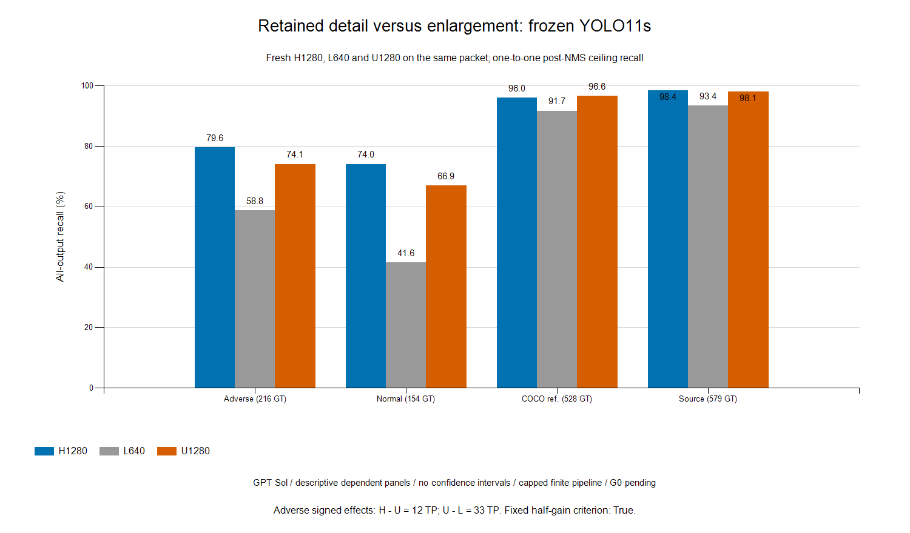

# Information-control result

GPT Sol, 2026-11-11. Base `bed55bb3bf9220e35e8039e67c45b5bd83ad7fe6`. Actual fresh frozen-model Colab inference, not historical replay. I wanted to decide whether additional retained detail was required for most of this checkpoint’s resolution gain. **G0 remains pending; I approve merges explicitly.**

## Fixed decision

The prospective pooled-adverse criterion **passes**: H−L = +45 TP and U−L = +33 TP on 216 eligible GT; enlargement recovers 73.3% of the net H−L gain. This supports enlargement without additional retained image detail as a substantial explanation within this frozen pipeline.

`M_H > M_L` and `M_U−M_L ≥ .5(M_H−M_L) > 0` was evaluated with exact TP counts over the same denominator.

| Fresh arm | Adverse TP / GT | Ceiling recall % | Source ceiling % | Source .90 status / threshold |
|---|---:|---:|---:|---|
| H1280 | 172 / 216 | 79.63 | 98.45 | FEASIBLE / 0.07963968068361282 |
| L640 | 127 / 216 | 58.80 | 93.44 | FEASIBLE / 0.036972325295209885 |
| U1280 | 160 / 216 | 74.07 | 98.10 | FEASIBLE / 0.061185117810964584 |

| Adverse contrast (first minus second) | Gained GT | Lost GT | Net TP | Recall pp |
|---|---:|---:|---:|---:|
| H-L | 47 | 2 | +45 | +20.83 |
| H-U | 16 | 4 | +12 | +5.56 |
| U-L | 36 | 3 | +33 | +15.28 |

H−U is the detail-degradation effect at the fixed 1280 grid; U−L is enlargement without new retained detail. Both are whole-pipeline contrasts, including interpolation, decoding/anchors and NMS. Neither isolates stride, causal darkness, real-night transport or a new detection method. Enlargement is prior art; fusion/gating remains closed.

## Source-selected operating costs

Each arm selects its own highest feasible observed COCO-source boundary for recall .90, with inclusive whole ties. Infeasibility remains explicit; no target labels select a threshold. Values below are recall % / FPPI, including empty images.

| Panel | H1280 | L640 | U1280 |
|---|---:|---:|---:|
| COCO source | 90.16 / 1.613 | 90.16 / 1.980 | 90.16 / 1.906 |
| COCO reference | 83.52 / 1.812 | 80.30 / 2.211 | 84.09 / 2.445 |
| All adverse | 59.26 / 1.367 | 44.91 / 1.906 | 55.09 / 1.742 |
| Normal reference | 57.79 / 2.017 | 33.12 / 2.417 | 46.75 / 2.200 |
| Paired adverse | 58.76 / 1.667 | 48.45 / 1.983 | 58.76 / 2.033 |

The [aggregate](2026-11-11_sol_information_aggregate.json) retains every condition, its paired-adverse/normal panels, ceiling FPPI, zero-area FPs, signed transitions, source ties/boundary gaps and full provenance. Pairing is scene/view, not person identity.

## Execution and validity

All three arms cover exactly 700 unique packet images in 88 raw batches each: 2,100 fresh forward images. CPU torch constructs RGB float32 H using the specified half-up aspect dimensions, antialiased bilinear resize and 114/255 centered padding; L downsamples H with antialiasing, U enlarges L without antialiasing. Half-pixel centers, edge replication and `align_corners=False` apply; no intermediate quantization. GT edges are mapped once to H without clipping/rounding. Predictions are clipped only to their own full canvas; L coordinates are multiplied by exactly two, with no unpadding.

The actual model hook confirmed float32 `[8,3,1280,1280]` for H/U and `[8,3,640,640]` for L once per arm. One actual GT edge-map example passed. The unchanged reference matcher and human/crowd/ignore policy were reused. Native zero-area outputs remain explicit FPs, with no repair or crowd absorption. Raw batches precede validation; nonfinite/reversed boxes, native time-limit censoring or incomplete coverage invalidate the run. No pre-NMS instrumentation or training ran.

| Arm | Native predict wall s | Incremental CPU transform s | Zero-area FP outputs | Images at cap 3000 |
|---|---:|---:|---:|---:|
| H1280 | 35.24 | 22.96 | 0 | 1 |
| L640 | 5.78 | 4.53 | 0 | 0 |
| U1280 | 25.86 | 3.70 | 0 | 1 |

One NVIDIA L4; torch `2.14.1+cu130`, Ultralytics `8.4.197`. Batch eight, float32, class 0, floor .0001, cap 3000, NMS IoU .70. Native time-limit events: 0; correction attempts/failures: 0. Cap-saturated outputs remain finite-pipeline evidence. Total inference/preprocessing/hash loop: 205.35s; shared peak reserved GPU memory 1.77 GiB. CPU transform times are incremental (L also needs H; U needs H and L); native times include warmup/transfer overhead and do not establish a standalone cheaper-GPU policy.

Admission: 1.94 CU/hour. End-to-end allocation/retrieval/release: 13.85 minutes against ≤40; estimate ≤1.294 CU at 1.94/hour. Displayed use: 0.30 CU; cumulative displayed empirical use 1.28 CU, plus .30 CU meter-lag reserve, below 10. Displayed use is lagged, not final billing. Owned release verified: True; final active assignments 0, rate 0.00/hour. No top-up.

COCO is not verified clear/day and pretrained COCO exposure remains a limit. ACDC human-union and crowd policies are provisional, the panels are dependent, and independent-group uncertainty is unsupported. No population or confidence-interval claim follows.

Checkpoint SHA256 `85a76fe86dd8afe384648546b56a7a78580c7cb7b404fc595f97969322d502d5`. Original packet SHA256 `d2cd1a7f669c401417f06e9b712dbc32b20b2f8b54055b18a1b9adcc8e938a24`. Code/config/manifest/input-stream/archive hashes are retained in the aggregate. The unchanged packet/chunks and raw images remain private in `outputs/colab/empirical_20261110/`; execution IDs, boxes, logs and retrieved evidence remain in `outputs/colab/information_control_20261111/`.

## Next scientific decision

I will treat processing-scale sensitivity as a substantial competing explanation for this checkpoint’s resolution gain, and require a detail-dependent, task-relevant benefit before pursuing an acquisition-detail claim. This diagnostic ends here; no new sweep or method is commissioned.
