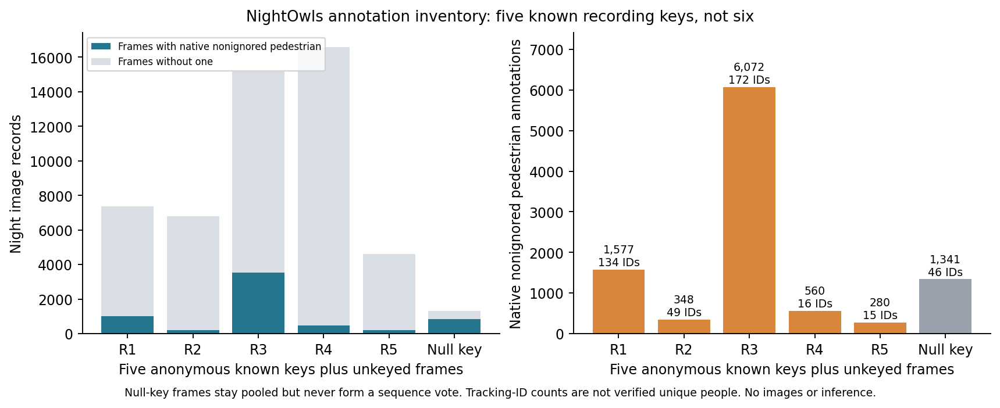

# NightOwls validation annotations acquired

I accepted the [publisher's conditions](https://www.nightowls-dataset.org/download/) and authorized private retrieval of validation annotations only. GPT Sol downloaded that JSON from the officially linked Oxford host on 2026-11-13. No dataset images, image-archive index, GPU operation or detector inference were acquired or run. Raw labels remain gitignored; public files contain nonrecoverable counts, schema names and provenance only.

The HTTPS response contained **10,696,948 bytes**, matching its Content-Length, and parsed successfully. SHA-256 is `584c0dc11f0d086fc5bcbaca0385cf2dd9794074f815f2727fbf9a093fd9a9b6`. This is a computed identity, not a match against a publisher checksum. The [acquisition record](../datasets/nightowls_validation_acquisition.json) retains response metadata and the authorization scope.

## Actual schema and support

The artifact contains **51,848 images and 17,091 annotations**. Explicit `daytime` values identify 51,846 night frames and two dusk frames. All image dimensions are 1024×640. There are **five non-null recording keys and 1,318 null-key frames**. GPT Sol initially counted the null bucket as a sixth recording; independent Opus review caught that error. The keys are not proof of independent trips or scenes, and null frames cannot be treated as one sequence. `timestamp` exists, but its units and a frame-cadence rule have not been adopted.

Native categories are pedestrian, bicycledriver, motorbikedriver and ignore. Night records contain **10,178 nonignored native pedestrian annotations**. Exactly **45,611 night frames have no nonignored native pedestrian annotation**; they must remain in any all-frame cohort and its FPPI denominator. These counts do not yet apply final height, difficulty, occlusion or extent rules. Recorded difficulty and occlusion fields include nulls, so they cannot be treated as simple Boolean defaults without inspecting the publisher convention.

The five known recording slots contain 1,577 / 348 / 6,072 / 560 / 280 native nonignored night pedestrian annotations; the null bucket contains 1,341. Distinct native tracking-ID counts are 134 / 49 / 172 / 16 / 15, with 46 distinct values in the null bucket. These are not verified unique people; the null bucket may combine unidentified sequences. Under the adopted height/occlusion eligibility, the known-key counts are 1,006 / 291 / 4,999 / 332 / 149 boxes and 53 / 39 / 143 / 13 / 11 tracking values; the null bucket has 872 boxes. Annotation and tracking counts do not establish independent observations.

All image/annotation IDs are unique in their respective tables, image and category references resolve, and every bbox has finite positive extents. **5,356 pose references do not resolve**; pose is unused and no repair is inferred. **2,231 boxes extend outside the image**, and all recorded areas equal bbox width×height. Nothing was clipped or repaired. These observations do not establish visible versus amodal extent. There are 1,358 nonignored night pedestrians shorter than 50 pixels, so absence of small-person labels cannot be assumed; completeness remains unknown.

The [inventory](../datasets/nightowls_validation_inventory.json) and [reproduction script](../../scripts/data/nightowls_annotation_inventory.py) retain exact counts and geometry checks. Run the script on the private JSON with `--output` pointing to a counts-only report; it never fetches images or imports a GPU library.

## Next decision

The licence and annotation-access prerequisites are satisfied for this authorized step. The [independent Opus review](../reviews/2026-11-13_nightowls_annotation_review.md) reproduced the counts and identified the null-key and wording errors now corrected. The [coordinator's policy decision](../decisions/2026-11-13_nightowls_external_policy.md) fixes null-key, dusk, eligibility and ignore/rider treatment before image proposals. A minimal adapter, its independent review, a fixed acquisition cohort and resource plan remain; no external execution is frozen and neither scoped nor original BDD-primary G0 passes. My annotation-only authorization does not extend to images or a GPU allocation.
