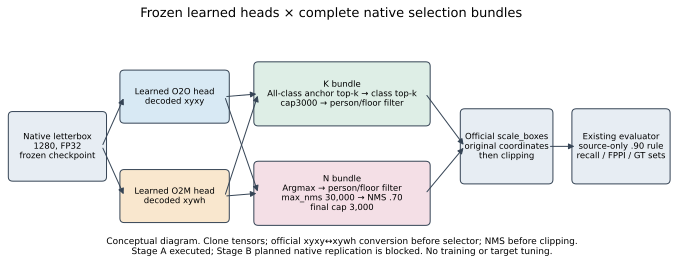
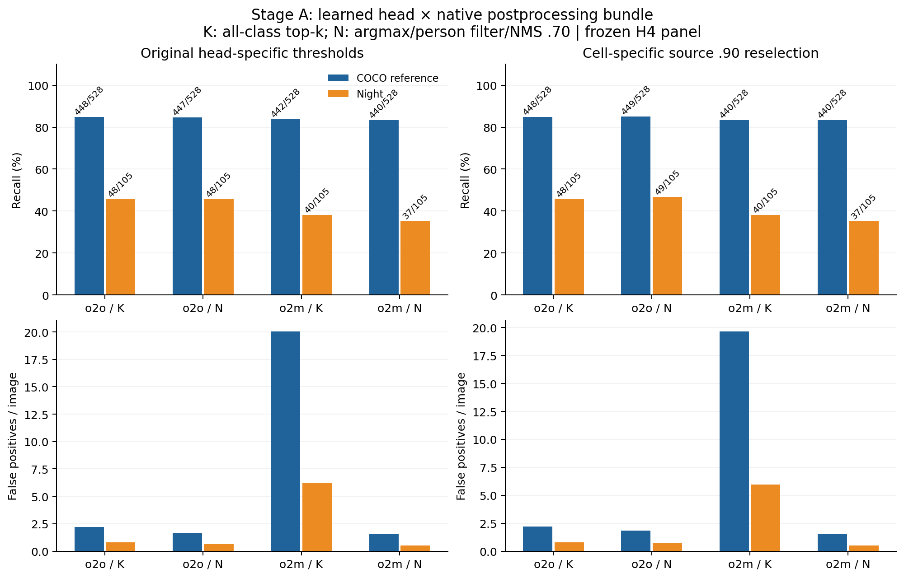

# Learned heads and native selection bundles

**GPT Sol, 2026-11-13. Stage A complete; Stage B incomplete/blocked. G0 pending.**

I want to distinguish learned-head associations from complete postprocessing-bundle effects. GPT Sol prespecified the contrasts before inference, executed the Stage A frozen-model study, and reused the existing evaluator. The [actual scientific exchange](2026-11-13_sol_head_policy_exchange.json) informed the direct/boundary distinction; it is not a publication review. A new independent Sol formal review is pending. My explicit approval still governs merges.

The unchanged H4 manifest contains 933 unique images. K is native all-class anchor/class top-k3000 followed by person/floor filtering. N is native argmax, person/floor filtering, max_nms30000, class-aware NMS .70 and cap3000. This intervenes on complete policy bundles. Official conversion handles O2O xyxy versus O2M xywh; selectors receive cloned tensors before official scale_boxes/clipping. Native1280, FP32, batch8, rect=False, floor .0001, checkpoint SHA256 `646f8bc3fe0a656803d95c294f7852321748cb29d13466a1af8862e2db384a1b` and Ultralytics8.4.197 are unchanged.

All four whole-tie source .90 selections are **FEASIBLE, 522/579 TP**; none is INFEASIBLE or UNDEFINED. Direct comparisons use each head's original numerical threshold (.0383278951 / .0756601393), retaining score-scale and source-selection confounding. Each cell is separately source-reselected; target labels score locked predictions only.

| Cell | Reselected source threshold | Night direct TP / FP | Night reselected TP / FP | Night ceiling TP / 105 |
|---|---:|---:|---:|---:|
| O2O / K | .0383278951 | 48 / 58 | 48 / 58 | 81 |
| O2O / N | .0319016241 | 48 / 46 | 49 / 53 | 75 |
| O2M / K | .0812533870 | 40 / 461 | 40 / 442 | 82 |
| O2M / N | .0756601393 | 37 / 37 | 37 / 37 | 74 |

At original thresholds, the O2O-minus-O2M night head contrast persists under K (**8 TP, 7.619 pp**) and N (**11 TP, 10.476 pp**). Night-minus-COCO-reference head contrasts are **6.483 / 9.150 pp**; source reselection gives **6.104 / 9.724 pp**. The night head×bundle interaction is −2.857 pp direct and −3.810 pp reselected. Head-associated operating differences persist under both bundles, while the native ceiling gap of seven TP shrinks to −1/+1 TP under common K/N. A learned-head-only account of that native ceiling gap is insufficient.

Within O2O, swapping K→N changes night TP/FP by **0/−12** directly, then **+1/+7** through source-boundary movement: total **+1/−5**. Within O2M, N→K gives **+3/+424**, then **0/−19**: total **+3/+405**. Exact TP/FP additive identities hold. Direct policy effects and source reselection explain different changes; the FP costs preclude a whole-frontier or matched-FPPI claim.

Native night operating sets are 37 shared/11 O2O-only/0 O2M-only; ten gains already occur below O2M's boundary. Common-K ceiling sets are 77 shared/4 O2O-only/5 O2M-only, versus common-N70/5/4. The aggregate retains all conditions, paired subsets, recall/FPPI and operating-discordance crosswalks against the other cell's ceiling.

All adverse conditions at the original head-specific thresholds follow. Each cell shows **recall; FPPI**; the [aggregate](2026-11-13_sol_head_policy_mechanism.json) also contains normal references, paired subsets and reselection results.

| Condition | Images / GT | O2O / K | O2O / N | O2M / K | O2M / N |
|---|---:|---:|---:|---:|---:|
| Fog | 68 / 46 | 91.30%; 1.000 | 91.30%; .838 | 93.48%; 6.147 | 93.48%; .676 |
| Night | 74 / 105 | 45.71%; .784 | 45.71%; .622 | 38.10%; 6.230 | 35.24%; .500 |
| Rain | 68 / 102 | 61.76%; 1.750 | 60.78%; 1.441 | 66.67%; 9.103 | 62.75%; 1.000 |
| Snow | 68 / 98 | 78.57%; 1.868 | 78.57%; 1.559 | 74.49%; 10.029 | 74.49%; 1.088 |

**Stage B has no completed expanded inference or results.** Its prespecified panel remains all ACDC train1600, annotated train800 references and unchanged COCO source/reference512. The first transfer failed with ConnectionResetError10054 on chunk1373/1383. One serial recovery lost its runtime404/401 at chunk198/1186; its retrieval failed after the runtime disappeared. No target result or Stage A favorability determined this stop. The GPT Sol coordinator ended transport development and further allocation after these repeated failures. Unrun streaming code was removed from the public implementation and preserved privately as unexecuted; no third allocation occurred.

Native replay against official predictor outputs is exact on all933 images: zero box/score error and exact classes/counts, with executed branch calls6/0 versus0/6 through the first batch. O2O's active head top-k is3000; O2M's head attribute300 is inactive on its dense path, whose final requested cap is3000. All recorded primary batches execute the intended branch. Peak allocated VRAM was1.421GiB.

Historical H4 TP/FP/ignored counts all reproduce after one original-final-batch correction. First-pass O2O snow-reference ceiling FP were6388 versus6391, with TP107 unchanged; all other operating/ceiling counts already matched. The two affected images belonged to H4's final batch5 but were rebatched into8. Replaying that original five-image batch once on both heads restored its original arrays exactly. Final unique coverage is **933×4=3732 image-cells**; ten extra image-head evaluations produced20 correction cells, with first-pass outputs retained. Counts exclude warmup.

These are separate comparisons: current-forward native selector replay is exact; corrected historical aggregate counts are exact; corrected original-final-five arrays are exact. The broader historical per-position array comparison exceeds the .002-pixel/1e-6-score replay tolerances. No permutation-invariant historical comparison was performed. Full cross-run tensor identity remains unresolved; the factorial's exact selector control uses the same new forward inputs.

Both owned sessions are verified stopped: receipts show zero active assignments/sessions. Total allocation was **5659.954s=94.333min**, displayed balance297.84→294.94CU (**2.90CU**). Elapsed time×admitted rate estimates **3.050086CU**, separately from the displayed meter. Both admissions were1.94CU/hour. The20CU/six-hour envelope was not exhausted. No GPU allocation, upload or inference occurred during CPU finalization.

Private evidence roots are `C:/Users/Advait/autonomous-sys-research/outputs/colab/head_policy_20261113/` and sibling `head_policy_20261113_recovery/`. The first retains `stage_A_evidence.tar.gz`, `correction_evidence.tar.gz`, combined `evidence_final.tar.gz`, `stage_A_first_pass_aggregate.json`, `correction_vs_original.json`, `historical_native_discrepancy.json`, `historical_output_controls.json`, `coverage_private.json`, executed scripts and per-batch outputs. Both roots retain `operation.json` and `controller_logs/`, including upload failures and teardown receipts. Sibling `head_policy_20261113_streamed/unexecuted_status.json` records preserved, unexecuted transport development. Exact artifact/source/config hashes and the two-attempt ledger are in the public aggregate; restricted images, boxes and IDs stay private.

Reproduce saved-output analysis on CPU with `experiments/2026-11-13_head_policy_mechanism.py finalize_saved PRIVATE --destination docs/gpt/2026-11-13_sol_head_policy_mechanism.json`, then the same script's `figures PRIVATE --destination ...`. PRIVATE is the first evidence root above; plotting uses its existing Matplotlib3.10.7 environment. No fresh inference is needed.

Base: `1a8c783`; [implementation](../../experiments/2026-11-13_head_policy_mechanism.py) and [frozen pre-output configuration](../../configs/research/head_policy_mechanism_20261113.json). The public aggregate contains counts and hashes, with no restricted per-image IDs or boxes. The original upload packet's3333-image inventory is prepared data; executed Stage A coverage is933 images.

This is finite-panel, same-checkpoint research. The head contrast retains score-scale and training-history confounding; released-checkpoint training provenance was not newly verified. COCO references are not verified clear/day. Merged ACDC person+rider GT, provisional crowd behavior, pretraining exposure and scene/view dependencies remain. Train/val recordings overlap; the uncompleted expanded panel would not establish independent-scene replication. No NMS-only, causal-darkness, novelty, safety or G0 claim follows.
