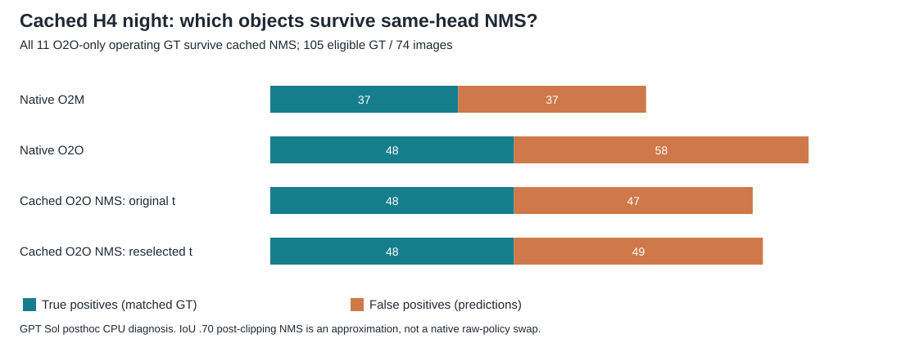

# Cached head-mechanism diagnosis

**GPT Sol, 2026-11-13. Posthoc finite-panel diagnosis, not unseen-test validation or formal publication review.** I want the overnight factorial to distinguish a direct policy-bundle effect from source-boundary movement. GPT Sol performed this CPU analysis of earlier GPT Sol inference; G0 remains pending.

Let A/B denote learned O2O/O2M heads and K/N the native top-k/NMS bundles. At each head's original source threshold, report head contrasts `R(A,p)−R(B,p)`, policy contrasts `R(h,K)−R(h,N)`, and their interaction; report night-minus-COCO-reference differences and FPPI alongside recall. Head-specific numerical thresholds retain score-scale confounding. For each cell, separately report `B=R(h,p,t*hp)−R(h,p,th)`: direct swap plus boundary movement equals total swap/reselection change exactly in TP/FP. Keep all conditions, infeasibility and native-control failures visible. Disappearance under a shared bundle contradicts a head-only explanation; an effect appearing only after reselection contradicts a direct-policy-only explanation. Persistence under both bundles supports a conditional head contrast, not a causal training/architecture claim. These contrasts were proposed before live factorial results, after H4 was known.

The [aggregate](2026-11-13_sol_mechanism_diagnosis.json) covers source, COCO reference, four adverse and four normal-reference panels, without duplicating paired subsets. Night operating matches are **37 shared, 11 O2O-only, zero O2M-only, 57 neither**. Ten of the eleven gains are already matched by O2M below its source threshold; only one is absent from its cached ceiling. All eleven COCO-reference O2O-only operating GT are also available below O2M's threshold. Operating discordance therefore differs from ceiling discordance: night ceiling sets are 71 shared/10 O2O-only/3 O2M-only/21 neither. Ceiling gains/losses are five/zero at height <32, five/two at 32–<96 and zero/one at ≥96; by native category they are four/two person and six/one rider.

Bins are posthoc descriptions fixed before this diagnostic: native GT height <32, [32,96), ≥96 pixels; maximum IoU with another eligible human 0, (0,.30), ≥.30; eligible humans/image 1, 2–4, ≥5; any positive intersection with an ignored/crowd human region; original person/rider category. Height is not distance, overlap is not occlusion, and category strata retain merged-human matching. Denominators <10 are flagged in JSON, including empty cells.

| Night stratum | GT | O2O-only operating gains |
|---|---:|---:|
| Height <32 / 32–<96 / ≥96 | 26 / 56 / 23 | 1 / 9 / 1 |
| Max eligible-GT IoU 0 / (0,.30) / ≥.30 | 93 / 12 / 0 | 9 / 2 / 0 |
| Eligible humans/image 1 / 2–4 / ≥5 | 14 / 65 / 26 | 3 / 5 / 3 |
| Intersects ignore/crowd: no / yes | 104 / 1 | 11 / 0 |
| Native person / rider | 88 / 17 | 10 / 1 |

One fixed IoU .70 greedy NMS was applied to cached O2O person outputs on source/reference/night (586 images). **All eleven extra night objects survive**, and the complete night operating and ceiling GT sets stay unchanged. At original threshold `.0383278951`, night remains 48 TP while FP fall 58→47; source TP fall 522→521. Source .90 reselection is feasible at `.0363650173`, restoring 522 source TP but leaving night at 48 TP/49 FP. Reference TP fall 448→447 and remain 447 after reselection. Night TP decomposition is `0 direct + 0 boundary = 0`; FP is `−11 + 2 = −9`. Native O2M remains 37 TP/37 FP. The existing gain is partly an FPPI tradeoff; these approximate points do not establish whole-frontier dominance.

This is **post-clipping cached NMS**, not native O2M reproduction: all-class top-k versus argmax/filter order, unretained candidates, preclip overlaps, active caps and native tensor formats remain different. The operator confirmed O2O xyxy versus O2M xywh and accepted the direct/boundary identity; [actual messages](2026-11-13_sol_mechanism_diagnosis.exchange.json) preserve the exchange without implied additional assent.

Next decision: use native-reproducing factorial cells to test bundle dependence; compare fixed-threshold effects before interpreting reselection. The approximation weakens a simple duplicate-suppression account of these eleven gains, but cannot identify the raw-bundle mechanism. Sparse overlap/crowd support precludes a crowding conclusion. Retain the unconditional expanded native train panel and its scene dependencies.

Reproduce with existing Python/numpy and `-B experiments/2026-11-13_cached_head_diagnosis.py ROOT PRIVATE`. ROOT is `C:/Users/Advait/autonomous-sys-research/outputs/colab/dual_head_20261111`; private rows/suppressions are under this checkout's ignored `outputs/cached_head_diagnosis_20261113/`. All 40 native operating/ceiling points reproduce saved TP/FP/ignored counts; strata close exactly, and all three direct/boundary count identities pass. Final execution used 23 panel matching passes and 6.92 CPU seconds; an initial execution before adding the availability crosswalk used 4.97 seconds. Both used identical bins/NMS and zero inference. Exact manifest, prediction, evaluator, script and private-evidence SHA256 values are in JSON. No downloads, installs, GPU or paid compute occurred.
