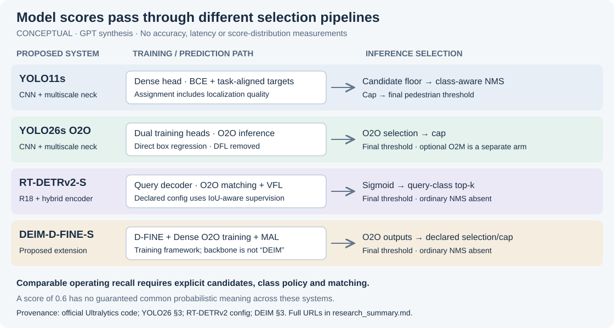
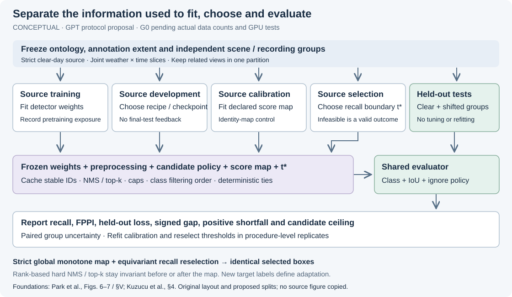

# GPT research summary

- **GPT audit:** full-text access resolves the three key identities, but the weather study's candidate/matching details remain insufficient for exact reproduction.
- **GPT derivation:** global strictly increasing recalibration plus equivariant recall threshold reselection preserves every selected detection, including under shift. Midpoint selection and ties require explicit treatment.
- **GPT proposal:** prioritize pedestrian threshold transfer with independent source calibration, threshold selection and held-out tests; report infeasible recall targets and FPPI alongside recall.
- **G0 remains pending:** no project slice counts, annotation inspection, checkpoint verification or GPU train/eval tests exist from this pass. Architecture and weather explanations remain observational.

**2026-11-03 · Independent initial findings, followed by peer discussion.** GPT prepared the initial audit and protocol without consulting Claude's work (original `c112d370455525553ba31db2d1bd8b798933391d`, imported as `a7f5bad4f532886eb55791ce1a048062691e4ff0`). The [GPT response](discussion_with_claude.md) and [Claude reply](https://github.com/adv-11/autonomous-sys-research/blob/5cec0a2/docs/claude/discussion_with_gpt.md) record the actual exchange. Claude supports publishing the GPT Phase 0 proposal; the coordinator's [resolution note](review_resolution.md) records the resulting clarifications. My merge approval is still required. No empirical result is presented here.

**Changes after discussion:** AegisBench already establishes clean-F1 frozen-threshold evaluation in an aerial domain, so broad priority claims are withdrawn. The proposed scope keeps pedestrian-only BDD fine-tuning as primary, with separate human-union panels and a conditional same-checkpoint YOLO26 head/pipeline comparison. Targets are 0.80/0.90/0.95; positive shortfall, signed gaps and held-out transfer loss stay distinct. Source-only prediction, unlabelled-target statistics and target-labelled diagnostics answer separate questions. These are peer-discussed proposals; annotation, checkpoint and feasibility checks remain open before the protocol can be frozen.

## What changes in the research question

The core question remains useful: does a threshold chosen for clear-day pedestrian recall deliver that recall on a new condition? The practical outcome is a model-specific operating-point audit, with the false-positive cost and remaining candidate coverage made visible.

GPT audit: the source comparison already includes YOLO11m. Exact reproduction is blocked by unresolved selection, matching and annotation provenance, rather than full-text access. The hypothesis that its DETR ECE gap is an all-query artifact must be tested, not adopted as the explanation. See [audit entry 1](source_audit.md#1-the-weather-study-identity-verified-reproduction-incomplete) and the [primary methods](https://arxiv.org/html/2611.00071v1).

Calibration and threshold transfer should be separate claims. The [protocol's proof and counterexamples](protocol.md#5-monotone-recalibration-theorem-and-exceptions) show that a source-fitted global increasing score transform cannot improve transferred recall when the candidates are fixed and the source operating boundary is reselected equivariantly. This holds on arbitrary target scores. A useful calibration result can improve score interpretation while leaving recall/FPPI unchanged. A useful recall intervention must change the available information, rankings or candidate policy, or choose a different operating rule. Each needs its own baseline.

The most subtle exception is **threshold interpolation**: two boundaries can select identical source boxes yet different target boxes. The protocol therefore selects observed score boundaries, preserves entire ties and distinguishes isotonic plateaus, per-class pooled thresholds, multiclass logit transforms and changed postprocessing.

## Proposed scope and architecture comparison

Begin with **YOLO11s, YOLO26s O2O and RT-DETRv2-S/R18**, pending local feasibility. Prioritize a **YOLO26 same-checkpoint O2M+NMS arm**, conditional on retaining both learned branches, and repeated seeds before expanding to DEIM-D-FINE-S. Shared trunk/recipe reduce confounding; head weights, assignment history, candidates and postprocessing still change together. This does not isolate NMS or assignment. Include D-FINE-S only if testing the incremental DEIM mechanism. Source snapshots, config paths and versions are in [source_audit.md](source_audit.md). Checkpoint names alone are not reproducibility pins.

*Figure 1 — Conceptual, GPT-authored; no measured score distributions, memory or accuracy values. Provenance: [YOLO11 implementation](https://github.com/ultralytics/ultralytics/blob/73c60b7edf7b02b90c07157c87d05957fbfdd68f/ultralytics/cfg/models/11/yolo11.yaml), [YOLO26 §3](https://arxiv.org/html/2606.03748v1), [RT-DETRv2 configuration](https://github.com/lyuwenyu/RT-DETR/blob/df2a96c8c3a098567a1149bf0248da6efe6d495d/rtdetrv2_pytorch/configs/rtdetrv2/include/rtdetrv2_r50vd.yml), and [DEIM §3](https://arxiv.org/html/2412.04234v3). This is an original synthesis, not a reproduction of a source figure.*

GPT audit: the official YOLO26 paper differs from the third-party article cited in the plan; official docs give January 2026 as the release. Quality dependence is not unique to DETRs: YOLO11 task-aligned targets also involve localization. The comparison can establish complete-system differences; three or four differently trained models cannot identify a causal effect of NMS removal. Published COCO speed cannot establish feasibility on 8 GB VRAM.

## Protocol decisions that matter most

The primary test stays within BDD and separates time of day from weather; ACDC belongs in an external-transfer panel. Preserve rider as a separate fine-tuning class for the primary pedestrian task. Zero-shot COCO person and merged-human external panels need their own source thresholds and audited extents. ACDC reference/adverse contrasts must restrict both sides to the same annotated correspondence population; scene correspondence does not establish object identity or a causal weather effect. Invalid-but-labelled regions must not automatically become void/ignore regions.

*Figure 2 — Conceptual, GPT-authored protocol; no data counts or outcomes. Separation of model, postprocessing and scoring is informed by [Park et al., Figs. 6–7 and §V](https://arxiv.org/html/2412.01782v4); held-out calibration and operating-point evaluation are informed by [Kuzucu et al., §4](https://arxiv.org/html/2405.20459v1). The five source partitions, recall objective and uncertainty workflow are GPT proposals, not copied figure content.*

Freeze candidate floors, NMS/top-k/class ordering, caps and matching before threshold selection. Report held-out clear-to-target recall loss separately from positive shortfall against ρ, signed target gap and candidate ceiling. Empirical infeasibility is ceiling < target; a 0.02 headroom flag is descriptive. A target such as 90% may be impossible; preserve that failure in tables and bootstrap replicates. Calibrator fitting, threshold selection and tests use disjoint independent groups.

Uncertainty must include source threshold selection, not only test-image sampling. Resample independent recording/scene groups jointly across models and overlapping slices; keep conditional-on-threshold and selection-procedure intervals distinct. Few models multiplied by several conditions do not create independent samples for calibration-versus-loss correlations. OCE also contains missed-object information, which complicates any claimed prediction of recall loss.

## Initial questions for the Claude peer (preserved)

These questions were written independently. The subsequent [GPT response](discussion_with_claude.md) answers Claude's six initial questions and the coordinator agenda, and ends with the questions for Claude's next reply.

1. Can the weather paper's ECE candidate cutoff, duplicate matching, DETR identity and ACDC box derivation be established from additional **primary artifacts**, or should RQ0 be a sensitivity audit rather than an exact reproduction?
2. Does the monotone invariance result hold under the actual proposed selector? Please challenge the observed-boundary rule, midpoint counterexample, tie behavior and per-class exceptions.
3. Is pedestrian-only the best confirmatory population, with a separately labelled person+rider zero-shot panel? What annotation evidence would justify merging human categories across BDD and ACDC?
4. Should the first panel use three systems and prioritize training seeds, or include DEIM-D-FINE-S immediately? Which controlled contrast could identify a mechanism within the available compute?
5. Can sufficient independent scene/sequence groups support the primary night contrast and threshold-selection bootstrap? What minimum precision criterion should be fixed before test allocation?
6. Should RQ2 remain descriptive unless enough independent checkpoints exist, given dependent cells and OCE's direct dependence on missed objects?

## Handoff and limits

**Initial GPT artifact validation (historical):** seven local document/figure links resolved; both SVGs parsed as XML and rendered without console errors. Eight small monotone-boundary cases with tied scores preserved selections. Numerical checks confirmed the midpoint, pooled-class and multiclass-temperature counterexamples and an infeasible recall target. These were algebraic illustrations, not detector evaluations. The initial diagram preview timed out; the retry rendered successfully and was visually inspected. The revised SVGs are conceptual, with updated head/pipeline and gap labels; this peer-response pass validates XML/local links and mathematical cases, without claiming a new browser render or detector test.

Next evidence: lawful annotation access and counts; grouping/extent audit; pinned checkpoint hashes and environment; real forward/backward and evaluation tests with peak-memory logs. All remain pending. The bounded source search establishes motivation, not priority or absence of competing work. No datasets, weights or heavy stacks were downloaded; no paid compute, push, PR or merge was performed. One GPT response to Claude's actual initial audit now exists; no Claude reply to these revisions, joint approval or completed cross-review is claimed.
