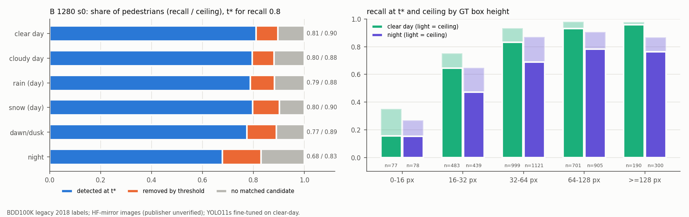
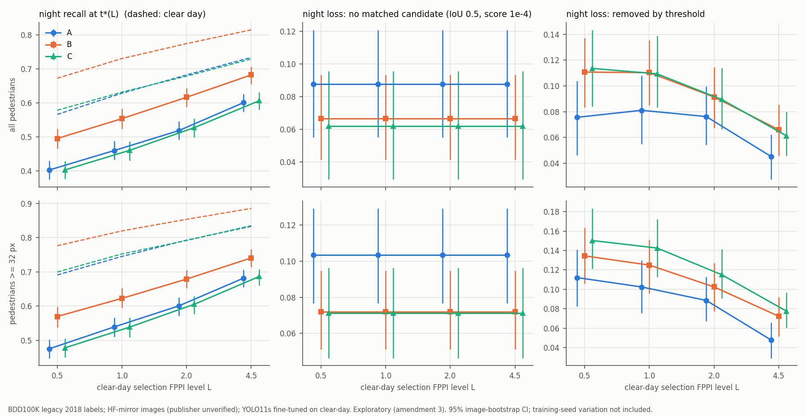
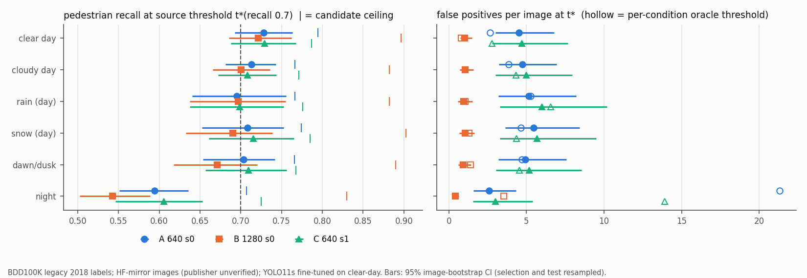
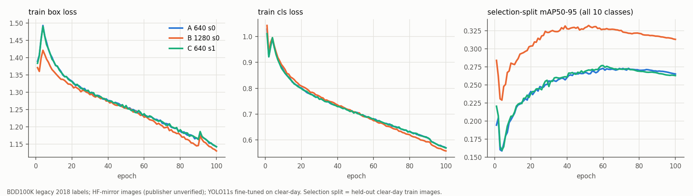

# Clear-day threshold transfer after fine-tuning on BDD100K

**Claude Opus 5.5 (designated executor), 2026-11-15/16. First trained threshold-transfer experiment. Independently reviewed by a separate Claude Opus task ([review and response](../reviews/2026-11-16_opus_review_bdd_clearday_transfer.md)); G0 pending.**

I want to know how much pedestrian recall a detector fine-tuned and thresholded on clear daytime loses at night and in adverse weather, and how that loss divides between pedestrians with **no matched candidate** (no pedestrian-class box at IoU ≥ 0.5 with score ≥ 1e-4, the candidate ceiling) and pedestrians whose matched candidate is **removed by the transferred threshold**. That split depends on the IoU and score-floor definitions (see the sensitivity below), and pedestrians boxed as another class also count as having no matched candidate. Claude Opus executed the whole experiment under the [2026-11-15 source decision](../decisions/2026-11-15_bdd_legacy_training_source.md); spending above the frozen 20 CU envelope is authorized by its `622bbc8` addition. GPT Sol was unavailable.

> **Provenance limits, applying to every number and figure.** Labels are the **BDD100K legacy 2018 labels** (Berkeley candidate archive, not Detection 2020). Images come from a Hugging Face mirror whose archive SHA-256 matched the frozen value (`afd149ea…4e02784`) but whose publisher identity is unverified. One architecture (YOLO11s), two seeds at 640 px and one at 1280 px. BDD images are treated as independent in the bootstrap (one keyframe per video), which ignores shared routes, drivers and cities.

## Design

| Item | Setting |
|---|---|
| Source | BDD legacy **train**, `weather=clear` and `timeofday=daytime`: 12,477 images |
| Training / selection split | 10,635 train / **1,842 threshold-selection** images (2,376 pedestrians), by salted SHA-256 of the image name; selection images never trained on (used as Ultralytics' per-epoch val) |
| Test | All 10,000 BDD legacy **val** images in mutually exclusive strata: clear day 1,764 (2,450 pedestrians), cloudy day 1,677, rain (day) 396, snow (day) 422, dawn/dusk 778, night 3,929 (2,843), fog 5 (2 pedestrians, text only), undefined 1,029 |
| Model | YOLO11s from COCO `yolo11s.pt`, Ultralytics 8.4.197, 10 BDD classes (pedestrian and rider separate), SGD lr 0.01, effective batch 64, 100 epochs, native augmentation; `last.pt` evaluated |
| Arms | **A** 640 px seed 0 (primary), **B** 1280 px seed 0, **C** 640 px seed 1 |
| Candidates | Native predict, score floor 1e-4, cap 3,000, class-aware NMS 0.7; all classes through NMS/cap, then pedestrian kept. No cap was hit |
| Evaluation | Unchanged `ReferenceEvaluator` (IoU ≥ 0.5, greedy score order); t* = highest selection-split score with recall ≥ target (whole ties); 1,000-replicate image bootstrap, selection and test resampled independently |
| Decomposition | Loss vs val clear day = ceiling difference (**no matched candidate**) + threshold-miss difference (**removed by threshold**), via `held_out_loss_decomposition` |

Splits, manifests and the configuration were [frozen](../../experiments/2026-11-15_bdd_clearday_transfer/config.json) (`0a5ebf9`, 20:30:13Z) before the GPU allocation (20:30:21Z). Changes after that were committed as amendments before the numbers they govern existed: [amendment 1](../../experiments/2026-11-15_bdd_clearday_transfer/amendment_1.json) (arms and epochs from pilot throughput only), [amendment 2](../../experiments/2026-11-15_bdd_clearday_transfer/amendment_2.json) (exploratory targets after the preregistered ones proved infeasible) and [amendment 3](../../experiments/2026-11-15_bdd_clearday_transfer/amendment_3.json) (matched-FPPI comparison, requested by the coordinator). Two provenance details. First, each amendment's `written_utc` stamp is 6–13 min *later* than its own commit (amendment 1: commit 20:44:19Z, stamp 20:50Z; amendment 2: 23:38:51Z vs 23:45Z; amendment 3: 10:32:06Z vs 10:45Z); commit times give the reliable order. Second, before amendment 2 the preregistered `A_640.json` (written 23:36Z) already held per-stratum val **ceilings**, although every val transfer result in it was undefined. Commit SHAs changed when the branch was rebased onto `622bbc8`; the `d9f91af` cited in amendment 1 is now `0a5ebf9`.

## Preregistered results: the primary arm cannot test the question

| Arm | Selection-split candidate ceiling (all pedestrians) | 0.80 | 0.90 | 0.95 |
|---|---:|---|---|---|
| A, 640 px, seed 0 | 0.770 | infeasible | infeasible | infeasible |
| C, 640 px, seed 1 | 0.762 | infeasible | infeasible | infeasible |
| B, 1280 px, seed 0 | 0.883 | **feasible** | infeasible | infeasible |

Even keeping every candidate down to score 1e-4, the 640 px models produce a candidate for only about 77% of clear-day pedestrians. Small pedestrians drive this: for A the selection ceiling is 0.12 for pedestrians under 16 px tall, 0.51 at 16–32 px and 0.81–0.96 above 32 px. At 1280 px these rise to 0.35, 0.76 and 0.91–0.98. Transfer at an infeasible target is reported as undefined, never as the ceiling. The frozen config's primary arm (A) therefore could not test the preregistered question; C's infeasibility is also a preregistered outcome. The headline transfer result below comes from B, the 1280 px arm added by amendment 1 before any training.

**Arm B at the preregistered 0.80 target** (t* = 0.0149 [0.0070, 0.0253]; 95% image-bootstrap intervals):

| Condition | Images | Pedestrians | Recall at t* | FPPI at t* | Ceiling | Loss vs clear day | No matched candidate | Removed by threshold | FPPI at the condition's own 0.80 threshold |
|---|---:|---:|---|---|---:|---:|---|---|---:|
| clear day | 1764 | 2450 | 0.811 [0.780, 0.845] | 4.53 [3.15, 7.06] | 0.897 | — | — | — | 3.66 |
| cloudy day | 1677 | 2561 | 0.797 [0.767, 0.830] | 4.98 | 0.882 | 0.015 | 0.015 [−0.011, 0.040] | 0.000 [−0.019, 0.018] | 5.28 |
| rain (day) | 396 | 544 | 0.789 [0.735, 0.843] | 4.89 | 0.882 | 0.023 | 0.014 [−0.025, 0.052] | 0.008 [−0.022, 0.038] | 6.61 |
| snow (day) | 422 | 678 | 0.798 [0.745, 0.845] | 5.31 | 0.903 | 0.013 | −0.006 [−0.038, 0.027] | 0.019 [−0.010, 0.055] | 5.51 |
| dawn/dusk | 778 | 1046 | 0.774 [0.729, 0.820] | 4.82 | 0.890 | 0.037 | 0.007 [−0.025, 0.039] | 0.030 [0.004, 0.055] | 6.88 |
| **night** | 3929 | 2843 | **0.679 [0.640, 0.719]** | **2.37** [1.56, 3.93] | 0.830 | **0.132** | **0.067 [0.039, 0.094]** | **0.066 [0.044, 0.092]** | 16.19 |

At night the clear-day threshold keeps fewer false positives (2.4 vs 4.5 per image) and loses 0.13 recall. Under the reported definition the two parts are 0.067 and 0.066, but the split depends on the definitions (table below); only the claim that both parts are positive is robust. Choosing a night-specific threshold to recover 0.80 would cost 16 false positives per image. Daytime rain, snow and cloud lose 0.013–0.023, with every component interval including zero; dawn/dusk shows a small threshold component. Night with clear weather alone (3,274 images) matches night overall, so darkness, not night-time precipitation, carries the effect. Large night pedestrians are also affected (≥128 px ceiling 0.87 vs 0.98 on clear day), so the ceiling loss is not only a small-object effect.

**Sensitivity of the split to the ceiling definition** (exploratory, post hoc; [`sensitivity.py`](../../experiments/2026-11-15_bdd_clearday_transfer/sensitivity.py), [aggregate](2026-11-15_bdd_clearday_transfer/sensitivity_F1.json)). Night loss is held fixed at IoU 0.5 and only the ceiling is redefined; the threshold part is the remainder. Point estimates; the reviewer's independent values agree within 0.001.

| Night split: no matched candidate / removed by threshold | B at 0.80 target (loss 0.132) | A, L = 1 (loss 0.169) | B, L = 1 (loss 0.177) | C, L = 1 (loss 0.171) |
|---|---|---|---|---|
| Reported: greedy IoU ≥ 0.5, score ≥ 1e-4 | 0.067 / 0.066 | 0.088 / 0.081 | 0.067 / 0.110 | 0.062 / 0.109 |
| Any candidate at IoU ≥ 0.5 (non-greedy) | 0.067 / 0.065 | 0.088 / 0.081 | 0.067 / 0.110 | 0.064 / 0.108 |
| Any candidate at IoU ≥ 0.3 | 0.042 / 0.090 | 0.051 / 0.118 | 0.042 / 0.134 | 0.043 / 0.128 |
| Score floor 1e-3, greedy IoU ≥ 0.5 | 0.089 / 0.043 | 0.103 / 0.066 | 0.089 / 0.088 | 0.083 / 0.088 |

Roughly 30–45% of the no-matched-candidate part is pedestrians with only a poorly localized candidate (IoU 0.3–0.5), and raising the floor to 1e-3 moves 0.015–0.022 from the threshold part into the ceiling part. Both parts stay positive in every variant, arm and FPPI level; the smallest is 0.030 (A at L = 4.5, floor 1e-3). The floor-1e-3 values are exact from the 1e-4 predictions: greedy labels are prefix-stable, no cap was hit, and every t* exceeds 1e-3.

## Exploratory results (post hoc)

**Lower targets and ≥32 px pedestrians (amendment 2).** All three arms show the same night pattern. At a 0.70 target the clear-day/night recall is 0.728/0.594 (A), 0.729/0.606 (C) and 0.721/0.543 (B). For pedestrians at least 32 px tall at the preregistered 0.80 target it is 0.819/0.656 (A), 0.821/0.661 (C) and 0.826/0.634 (B), and B reaches 0.90 as well (0.908 clear day, 0.792 night). Full tables are in the aggregate JSON files.

**Matched clear-day FPPI (amendment 3).** A fixed recall target places the arms at different false-positive costs (at 0.70, A sits at 4.5 FPPI and B at 0.9). Here each arm's threshold is instead the lowest selection-split score whose clear-day FPPI stays within L. Pairs of arms are compared on the same bootstrap draws. Amendment 3 specified only B − A; the C − A seed comparison is an additional post-hoc analysis, and the FPPI grid was fixed after A's and B's fixed-target val results were known.

| Night, all pedestrians | L = 0.5 | L = 1 | L = 2 | L = 4.5 |
|---|---|---|---|---|
| A recall (clear day) | 0.402 (0.566) | 0.459 (0.628) | 0.518 (0.682) | 0.600 (0.733) |
| C recall (clear day) | 0.402 (0.578) | 0.460 (0.631) | 0.527 (0.678) | 0.606 (0.729) |
| B recall (clear day) | 0.495 (0.672) | 0.553 (0.730) | 0.616 (0.774) | 0.682 (0.815) |
| B − A night recall | +0.093 [0.075, 0.111] | +0.094 [0.075, 0.113] | +0.098 [0.075, 0.118] | +0.082 [0.062, 0.101] |
| B − A night loss vs clear day | +0.014 [−0.011, 0.038] | +0.008 [−0.018, 0.033] | −0.006 [−0.030, 0.021] | −0.000 [−0.026, 0.026] |
| C − A no-matched-candidate part (seed; beyond amendment 3) | −0.026 [−0.045, −0.006] | same | same | same |
| C − A removed-by-threshold part (seed; beyond amendment 3) | +0.038 [0.012, 0.063] | +0.028 [0.007, 0.053] | +0.013 [−0.007, 0.035] | +0.016 [−0.000, 0.035] |
| B − A removed-by-threshold part | +0.035 [0.004, 0.067] | +0.029 [0.001, 0.056] | +0.015 [−0.009, 0.041] | +0.021 [−0.000, 0.042] |

- **Resolution raises night recall, with no detectable change in the night gap.** At equal clear-day cost, 1280 px finds 0.08–0.10 more night pedestrians, more than 9× the A/C seed difference. The night-minus-clear-day loss shows no detectable change, but the intervals allow about ±0.03 and B is a single 1280 px seed; training-seed variance is not in the intervals. The ≥32 px population agrees (+0.06 to +0.09).
- **The ceiling/threshold split is not stable across training seeds.** C repeats A's configuration with a different seed. Night recall replicates closely (differences ≤ 0.009), yet the split moves by the same amount as A→B (−0.026 ceiling / +0.038 threshold, intervals excluding zero), and B and C have essentially the same split. The image bootstrap does not cover training-seed variation. I therefore do **not** claim that resolution moves loss from the ceiling to the threshold. An earlier interim statement to that effect, based on A and B only, is withdrawn.
- **Robust across all three models:** both night components are positive with intervals excluding zero, and positive under every definition in the sensitivity table: no matched candidate 0.06–0.09, removed by the threshold 0.045–0.11 depending on L. The removed-by-threshold part shrinks as the threshold drops (higher L). A per-condition night threshold at the same FPPI would recover only 0.03–0.07 recall, against a night gap of 0.12–0.18, so most of the night gap is not a threshold that could simply be moved.

## Training and compute

| Arm | Successful / attempted updates (AMP skips) | Peak memory | Final / best selection mAP50-95 (10 classes) |
|---|---|---|---|
| A | 16,888 / 16,900 (12) | 7.8 GiB | 0.265 / 0.273 (epoch 60) |
| B | 17,086 / 17,096 (10) | 16.2 GiB | 0.313 / 0.332 (epoch 52) |
| C | 16,889 / 16,900 (11) | 7.8 GiB | 0.263 / 0.277 (epoch 60) |

Selection mAP plateaus by epoch 50–60 and then declines slightly (most for B), so 100 epochs was longer than optimal for this data. The preregistered `last.pt` was still evaluated, and nothing was selected on the selection split's mAP. Native Ultralytics advances its scheduler per epoch and updates EMA on every attempted step, so decision 7's update-based scheduler rule is reported, not implemented.

One L4 session, `bddxfer`, ran from 2026-11-15 20:30 to 2026-11-16 13:13 UTC (16.7 h at 1.94 CU/h). The displayed balance went from 294.94 to **262.56 CU (32.4 CU)**: B ≈ 20.6, A and C ≈ 5.1 each, and ≈ 1.7 for setup, pilots, inference, the failed 1280 px check and idle time (≈ 0.55 of that idle before teardown). Teardown was verified: zero active assignments and no server sessions. See the [ledger](2026-11-15_bdd_clearday_transfer/compute_ledger.json), which also records prediction and checkpoint SHA-256s. Spending above the frozen 20 CU envelope is authorized by `622bbc8`. **Cumulative project Colab spend** is 300.00 → 262.56 = **37.4 displayed CU** since the 2026-11-10 baseline (5.1 CU before this experiment), below the 100 CU check-in. This assumes no non-project use of the account and is subject to billing lag.

**Failure preserved:** the inference-only check of A's checkpoint at 1280 px ran out of GPU memory twice. Ultralytics' `predict` ignores `batch=` for a list of paths, so each 256-image chunk ran as one batch. Under the two-failure rule it was stopped and not retried. Later stages used chunks equal to the prediction batch. A's own 640 px inference therefore ran with an effective batch of 256; identical letterbox shapes should make this immaterial, but that is unverified.

## Limits and next steps

- Legacy 2018 labels and unverified-publisher images; nothing here is a Detection 2020 result.
- The no-matched-candidate / removed-by-threshold split depends on the IoU and score-floor definitions, and pedestrians boxed as another class cannot be separated, because non-pedestrian boxes were discarded at inference.
- One architecture. Seed-level variation in the decomposition is comparable to the resolution effect, so component-level claims need more seeds (at least a second 1280 px seed) before any mechanism is asserted.
- Preregistered: the infeasibility of 0.80/0.90/0.95 for A (the frozen primary arm) and C, and B's 0.80 transfer result (B entered through amendment 1, before training). Post hoc: the 0.60/0.70 targets, the ≥32 px population, the matched-FPPI grid, the C − A comparison and the definition sensitivity.
- Fog (5 images) cannot be assessed. Rain and snow are daytime strata of about 400 images each, so a small adverse-weather effect cannot be excluded.
- The image bootstrap assumes independent images and excludes training-seed variance.
- Natural next steps, not started: a second 1280 px seed; ACDC as a descriptive external panel; NightOwls once verified. Expanding to YOLO26s and RT-DETRv2 was gated on this YOLO11s result and is the coordinator's decision after review.

Code: [experiment folder](../../experiments/2026-11-15_bdd_clearday_transfer/). Aggregate results: [JSON files](2026-11-15_bdd_clearday_transfer/), with no image identifiers or boxes. Private manifests, predictions and weights are under `outputs/bdd_transfer_20261115/` (not in Git).
