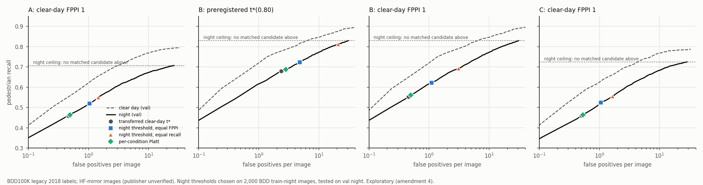

# Night threshold remedies, a second 1280 px seed and an ACDC panel

**Claude Opus 5.5 (designated executor), 2026-11-17/18. Exploratory follow-up to the [BDD clear-day transfer report](2026-11-15_bdd_clearday_transfer.md) (PR #13). Not yet reviewed; G0 pending.**

I want to know whether the night recall lost at a transferred clear-day threshold can be recovered by choosing the threshold differently, and at what false-positive cost. The part with no matched candidate cannot be recovered by any threshold. [Amendment 4](../../experiments/2026-11-15_bdd_clearday_transfer/amendment_4.json) (`0b8909e`) fixed the remedies, calibration data and Colab stage before any number existed. Everything here is exploratory and post hoc.

> Same provenance limits as PR #13: **BDD100K legacy 2018 labels**, Hugging Face mirror images (archive SHA-256 verified; publisher unverified), one architecture (YOLO11s), image bootstrap without training-seed variance.

## Remedies and calibration data

- **Equal-FPPI night threshold:** the lowest night-calibration score whose night FPPI stays within the clear-day budget (the clear-day selection FPPI at t*).
- **Equal-recall night threshold:** the highest night-calibration score whose night recall reaches the source recall target.
- **Platt scaling** `p = σ(a·logit(s) + b)`, fitted on TP/FP candidates:
  - **Global** (fitted on the clear-day selection split): strictly increasing, so reselecting the threshold selects the same detections. Its recovery is exactly zero by construction.
  - **Per condition:** the night threshold is the raw score whose night-calibrated probability equals the clear-day calibrated probability at t*.
- **Calibration data:** 2,000 BDD legacy **train** images with `timeofday = night`, the first by salted SHA-256 ([record](../../experiments/2026-11-15_bdd_clearday_transfer/nightcal_manifest_record.json); 1,226 pedestrians; none trained on, since training was clear-day only). Test data: all 3,929 BDD val night images. A val-night split-half proxy, computed before the Colab inference existed, gave the same pattern ([proxy aggregates](2026-11-17_threshold_remedies/)).
- **Intervals:** 1,000-replicate image bootstrap, with selection, calibration and test images resampled independently and thresholds and Platt maps refitted in every replicate.

## Results: a threshold can move along the night curve, not onto the clear-day curve

Night test values; Δ is relative to the transferred clear-day threshold; 95% intervals.

| Arm, operating point | Transferred night recall / FPPI | Threshold part | Equal-FPPI: Δrecall, night FPPI | Equal-recall: Δrecall, night FPPI | Per-condition Platt: Δrecall | No matched candidate (unrecoverable) |
|---|---|---|---|---|---|---|
| A, clear-day FPPI 1 | 0.459 / 0.46 | 0.081 | +0.060 [+0.042, +0.079], 1.04 | +0.091 [+0.038, +0.149], 1.47 | +0.004 [-0.006, +0.016] | 0.088 |
| A, clear-day FPPI 4.5 | 0.600 / 2.79 | 0.045 | +0.033 [+0.023, +0.048], 4.94 | +0.069 [+0.023, +0.105], 9.30 | +0.007 [-0.002, +0.019] | 0.088 |
| C, clear-day FPPI 1 | 0.460 / 0.50 | 0.109 | +0.065 [+0.042, +0.085], 1.06 | +0.095 [+0.042, +0.151], 1.65 | +0.004 [-0.007, +0.015] | 0.062 |
| C, clear-day FPPI 4.5 | 0.606 / 3.00 | 0.061 | +0.033 [+0.021, +0.045], 4.74 | +0.056 [+0.003, +0.099], 6.77 | +0.012 [+0.001, +0.025] | 0.062 |
| B, t*(0.80), preregistered | 0.679 / 2.37 | 0.066 | +0.044 [+0.031, +0.062], 4.79 | +0.133 [+0.086, +0.170], 20.96 | +0.009 [+0.002, +0.022] | 0.067 |
| B, clear-day FPPI 1 | 0.553 / 0.46 | 0.110 | +0.068 [+0.051, +0.088], 1.10 | +0.139 [+0.092, +0.198], 3.11 | +0.007 [-0.003, +0.017] | 0.067 |
| B, clear-day FPPI 4.5 | 0.682 / 2.48 | 0.066 | +0.045 [+0.031, +0.060], 4.96 | +0.133 [+0.088, +0.156], 22.37 | +0.008 [+0.001, +0.018] | 0.067 |
| B2, t*(0.80), preregistered | 0.696 / 3.26 | 0.052 | +0.036 [+0.021, +0.054], 5.49 | +0.100 [+0.049, +0.149], 17.22 | +0.005 [-0.006, +0.015] | 0.068 |
| B2, clear-day FPPI 1 | 0.573 / 0.54 | 0.077 | +0.043 [+0.026, +0.061], 1.09 | +0.116 [+0.063, +0.165], 2.92 | -0.003 [-0.014, +0.007] | 0.068 |
| B2, clear-day FPPI 4.5 | 0.688 / 2.83 | 0.053 | +0.039 [+0.025, +0.053], 4.83 | +0.103 [+0.052, +0.139], 15.09 | +0.002 [-0.009, +0.015] | 0.068 |

- **Equal-FPPI** spends the clear-day false-positive budget at night. It recovers 0.03–0.07 recall, which is 53–87% of the threshold part (the threshold-removed loss relative to clear day), at the clear-day FPPI. It is the only remedy that does not cost more false positives than clear day already accepts.
- **Equal-recall** reaches the recall target at night, but the night operating curve is flat near its ceiling. For B at the preregistered 0.80, night recall rises from 0.679 to 0.813 while FPPI rises from 2.4 to 21.0. At clear-day FPPI 1 it costs 1.0–2.7 extra FPPI.
- **Platt per condition** recovers at most 0.012 (≤ 20%). Equal calibrated confidence keeps the night threshold close to the transferred one, which is consistent with night lowering TP and FP scores similarly (not tested directly). **Global Platt** recovers nothing, as it must.
- **Unrecoverable:** 0.06–0.09 recall at night has no matched candidate (IoU 0.5, score ≥ 1e-4). This bound depends on the definition, per the PR #13 sensitivity.
- **Mechanism, descriptively:** at every FPPI the night curve lies below the clear-day curve. Any single-threshold remedy trades false positives for recall along the night curve. Closing the gap needs better night candidates or scores, not a better threshold.

## B2: a second 1280 px seed

B2 repeats B's configuration with seed 1 (100 epochs, 17,086/17,096 successful updates, last.pt evaluated). It is evaluated with B's preregistered protocol: selection-split t\* at recall 0.80, val strata, image bootstrap.

| 1280 px run | Selection ceiling | t*(0.80) | Clear-day recall / FPPI | Night recall [95% CI] / FPPI | Night loss | No matched candidate | Removed by threshold |
|---|---|---|---|---|---|---|---|
| B (seed 0) | 0.883 | 0.0149 | 0.811 / 4.53 | 0.679 [0.640, 0.719] / 2.37 | 0.132 | 0.067 [0.039, 0.094] | 0.066 [0.044, 0.092] |
| B2 (seed 1) | 0.880 | 0.0105 | 0.816 / 5.48 | 0.696 [0.652, 0.743] / 3.26 | 0.119 | 0.068 [0.039, 0.096] | 0.052 [0.029, 0.078] |

| Paired night difference at clear-day FPPI 1 | Night recall | Night loss | No matched candidate | Removed by threshold |
|---|---|---|---|---|
| B2 − B (1280 px seed) | +0.019 [+0.001, +0.037] | -0.033 [-0.055, -0.009] | +0.001 [-0.014, +0.018] | -0.034 [-0.056, -0.010] |
| C − A (640 px seed) | +0.001 [-0.015, +0.015] | +0.003 [-0.015, +0.024] | -0.026 [-0.045, -0.006] | +0.028 [+0.007, +0.053] |
| B − A (resolution, seed 0) | +0.094 [+0.075, +0.113] | +0.008 [-0.018, +0.033] | -0.021 [-0.044, +0.004] | +0.029 [+0.001, +0.056] |
| B2 − A (resolution, mixed seeds) | +0.113 [+0.095, +0.132] | -0.025 [-0.049, +0.002] | -0.020 [-0.047, +0.005] | -0.005 [-0.031, +0.023] |

- **B's preregistered result replicates.** B2 is feasible only at 0.80 (ceiling 0.880), transfers to night at 0.696 recall against 0.816 on clear day, and both night components are positive with intervals excluding zero.
- **Seed variation is about 0.03 at both resolutions, but in different components.** At 640 px the two seeds share the total night loss and move its split (C − A). At 1280 px they share the no-matched-candidate part and differ in the threshold part and the total (B2 − B, −0.034). The image bootstrap does not capture this; it is the dominant unquantified uncertainty in the PR #13 decomposition.
- **The resolution gain in night recall holds for both 1280 px seeds** (+0.094 and +0.113 vs A). Whether the night *gap* changes stays unresolved: B − A is +0.008 and B2 − A is −0.025, both with intervals including zero.
- **The B2 remedies** match A/B/C (rows above): equal-FPPI +0.036 to +0.062, equal-recall +0.100 at 17.2 FPPI for the 0.80 target, per-condition Platt ≈ 0.

## ACDC: descriptive external panel

ACDC was downloaded inside Colab directly from the ACDC package API (unauthenticated token endpoint; archive SHA-256 checked against [our manifest](../datasets/acdc_archive_manifest.json)). Nothing was uploaded from this PC. All 3,009 labelled images were used: 2,006 adverse plus 1,003 annotated normal references.

- **Population:** non-crowd `person` boxes are the pedestrian GT. Crowd boxes are ignore regions under the provisional `acdc_iscrowd_v1_provisional` policy. Riders stay a separate class.
- **Thresholds:** the BDD selection thresholds, unchanged. B/B2 at the preregistered t\*(0.80) are shown below; the A/C exploratory thresholds are in the [aggregate](2026-11-17_threshold_remedies/acdc_panel.json).
- **Intervals:** bootstrap clusters are GoPro recordings, only 4–6 per condition, so intervals are omitted here.

| ACDC stratum (images / pedestrians) | Recording clusters | B ceiling | B recall / FPPI at BDD t*(0.80) | B2 ceiling | B2 recall / FPPI at BDD t*(0.80) | A ceiling | C ceiling |
|---|---:|---:|---|---:|---|---:|---:|
| fog adverse (500 / 236) | 6 | 0.814 | 0.708 / 1.30 | 0.805 | 0.733 / 1.64 | 0.631 | 0.644 |
| fog reference (250 / 298) | 6 | 0.614 | 0.550 / 2.78 | 0.617 | 0.574 / 3.57 | 0.386 | 0.389 |
| night adverse (506 / 817) | 4 | 0.576 | 0.477 / 3.08 | 0.624 | 0.542 / 4.56 | 0.436 | 0.433 |
| night reference (253 / 997) | 4 | 0.635 | 0.595 / 9.76 | 0.660 | 0.625 / 12.59 | 0.467 | 0.483 |
| rain adverse (500 / 369) | 4 | 0.783 | 0.680 / 4.96 | 0.772 | 0.678 / 5.00 | 0.545 | 0.599 |
| rain reference (250 / 476) | 4 | 0.655 | 0.559 / 5.81 | 0.655 | 0.586 / 7.32 | 0.431 | 0.445 |
| snow adverse (500 / 753) | 6 | 0.814 | 0.738 / 4.77 | 0.834 | 0.750 / 6.79 | 0.564 | 0.602 |
| snow reference (250 / 826) | 6 | 0.613 | 0.544 / 7.46 | 0.603 | 0.554 / 9.56 | 0.381 | 0.378 |

- **Cross-dataset shift dominates.** At the BDD t\*(0.80), B/B2 recall on ACDC is 0.48–0.75 across all strata, and only 0.54–0.63 on the normal-daytime references. The ACDC labels, camera and resolution (1920×1080) differ from BDD's.
- **Adverse vs reference is not a clean weather contrast here.** The references have *lower* ceilings than fog, rain and snow because they are different frames with denser, smaller pedestrians (for example night references: 997 pedestrians on 253 images). Night is the one condition where adverse sits below its reference for every run.
- **The 1280 px runs raise ceilings everywhere** (for example fog adverse 0.63–0.64 at 640 px vs 0.81 at 1280 px). The two 1280 px seeds differ by up to 0.065 in night-adverse recall.
- This panel answers no preregistered question and supports no adverse-weather claim. It is descriptive context for a later contract like Sol's NightOwls one.

## NightOwls: raw predictions only

At the coordinator's request, and under GPT Sol's preregistered contract (`docs/research/2026-11-17_nightowls_external_contract.md` on branch `gpt-nightowls-external-contract`, commit `d59e2186`; under independent review), the NightOwls validation archive was downloaded **directly inside Colab** from the publisher URL. It took 330 s (16 ranged parts, no retries), and the archive matched Sol's local reference exactly: 57,481,286,834 bytes, SHA-256 `6663dc50…fcf9d`. Nothing was uploaded from this PC.

Raw candidate predictions were generated for A and C at 640 px and B and B2 at 1280 px, the inference sizes the contract specifies (B2 is outside the contract's A/B/C scope). Candidate policy and NPZ format are unchanged from BDD: floor 1e-4, cap 3,000, class-aware NMS 0.70, FP32, pedestrian class kept after the cap.

- **Coverage:** every one of the 51,848 archive PNGs (1024×640), decoded from the verified ZIP without extraction. The 51,782-image cohort is a subset and is filtered at evaluation.
- **Cap hits:** none.
- **Hashes:** retrieved and checked against the remote summaries; recorded in the [stage-2 ledger](2026-11-17_threshold_remedies/compute_ledger_stage2.json).

**No NightOwls metric has been computed.** Evaluation waits for the contract review and the coordinator's go-ahead.

## Compute

| Stage (2026-11-18 UTC) | CU (time × 1.94) |
|---|---:|
| Setup (BDD mirror SHA-256 verified in 77 s), uploads (3.8 MB packet, 3 × 19 MB checkpoints) and night-calibration inference | 0.20 |
| B2 training, with NightOwls (330 s) and ACDC (1,402 s) direct downloads running concurrently | 20.66 |
| B2, ACDC and NightOwls inference | 2.63 |
| Idle before automated retrieval and stop | 0.44 |
| **Session `bddxfer2`, 07:45–20:05 (12.3 h)** | **≈ 23.9; displayed 200.00 → 176.52 = 23.48** |

- **Stage limit:** within the 30 CU stage limit, with teardown verified (0 assignments, 0.00/h, no server sessions).
- **Balance anomaly:** stage 1 ended at 262.56 CU and stage 2 began at 200.00 CU with no Claude-owned session in between. The round value suggests an account-level change rather than compute use, but that is unverified.
- **Cumulative Claude-owned Colab spend:** 5.06 + 32.38 + 23.48 = **60.9 displayed CU**, below the 100 CU check-in.
- **Failures:** no Colab stage failed. One local ordering error (the ACDC evaluation was launched before B2's threshold file existed) failed once on CPU and was rerun.

## Limits

- Exploratory and post hoc throughout (amendment 4); none of these remedies was preregistered in the frozen config.
- The calibration set is BDD train night, the same camera fleet and label policy as the test. A deployed system would need its own night calibration labels, and the 2,000-image set is small: equal-recall intervals are wide (±0.05).
- Single architecture; the B2 seed check addresses only the 1280 px arm.
- The image bootstrap ignores training-seed variance and shared routes, drivers and cities.
