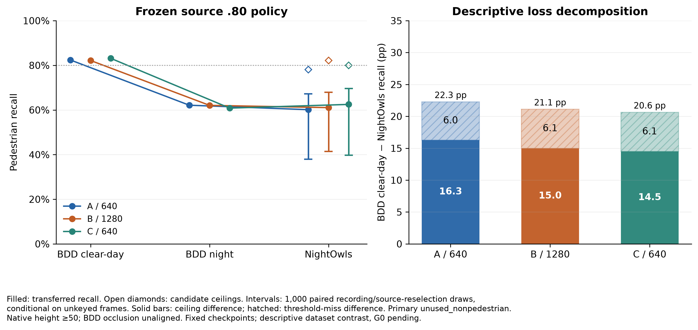
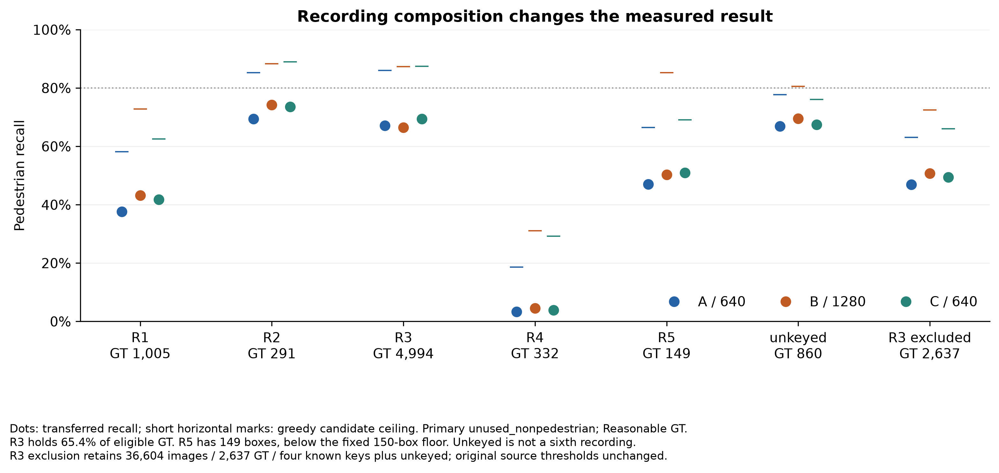

# First frozen NightOwls threshold-transfer results

I want this external panel to measure how my frozen BDD source policies transfer,
including failures and dependence on recording composition. **GPT Sol performed
this CPU scoring on 2026-11-23** from `c922cdac`, which contains merged policy
`5251312`. The saved inference is historically attributed to **Claude Opus 5.5**
in the stage-2 ledger; that attribution is not a new verification or review.
No model was loaded and no new inference, GPU work, download or installation
was performed. **G0 remains pending; no novelty claim is made.**

The [v1 contract](2026-11-17_nightowls_external_contract.md), superseding
[v2 amendment](2026-11-18_nightowls_contract_v2.md) and exact
[BDD reference thresholds](2026-11-18_nightowls_v2_bdd_reference.md) were frozen.
V1 predates predictions; v2 was fixed during prediction generation, before
scoring. Height-aligned source reselection remains post hoc on BDD. A/B/C are
the entire primary panel; B2 is outside this contract.

## Measured external answer

Primary: BDD native-height ≥50 source selection, target .80, transferred unchanged
to NightOwls Reasonable GT under **`unused_nonpedestrian`**. The cohort contains
**51,782 images / 7,631 eligible GT**, including **42,316 natively empty frames**,
five known recording keys and **1,304 unkeyed frames / 860 GT**. The exact 64 pilot
frames and two dusk frames are excluded. Eligible GT are category-1, not ignored,
native unclipped height ≥50 and occluded not true; null visibility follows the
frozen SDK convention. Empty and ignored-only frames remain in FPPI.

| Run | Recall | FPPI | Precision | Candidate ceiling | Misses: no greedy match / threshold removed |
|---|---:|---:|---:|---:|---:|
| A / 640 | 60.14% | 0.6943 | 11.32% | 78.06% | 1,674 / 1,368 |
| B / 1280 | 61.05% | 0.1787 | 33.48% | 82.22% | 1,357 / 1,615 |
| C / 640 | 62.50% | 0.8869 | 9.41% | 80.016% | 1,525 / 1,337 |

The BDD ≥50 clear-day reference recalls are 82.40/82.17/83.12%, giving losses of
**22.27/21.11/20.63 percentage points** for A/B/C. Relative to the separate BDD
night comparator, NightOwls recall is lower by 1.99/1.01 points for A/B and
**higher by 1.67 points for C**. These populations are not interchangeable.

A's target .80 oracle is **infeasible** at the frozen candidate floor. B and C
reach 6,105/7,631 at diagnostic target-selected thresholds
0.00041072125895880163 and 0.000101788122265134, costing **34.69 and 45.88 FPPI**.
C's ceiling has only one TP above that minimum. Oracles use these target labels;
they are not deployment estimates. Targets .90/.95 are oracle-infeasible for all
three runs. A/C source .95 is infeasible, so its transferred operating point
remains undefined. Source infeasibility is never replaced by a ceiling.
All original, low-target and h32 exploratory policies
remain separately labelled in the aggregate.

The fixed .90 source policies give **70.00/70.95/74.12%** recall at
**8.22/1.87/14.26 FPPI**. Only B has a feasible .95 source policy: **78.40%**
recall at **22.50 FPPI**. These are sensitivity results, not replacement policies.

The primary loss split is 16.28/15.00/14.49 points of ceiling difference plus
5.98/6.12/6.14 points of threshold-miss difference. This interpretation depends
on the definition: under fixed any-candidate IoU≥.30, B/C ceiling differences
are 9.32/9.03 points and residual threshold parts are **11.79/11.59 points**.
Operating recall is unchanged. Greedy floor1e-3 and any-IoU≥.50 diagnostics,
signed subgroup components and nulls are retained. Floor1e-3 decomposition is
not applicable at B's .95 source threshold below 1e-3. “No greedy match” includes
localization, competition and pipeline selection; it does not establish absence
of an object or a causal failure mechanism.

## Recording dependence and uncertainty

All intervals below are descriptive 2.5/97.5 percentiles from **1,000 paired
draws, seed 20261117**, with independent BDD source reselection and clear-test
resampling. All primary source draws were feasible; each displayed recall
interval has 1,000 defined replicates. Source-infeasible policies elsewhere
retain their counts and undefined transfer intervals.

| Target resampling mode | A recall interval | B recall interval | C recall interval |
|---|---:|---:|---:|
| Five-key, fixed unkeyed (primary) | 37.93–67.26% | 41.42–67.90% | 39.76–69.63% |
| Known-key-only | 22.88–67.30% | 26.98–67.61% | 26.52–69.86% |
| R3-out, fixed unkeyed | 34.06–65.52% | 36.81–69.51% | 35.79–68.44% |
| IID images (sensitivity) | 57.66–62.48% | 57.94–63.90% | 59.88–65.24% |

Paired primary recall contrasts (point [interval], percentage points):
A−B -0.92 [-5.53, +1.77]; A−C -2.36 [-4.35, -0.98]; B−C -1.44 [-4.07, +2.49]. These condition on the trained checkpoints.

Target .80 oracle feasibility was **349/618/493 of 1,000**
recording draws for A/B/C; oracle intervals use only feasible draws and
report infeasible/zero-GT counts. This does not change observed feasibility.
The five-key draw space has only **126 distinct multisets**; 119 occurred,
and R3 was omitted in **336/1,000** draws (theoretical probability .32768).
Lumpy recording support and unverified trip independence limit interpretation.
Pooled and R3-out intervals condition on fixed unkeyed frames; IID-image
intervals may be anti-conservative under video correlation. Nominal coverage
has not been established.

R3 contains **4,994 GT (65.4%)**. Its fixed exclusion retains **36,604 images /
2,637 GT**, four known keys and all unkeyed frames. Recall becomes
**46.87/50.74/49.41%**, with FPPI **0.4244/0.0984/0.5751**; all .80 target oracles
are then infeasible. This sensitivity does not replace the pooled estimand.

Joint A/B/C ceiling coverage is **512/236/3,933/39/81 GT** under R1–R5, satisfying
the fixed ≥10 rule for five known keys. No sequence-majority claim is tested.
R5's **149 eligible boxes** fail the unchanged 150-box operational floor.
Distinct eligible native tracking-value counts are **53/39/143/13/11**, plus
36 unkeyed; they are not verified counts of unique people. Per-recording results
and support flags remain visible under every reported policy/profile.

## Scope, validation and review

The ignore sensitivity **`person_compatible_ignore`** uses 9,421 absorbing regions
versus 2,520 primary regions. It preserves recall and reduces primary-policy FPPI
to **0.6546/0.1537/0.8387** through absorption, without a detector change.
Both profiles retain ignored-candidate totals. Four SDK-inspired eligibility
setups and native/model-input height bins are reported with full-population
matching assignments; zero-support bins are undefined. On Reasonable_small,
recall is **65.15/62.94/63.98%**, reversing B's pooled advantage over A.

BDD lacks the occlusion metadata needed to align Reasonable visibility. Label
completeness, box extent, image composition and ignore rules also differ, so
FPPI is annotation-policy-dependent and the clear-reference contrast is not a
causal night effect. At equal native height, NightOwls objects are 1.25× taller
in model-input pixels than BDD objects for each run. Resize ratios follow the
saved uniform original shapes and frozen letterbox configuration; padded tensor
shapes were not logged and are explicitly marked derived. Neither height
stratification nor the fixed inference sizes remove these confounders.

GPT Sol retained **24 real-data fast/reference equivalence checks**, using a
fixed 1/17 image sample plus every zero-area-candidate image in each arm/setup/
profile. Exact per-GT scores, TP/FP/ignored counts, thresholds and oracles agree.
The unchanged BDD matcher reproduced every stored source threshold and the
decisive ≥50 clear/night TP reference points. One final bounded pass checked
**2,376 aggregate rows**, 43 weighted operating points,
24 height-interval comparisons, image pairing, source infeasibility,
candidate accounting, miss identities, cap counts and public JSON privacy.
These are implementation checks on actual saved predictions, not independent
review or synthetic detector evidence. All required analyses completed.
Point scoring took **18.11 CPU wall-minutes**; bootstrap took
**7.93 wall-minutes**. Scoring used Python 3.12.14 /
NumPy 2.5.4; the earlier BDD reference used NumPy 2.2.6. Exact point
reproduction was checked; historical bootstrap intervals were not claimed
reproduced with the external joint seed.

Complete counts-only results are in losslessly compressed
[point aggregates](2026-11-23_nightowls_evaluation/aggregate.json.gz) and
[uncertainty/paired contrasts](2026-11-23_nightowls_evaluation/uncertainty.json.gz).
Readable CSVs cover [source policies](2026-11-23_nightowls_evaluation/source_policies.csv),
[recordings](2026-11-23_nightowls_evaluation/recordings_primary.csv),
[eligibility](2026-11-23_nightowls_evaluation/eligibility_primary.csv),
[height](2026-11-23_nightowls_evaluation/heights_primary.csv) and
[paired contrasts](2026-11-23_nightowls_evaluation/contrasts_primary.csv).
Additional measured figures show [height strata](2026-11-23_nightowls_evaluation/height_sensitivity.png)
and the [bootstrap distribution](2026-11-23_nightowls_evaluation/bootstrap_distribution.png);
all four figures also have editable SVGs. The [receipt](2026-11-23_nightowls_evaluation/receipt.json),
[validation record](2026-11-23_nightowls_evaluation/validation.json) and
[reproduction instructions](../../experiments/2026-11-23_nightowls_evaluation/README.md)
preserve versions, hashes, checks and commands. Restricted evidence, exact
per-image/GT scores, recording mapping, paired draws and executed source copies
remain in canonical ignored `outputs/nightowls_evaluation_20261123/`.

**Required next step:** a separate independent reviewer task must inspect this
commit, the frozen contracts, actual private evidence, fast/reference equivalence,
source reselection, pairing, feasibility/null handling and exported results.
No review assent is claimed or inferred. No outcomes were sent to the active
RT-DETR study task. My explicit GitHub approval remains required for any merge.
