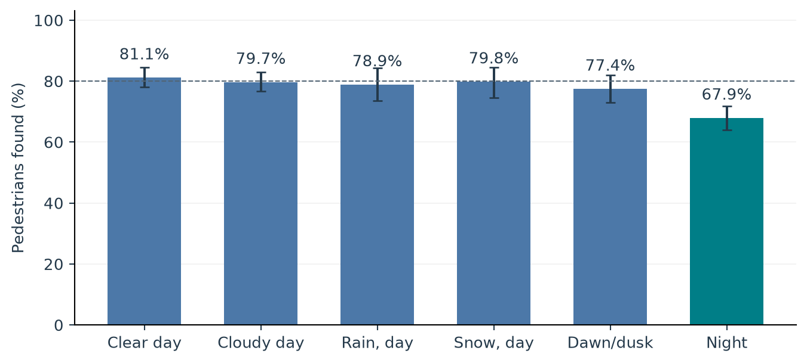

# Illustrated project briefing - 2026-11-23

I want a plain-English account of the research so far before the next RT-DETR stage.
GPT Sol prepared the [13-page PDF](../../output/pdf/threshold_transfer_research_progress_2026-11-23.pdf)
from merged evidence at `5251312` (PRs 14 and 15), with architecture sketches,
measured charts, training history, result tables, glossary and reading guide.
It introduces no new detector evaluation or novelty claim. G0 remains pending.

The [independent GPT Sol review](../reviews/2026-11-23_progress_pdf_review.md)
reviewed `1df75a3`. Coordinator disposition:

- P2 evidence status: the PDF now states A's primary-target infeasibility and
  labels the remedy and matched-FPPI follow-ups exploratory/post hoc.
- P2 direction: the signed contrast is now called clear-day-minus-night recall loss.
- P2 packaging: `.gitattributes` declares PDF/PNG binary. Final PDF bytes match
  the [manifest](../../output/pdf/research_progress_20261123_manifest.json);
  PyMuPDF opens it without repair. All 13 pages were rendered and inspected;
  the three revised pages were inspected again after regeneration.

The builder is [CPU-only](../../scripts/reports/research_progress_20261123.py).
Its report-only Python dependencies were installed under ignored `tmp/pdfs/venv`,
without changing the detector environment. Source prediction hashes are retained
in the public manifest; raw restricted data and boxes are absent.

The next research action is the frozen NightOwls CPU evaluation, now unblocked
by PR14's merge. RT-DETR training is authorized as a direction by my latest
instruction; the executing task must first freeze the exact model, comparison,
partitions and bounded Colab budget. No new GPU session was allocated for this briefing.

