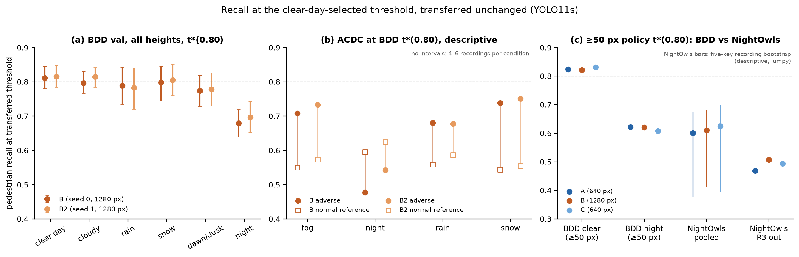
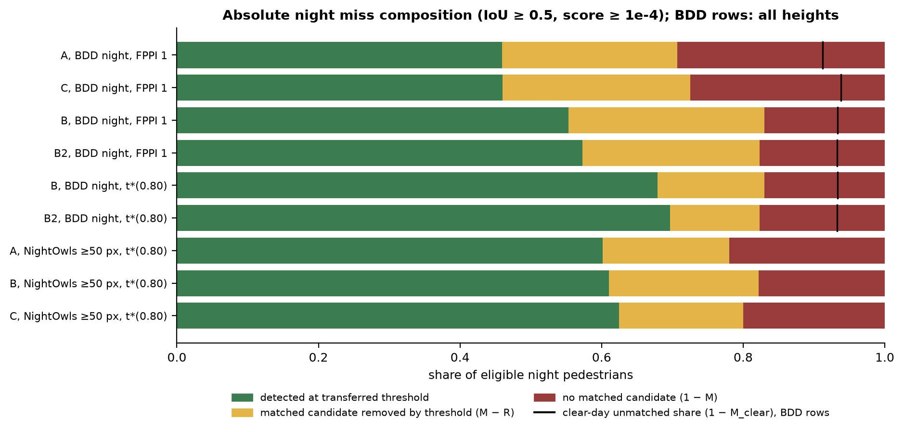
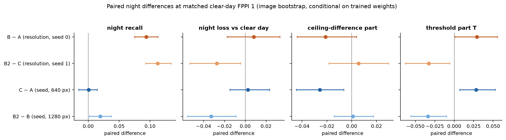
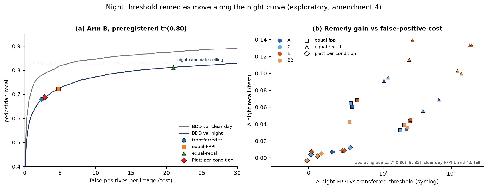

# Clear-day confidence thresholds under night and adverse-weather shift: a YOLO11s synthesis

**Claude Opus 5.5, 2026-11-23. Synthesis draft of merged results only (PRs #13–#17); no new experiment, inference or recomputation.** Every number below is copied from the cited merged report or aggregate. The four figures are re-plotted from committed counts-only aggregates by [`scripts/reports/threshold_transfer_synthesis_figures.py`](../../scripts/reports/threshold_transfer_synthesis_figures.py). The underlying experiments were executed by Claude Opus 5.5 (BDD training, remedies, ACDC, NightOwls inference) and GPT Sol (NightOwls contract v2, BDD ≥50 px reference, NightOwls CPU scoring); that attribution is historical, and this synthesis adds no verification. The RT-DETR extension is paused and is not covered. **G0 remains pending.** This is a draft for review, not a claim of novelty.

**Sources** (cited by key throughout; paths relative to `docs/research/`):

| Key | Source | PR |
|---|---|---|
| [T] | [2026-11-15_bdd_clearday_transfer.md](2026-11-15_bdd_clearday_transfer.md), including its 2026-11-18 erratum; aggregates in [2026-11-15_bdd_clearday_transfer/](2026-11-15_bdd_clearday_transfer/) (`B_1280.json`, `matched_ABC_all.json`, `sensitivity_F1.json`) | #13 |
| [T-rev] | [../reviews/2026-11-16_opus_review_bdd_clearday_transfer.md](../reviews/2026-11-16_opus_review_bdd_clearday_transfer.md) | #13 |
| [R] | [2026-11-17_threshold_remedies.md](2026-11-17_threshold_remedies.md); aggregates in [2026-11-17_threshold_remedies/](2026-11-17_threshold_remedies/) (`remedies_trainnight_{A,B,C,B2}.json`, `B2_1280.json`, `matched_ABCB2_all.json`, `acdc_panel.json`) | #15 |
| [R-rev] | [../reviews/2026-11-18_sol_review_threshold_remedies.md](../reviews/2026-11-18_sol_review_threshold_remedies.md) | #15 |
| [V2] | [2026-11-18_nightowls_contract_v2.md](2026-11-18_nightowls_contract_v2.md) | #14 |
| [H50] | [2026-11-18_nightowls_v2_bdd_reference.md](2026-11-18_nightowls_v2_bdd_reference.md); same values in `bdd_h50` of [aggregate.json.gz](2026-11-23_nightowls_evaluation/aggregate.json.gz) | #14, #17 |
| [N] | [2026-11-23_nightowls_evaluation.md](2026-11-23_nightowls_evaluation.md); [source_policies.csv](2026-11-23_nightowls_evaluation/source_policies.csv), [recordings_primary.csv](2026-11-23_nightowls_evaluation/recordings_primary.csv) | #17 |
| [N-rev] | [../reviews/2026-11-23_nightowls_evaluation_review.md](../reviews/2026-11-23_nightowls_evaluation_review.md) | #17 |
| [P] | [2026-11-23_progress_briefing.md](2026-11-23_progress_briefing.md) | #16 |

## 1. Research question

A pedestrian detector is usually deployed with one confidence threshold, chosen on data resembling the source domain. I want to know how much pedestrian recall a threshold chosen on clear daytime images loses when it is applied unchanged to night and adverse-weather images, and how that loss divides between two parts [T]:

- pedestrians with **no matched candidate** at any score above the floor, which no threshold can recover; and
- pedestrians whose matched candidate exists but is **removed by the transferred threshold**, which a different threshold could in principle recover.

Two follow-up questions are exploratory: can a night-specific threshold recover the threshold part, and at what false-positive cost [R]; and does the BDD result carry to external night data (NightOwls) and an adverse-weather panel (ACDC) [N, R].

## 2. Setup

**Data.** Training and threshold selection use BDD100K **legacy 2018 labels**; images come from a Hugging Face mirror whose archive SHA-256 matched the frozen value but whose publisher is unverified [T]. The source is BDD train with `weather=clear`, `timeofday=daytime` (12,477 images), split by salted hash into 10,635 training and 1,842 threshold-selection images (2,376 pedestrians) [T]. The test set is all 10,000 BDD val images in exclusive strata, including clear day (1,764 images / 2,450 pedestrians) and night (3,929 / 2,843) [T]. External data: ACDC, 3,009 labelled images in four adverse conditions plus normal-condition references, downloaded inside Colab from the publisher [R]; NightOwls validation, 51,782 images / 7,631 eligible "Reasonable" pedestrians under the frozen cohort rules, of which 42,316 frames are natively empty [N].

**Models.** One architecture: YOLO11s fine-tuned from COCO weights for 100 epochs, 10 BDD classes, `last.pt` evaluated [T].

| Run | Input size | Seed | Status |
|---|---|---|---|
| A | 640 px | 0 | frozen primary arm [T] |
| C | 640 px | 1 | preregistered seed repeat [T] |
| B | 1280 px | 0 | added by amendment 1 before any training [T] |
| B2 | 1280 px | 1 | exploratory second 1280 px seed [R]; outside the NightOwls contract [N] |

**Protocol.** Candidates are native predictions with score floor 1e-4, cap 3,000 (never hit), class-aware NMS 0.7 [T]. Matching is greedy at IoU ≥ 0.5 by the unchanged `ReferenceEvaluator`. The source threshold t\*(r) is the highest selection-split score whose recall reaches target r [T]. The candidate ceiling M is recall with every candidate kept. At the transferred threshold, the night loss relative to clear day decomposes exactly into the **ceiling difference** M_clear − M_night and the **threshold part** T = (M_night − R_night) − (M_clear − R_clear) [T erratum, R]. Neither is an absolute miss rate; absolute shares are 1 − M_night (no matched candidate) and M_night − R_night (removable by threshold) [T erratum]. Intervals are 1,000-replicate image bootstraps that resample selection and test images independently and reselect t\* in every replicate; they exclude training-seed variance [T].

**Preregistered vs exploratory.**

| Status | Analyses |
|---|---|
| Preregistered (frozen config, `0a5ebf9`, before GPU allocation) [T] | targets 0.80/0.90/0.95 for A, C and (via amendment 1, before training) B; the infeasibility outcomes; B's transfer at 0.80 |
| Pre-scoring external contract [N, V2] | NightOwls v1 contract (before predictions) and v2 amendment (during prediction generation, before scoring): ≥50 px source reselection, `unused_nonpedestrian` primary profile, R3-out sensitivity |
| Post hoc / exploratory | lower targets 0.60/0.70 and ≥32 px population (amendment 2), matched-FPPI comparison (amendment 3), C − A comparison, ceiling-definition sensitivity [T]; all remedies, B2, ACDC (amendment 4) [R]; the BDD ≥50 px reselection itself is post hoc on BDD [H50] |

## 3. Results

### 3.1 BDD transfer at the preregistered 0.80 target

The 640 px runs cannot test the preregistered question: even with every candidate kept, their selection-split ceilings are 0.770 (A) and 0.762 (C), so 0.80, 0.90 and 0.95 are infeasible [T]. Only B (ceiling 0.883) is feasible, and only at 0.80 [T]. B2 replicates this pattern (ceiling 0.880, feasible only at 0.80) [R].

| Run, t\*(0.80) | t\* | Clear-day recall / FPPI | Night recall [95% CI] / FPPI | Night loss | Ceiling difference | Threshold part T |
|---|---|---|---|---:|---|---|
| B (seed 0) [T] | 0.0149 [0.0070, 0.0253] | 0.811 [0.780, 0.845] / 4.53 | 0.679 [0.640, 0.719] / 2.37 | 0.132 | 0.067 [0.039, 0.094] | 0.066 [0.044, 0.092] |
| B2 (seed 1) [R] | 0.0105 | 0.816 / 5.48 | 0.696 [0.652, 0.743] / 3.26 | 0.119 | 0.068 [0.039, 0.096] | 0.052 [0.029, 0.078] |

*Figure 1. (a) BDD val strata at t\*(0.80) for B and B2, 95% image-bootstrap intervals (`B_1280.json` [T], `B2_1280.json` [R]). (b) ACDC adverse vs normal-reference strata at the same BDD thresholds, points only (`acdc_panel.json` [R]). (c) ≥50 px source policy at t\*(0.80): BDD clear and night references (`bdd_h50` in `aggregate.json.gz` [H50]) and NightOwls pooled with its five-key recording-bootstrap interval, and with R3 excluded (`recordings_primary.csv`, `source_policies.csv` [N]).*

Night is the only stratum with a clear loss. Daytime cloud, rain and snow lose 0.015, 0.023 and 0.013 recall for B, with every component interval including zero; dawn/dusk loses 0.037 with a small threshold component, 0.030 [0.004, 0.055] [T]. Night with clear weather (3,274 images) matches night overall, so darkness rather than night precipitation carries the effect [T]. At night the transferred threshold keeps fewer false positives than on clear day (2.37 vs 4.53 FPPI for B), and a night-specific threshold reaching 0.80 on the test images would cost 16.19 FPPI [T].

**Pedestrians ≥50 px (post hoc on BDD, contract v2).** Restricting selection and test to pedestrians at least 50 px tall (shorter ones as ignore regions) makes all three contract runs feasible at 0.80, with selection recall 945/1,181 each [H50]. The source thresholds are 0.1114 (A), 0.2399 (B) and 0.1220 (C) [H50].

| Run, ≥50 px t\*(0.80) [H50] | Clear-day recall / FPPI | Night recall / FPPI | Clear / night ceiling |
|---|---|---|---|
| A | 0.824 / 1.10 | 0.621 / 0.53 | 0.943 / 0.853 |
| B | 0.822 / 0.38 | 0.621 / 0.15 | 0.972 / 0.900 |
| C | 0.831 / 0.99 | 0.608 / 0.50 | 0.945 / 0.864 |

The ≥50 px clear-day-minus-night recall difference (0.20–0.22) is larger than B's all-height loss (0.132), at a much higher threshold (B: 0.2399 vs 0.0149) and on a different population, so the two are not directly comparable; no mechanism for the difference was tested. Using B's original all-height t\* on the ≥50 px population gives 0.906 clear-day and 0.773 night recall [H50]. The earlier ≥32 px exploratory population shows the same pattern: 0.826 clear day vs 0.634 night for B at 0.80 [T].

### 3.2 Miss decomposition, with absolute rates

The decomposition reported in PR #13 is a *difference* decomposition. The absolute share of night pedestrians with no matched candidate is 1 − M_night: **0.293 (A), 0.170 (B), 0.275 (C), 0.177 (B2)** [T erratum, R]. The excess over clear day (ceiling difference) is only 0.088 / 0.067 / 0.062 / 0.068 [R].

| Run, operating point [R] | Night recall | 1 − M_night | M_clear − M_night | T | M_night − R_night |
|---|---:|---:|---:|---:|---:|
| A, clear-day FPPI 1 | 0.459 | 0.293 | 0.088 | 0.081 | 0.248 |
| C, clear-day FPPI 1 | 0.460 | 0.275 | 0.062 | 0.109 | 0.265 |
| B, clear-day FPPI 1 | 0.553 | 0.170 | 0.067 | 0.110 | 0.277 |
| B2, clear-day FPPI 1 | 0.573 | 0.177 | 0.068 | 0.077 | 0.250 |
| B, t\*(0.80) | 0.679 | 0.170 | 0.067 | 0.066 | 0.151 |
| B2, t\*(0.80) | 0.696 | 0.177 | 0.068 | 0.052 | 0.127 |

*Figure 3. Absolute composition of eligible night pedestrians at the transferred threshold: detected (R), matched candidate removed by threshold (M − R), no matched candidate (1 − M). BDD rows from `remedies_trainnight_*.json` [R]; NightOwls rows from `recordings_primary.csv` (pooled, ≥50 px, `unused_nonpedestrian`) [N]. Black ticks mark the clear-day unmatched share 1 − M_clear for BDD rows; their distance from the red segment's left edge is the ceiling difference.*

**Definition sensitivity.** The split depends on matching definitions [T]. For B at 0.80, the ceiling/threshold split is 0.067/0.066 at the reported definition, 0.042/0.090 if any candidate at IoU ≥ 0.3 counts, and 0.089/0.043 with a 1e-3 score floor [T, `sensitivity_F1.json`]. Both parts stay positive in every variant, arm and FPPI level; the smallest is 0.030 [T]. Roughly 30–45% of the no-matched-candidate difference is pedestrians with only a poorly localized candidate (IoU 0.3–0.5) [T]. Pedestrians boxed as another class also count as unmatched, because non-pedestrian boxes were discarded [T].

### 3.3 Resolution and seed effects

At matched clear-day FPPI, 1280 px finds more night pedestrians for both seed-matched pairs: +0.094 [0.075, 0.113] (B − A, seed 0) and +0.113 [0.093, 0.134] (B2 − C, seed 1) at FPPI 1 [R, `matched_ABCB2_all.json`]. The 640 px seeds agree closely on night recall (C − A +0.001 [−0.015, 0.015]) [R].

**The two seed pairs disagree on the night gap and on the split.** At seed 0 the resolution change leaves the night loss unchanged (B − A +0.008 [−0.018, 0.033]); at seed 1 the 1280 px run has a smaller night loss (B2 − C −0.027 [−0.053, −0.005]) [R]. A pure seed change moves the split as much as the resolution change does: C − A shifts −0.026 [−0.045, −0.006] from the ceiling difference to +0.028 [0.007, 0.053] in the threshold part, while B2 − B leaves the ceiling difference unchanged (+0.001) and lowers the threshold part and total loss by about 0.033–0.034 [R].

*Figure 4. Paired night differences at clear-day FPPI 1, image-bootstrap intervals conditional on each pair of trained weights (`matched_ABCB2_all.json` [R]).*

With two seeds per resolution, these intervals cannot estimate a training-seed distribution [R]. The defensible conclusion is that resolution raises night recall at equal clear-day cost; whether it changes the night gap or moves loss between components is unresolved. PR #13 withdrew an earlier A/B-only claim that resolution moves loss from the ceiling to the threshold [T].

### 3.4 Night threshold remedies (exploratory)

Thresholds were recalibrated on 2,000 BDD train-night images (1,226 pedestrians; never trained on) and evaluated on BDD val night [R]. Calibration constraints hold on calibration data only; test values are reported [R].

| Remedy (B at t\*(0.80)) [R] | Test night recall | Test night FPPI | Δ recall [CI] | Note |
|---|---:|---:|---|---|
| Transferred t\* | 0.679 | 2.37 | — | |
| Equal-FPPI | 0.723 | 4.79 (budget 4.34) | +0.044 [0.031, 0.062] | 66% of T, 29% of night-removable |
| Equal-recall | 0.813 (target 0.800) | 20.96 | +0.133 [0.086, 0.170] | conditional on 862/1,000 feasible calibration replicates |
| Per-condition Platt | — | — | +0.009 [0.002, 0.022] | |
| Global Platt | — | — | 0 | monotone, zero by construction |

*Figure 2. (a) B's BDD val night and clear-day operating curves with remedy operating points (`remedies_trainnight_B.json`, `target0.8` [R]). (b) Test Δ recall against Δ FPPI for every arm and operating point (t\*(0.80) for B/B2; clear-day FPPI 1 and 4.5 for all) [R].*

Across all arms and operating points, equal-FPPI recovers 0.033–0.068 recall, i.e. 53–75% of T but only 17–31% of night-removable misses, and its test FPPI exceeds the calibration budget in every row by 0.04–0.46 [R]. Equal-recall recovers more (up to +0.139) at much higher cost (B2 at 0.80: 0.796 recall at 17.22 FPPI) [R]. Per-condition Platt recovers at most 0.012 [R]. No threshold recovers the 17–29% of night pedestrians without a matched candidate [R]. The night curve lies below the clear-day curve at every FPPI, so a threshold can move along the night curve but not onto the clear-day curve (Fig. 2a) [R].

### 3.5 ACDC (descriptive)

ACDC was evaluated at the unchanged BDD thresholds, without intervals: 4–6 GoPro recordings per condition give resampling intervals no validated coverage [R]. At B/B2's t\*(0.80), recall is 0.48–0.75 across all strata and only 0.54–0.63 on normal-condition references, so cross-dataset shift dominates [R]. Adverse-vs-reference is not a clean weather contrast: references have lower ceilings than fog, rain and snow because they are different frames with denser, smaller pedestrians [R]. Night is the only condition where adverse sits below its reference for every run (B 0.477 vs 0.595; B2 0.542 vs 0.625) [R]. This panel answers no preregistered question and supports no adverse-weather claim [R].

### 3.6 NightOwls external result

Under the frozen contract (≥50 px BDD source t\*(0.80), Reasonable GT, `unused_nonpedestrian` profile) [N, V2]:

| Run [N] | Recall | FPPI | Ceiling | Loss vs BDD ≥50 clear day | vs BDD ≥50 night | Five-key recording interval | R3 excluded: recall / FPPI |
|---|---:|---:|---:|---:|---:|---|---|
| A / 640 | 60.14% | 0.694 | 78.06% | 22.27 pp | −1.99 pp | 37.93–67.26% | 46.87% / 0.424 |
| B / 1280 | 61.05% | 0.179 | 82.22% | 21.11 pp | −1.01 pp | 41.42–67.90% | 50.74% / 0.098 |
| C / 640 | 62.50% | 0.887 | 80.02% | 20.63 pp | +1.67 pp | 39.76–69.63% | 49.41% / 0.575 |

NightOwls recall at the transferred threshold is close to BDD ≥50 px night recall, and about 21–22 points below BDD ≥50 px clear day [N]. The loss splits into 16.28/15.00/14.49 pp ceiling difference and 5.98/6.12/6.14 pp threshold part; under any-candidate IoU ≥ 0.3, B/C become 9.32/11.79 and 9.03/11.59 pp, so which component dominates depends on the definition [N, N-rev]. A's 0.80 oracle is infeasible; B and C reach 0.80 only at 34.69 and 45.88 FPPI [N].

**Recording sensitivity.** One recording, R3, holds 4,994 of 7,631 eligible pedestrians (65.4%) [N]. Excluding it lowers recall by 10–13 points to 46.87/50.74/49.41% and makes every 0.80 oracle infeasible [N]. The five-key recording bootstrap gives intervals about 26–30 points wide, omits R3 in 336/1,000 draws, and has only 126 distinct multisets; IID-image intervals (57.66–62.48% for A) are much narrower and may be anti-conservative [N]. The only paired contrast excluding zero is A − C −2.36 pp [−4.35, −0.98] [N]. B's pooled advantage over A reverses on Reasonable_small [N]. These intervals are descriptive, with unvalidated coverage [N-rev].

## 4. What is and is not supported

| Claim | Status | Basis |
|---|---|---|
| A clear-day threshold transferred to BDD night loses recall (B: 0.811 → 0.679 at t\*(0.80); B2: 0.816 → 0.696) | **Supported**, one architecture, two 1280 px seeds | [T, R] |
| Daytime cloud/rain/snow cause no detectable loss at this sample size | Supported as "not detected"; ~400-image rain/snow strata cannot exclude small effects | [T] |
| Both night components (ceiling difference and threshold part) are positive | **Supported** across A/B/C/B2, all FPPI levels and all sensitivity definitions | [T, R] |
| Their relative size (which part dominates) | **Not supported**: definition- and seed-dependent | [T, R, N-rev] |
| 17–29% of BDD night pedestrians have no matched candidate | Supported under IoU ≥ 0.5 / floor 1e-4; definition-dependent | [T erratum, R] |
| 1280 px input raises night recall at equal clear-day FPPI | **Supported** for both seed-matched pairs (+0.094, +0.113) | [R] |
| 1280 px reduces the night gap or shifts loss between components | **Not supported**: seed pairs disagree | [R] |
| Night thresholds recover part of the threshold loss at a false-positive cost; no threshold reaches clear-day recall at clear-day cost | Supported, exploratory, BDD calibration from the same fleet | [R] |
| Calibration constraints hold on test data | **Not supported**: equal-FPPI exceeds its budget in every row | [R] |
| ACDC shows adverse-weather threshold loss | **Not supported**: descriptive; cross-dataset shift dominates | [R] |
| NightOwls recall at the transferred threshold is ~60–63%, ~21–22 pp below BDD ≥50 px clear day | Supported as a provisional descriptive external result | [N, N-rev] |
| The NightOwls loss is a causal darkness effect, or generalizes beyond these recordings | **Not supported**: R3 dominates; occlusion, annotation and input-scale mismatches | [N, V2] |
| Any architecture-general conclusion; G0 passed | **Not supported** | — |

## 5. Threats to validity

- **One architecture.** All results are YOLO11s; the extension to RT-DETR is paused (§6).
- **Two seeds per resolution.** Paired intervals condition on trained weights; seed-level variation in the decomposition is comparable to the resolution effect [R].
- **Label and image provenance.** BDD legacy 2018 labels, images from an unverified-publisher mirror (archive hash verified) [T]. Nothing is a Detection 2020 result.
- **Independence.** The BDD image bootstrap treats keyframes as independent, ignoring shared routes, drivers and cities [T]. NightOwls has five known recordings, unverified trip independence, and one recording with 65.4% of the eligible pedestrians [N].
- **Definitions.** The ceiling/threshold split depends on IoU, greedy matching and score floor; "no greedy match" includes localization, competition and class confusion, not object absence [T, N].
- **Population alignment.** The ≥50 px BDD population cannot enforce NightOwls' not-occluded rule; FPPI depends on ignore policy (`person_compatible_ignore` lowers FPPI by absorption alone); NightOwls objects are 1.25× taller in model-input pixels at equal native height; padded tensor shapes were derived, not logged [V2, N, N-rev].
- **Selection effects.** Most follow-ups are post hoc (§2); the ≥50 px reselection was fixed after BDD results were known [H50]. Amendment `written_utc` stamps postdate their commits by 6–13 min; commit times give the order [T].
- **Training length.** Selection mAP peaks at epochs 50–60 and declines slightly; the preregistered `last.pt` was evaluated anyway [T].
- **Remedy calibration.** BDD train-night calibration comes from the same camera fleet and label policy as the test; equal-recall intervals drop up to 232/1,000 infeasible replicates [R].

## 6. Next experiments

1. **Second architecture (paused).** RT-DETRv2 R18 contract frozen; blocked on Colab L4 allocation (four failed requests, about 0.3 CU); branch `rtdetr-night-transfer-paused`. Resuming it is the most direct test of whether the BDD pattern is YOLO11s-specific.
2. **More seeds, then the decomposition.** At least two further seeds at 640 and 1280 px, evaluated with the existing matched-FPPI script, to estimate training-seed variance before any component-level or resolution-gap claim.
3. **Scale-matched NightOwls inference.** Re-run NightOwls at 512 (A/C) and 1024 (B) input to remove the 1.25× model-input height difference that contract v2 flagged but did not authorize [V2].
4. **Recording-robust external estimate.** Report NightOwls per-recording results as the primary unit in any follow-up, and add a second external night set with more independent recordings before claiming generalization.
5. **Candidate-level remedies.** Because threshold remedies cannot reach the clear-day curve, test interventions that change night candidates or scores (e.g. night-inclusive fine-tuning or low-light augmentation), evaluated against the same frozen transfer protocol.
6. **Retained class boxes.** Keep non-pedestrian boxes at inference so that pedestrians detected as another class can be separated from true no-candidate misses [T].

Compute for the completed YOLO11s study: 32.4 CU (PR #13 training) plus 23.48 CU (stage 2), 60.9 displayed CU of cumulative Claude-owned Colab spend including 5.06 CU earlier [T, R]. The NightOwls scoring was CPU-only [N].
