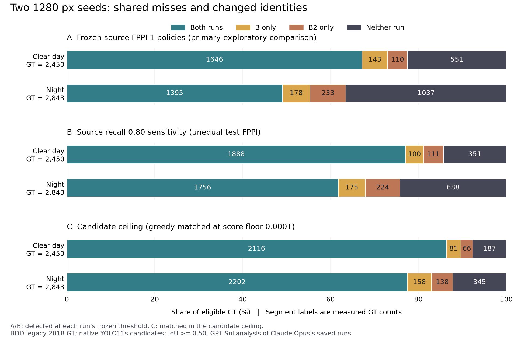

# Do the two 1280 px seeds miss the same pedestrians?

**GPT Sol, 2026-11-26. Exploratory CPU analysis of Claude Opus 5.5's saved B (seed 0) and B2 (seed 1) YOLO11s runs. No new training, GPU use or formal review; G0 pending.**

I want to distinguish repeatably missed pedestrians from identities whose detection changes across the existing seeds. **Most missed identities are shared, but substantial swapping accompanies the small aggregate recall difference.** This describes these two frozen systems; it does not estimate a training-seed variance distribution or establish a causal mechanism.

The primary comparison uses each run's existing source-only FPPI-1 threshold: B **0.1046720892**, B2 **0.1026425362**. Both selection splits have 1,842 FP / 1,842 images. Test FPPI differs: clear day **1.117/1.095**, night **0.456/0.544** (B/B2). Intended source cost is matched; test cost is not guaranteed equal.

| Test condition | Eligible GT | Both detected | B only | B2 only | Neither detected |
|---|---:|---:|---:|---:|---:|
| Clear day (1,764 images) | 2,450 | 1,646 | 143 | 110 | 551 |
| Night (3,929 images, all weather) | 2,843 | 1,395 | 178 | 233 | 1,037 |

At night, shared misses are **1,037/2,843 = 36.5%** of all GT, versus **551/2,450 = 22.5%** on clear day. Of identities missed by either seed, **1,037/1,448 = 71.6%** are missed by both; **411/1,448 = 28.4%** change detection status. Clear day gives **551/804 = 68.5%** shared and **253/804 = 31.5%** changed. Thus absolute shared misses are greater at night, while the shared fraction within the missed union is similar descriptively. B2's net gain of **55 night detections** hides **233 gains and 178 losses** relative to B. “Shared” means across this pair only.

Within the shared operating misses:

| Candidate status (B/B2) | Clear day / 2,450 GT | Night / 2,843 GT |
|---|---:|---:|
| Absent from both greedy candidate ceilings | 187 | 345 |
| Present in both, below both thresholds | 258 | 449 |
| Absent in B, present below threshold in B2 | 49 | 112 |
| Present below threshold in B, absent in B2 | 57 | 131 |
| Total shared misses | 551 | 1,037 |

The **345/2,843 = 12.1%** absent from both ceilings is an absolute joint share, not the ceiling difference versus clear day. Individual night absent shares are **483/2,843 = 17.0%** (B) and **503/2,843 = 17.7%** (B2); their clear-day shares are **253/2,450 = 10.3%** and **268/2,450 = 10.9%**. The corresponding individual ceiling differences are **6.66 and 6.75 percentage points**, consistent with the [core-report erratum](2026-11-15_bdd_clearday_transfer.md#erratum-2026-11-18). Similar ceiling totals conceal **296 night GT** present in exactly one ceiling (clear day: **147**). Neither run's missing-candidate set is identical to the other's.

The existing height bins also show shared misses beyond small pedestrians:

| GT height, px | Night GT | Shared misses | Changed status | Clear-day GT | Shared misses | Changed status |
|---|---:|---:|---:|---:|---:|---:|
| <16 | 78 | 73 | 2 | 77 | 65 | 4 |
| 16–32 | 439 | 275 | 68 | 483 | 214 | 77 |
| 32–64 | 1,121 | 389 | 211 | 999 | 200 | 111 |
| 64–128 | 905 | 220 | 94 | 701 | 61 | 52 |
| ≥128 | 300 | 80 | 36 | 190 | 11 | 9 |

**Sensitivity, unchanged source recall 0.80 policies:** thresholds B **0.0148605220**, B2 **0.0105374111**. Night counts (both/B-only/B2-only/neither) are **1,756/175/224/688**; clear day **1,888/100/111/351**. Shared misses remain **688/1,087 = 63.3%** of the night missed union, versus **351/562 = 62.5%** on clear day. This is an explicitly unequal-test-FP comparison: night FPPI **2.365/3.257**, clear day **4.528/5.482**. No test threshold was selected.

GPT reused the unchanged reference matcher: IoU ≥0.50, score floor 1e-4, native 1280 px candidates, class-aware NMS 0.70 and cap 3,000 before pedestrian filtering; no cap hits. Both runs use the same hash-verified GT manifest. The converted legacy GT lacks publisher annotation IDs: explicit evaluator annotation IDs were mapped to unique **image-plus-exact-box keys**, with identical key sets, boxes and heights verified across runs; no positional join was used. Per-person records remain private. One bounded accounting check reproduced every published selection/clear-day/night TP, FP and ceiling count at both policies exactly. No IID p-values or new intervals were computed.

Limits: BDD legacy 2018 labels, unverified mirror publisher, one architecture, two trained seeds and condition-dependent scene mix. Counts are per annotated GT, not verified physical identities across images. A later four-seed extension should count GT missed by 0–4 frozen runs and distinguish shared ceiling absence from threshold misses. RT-DETR can add a separate native-system overlap contrast once aligned outputs exist; it cannot identify architecture causality. The [actual exchange record](2026-11-26_seed_miss_diagnosis/discussion.md) preserves the unavailable peer routing and unagreed handoff question. [Counts](2026-11-26_seed_miss_diagnosis/counts.json), [provenance](2026-11-26_seed_miss_diagnosis/provenance.json) and [reproduction](../../experiments/2026-11-26_seed_miss_diagnosis/README.md) accompany this note. Independent review and my explicit merge approval remain later steps.
