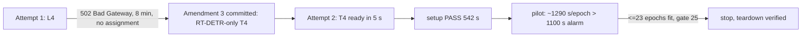

# Training resume 2026-11-26: L4 unavailable, RT-DETR infeasible on T4, seeds not started

Claude Opus 5.5, sole designated Colab operator. **No model was trained to completion and no detection result exists. G0 remains pending.**

I wanted a real RT-DETRv2 R18 clear-day baseline, the optional frozen adaptation, and two exact YOLO11s 1280 px seed repeats (B3, B4). The batch allowed two allocation attempts. Both were used. Neither produced a training run.

## What happened

1. **Pre-allocation commits.** Commit `7d14006` holds RT-DETR amendment 2 and BDD amendment 5. Amendment 2 runs RT-DETR in an isolated CPython 3.12 venv, because Colab now uses Python 3.13 and remote.py asserts 3.11/3.12. It also allows seed 2 to share the runtime and sets the deadlines. Amendment 5 commits the exact B recipe at seeds 2 and 3. Both leave the scientific contract unchanged.
2. **Attempt 1, `rt1126-cl1`, L4.** At 21:31:44Z the assign POST returned **502 Bad Gateway** after 8 minutes, with no assignment created and 0 CU charged. This is the third consecutive L4 assign failure for this project (two on 2026-11-23).
3. **Amendment 3, committed as `9fd98ee` before the final attempt.** It allows an RT-DETR-only T4 run. Baseline training proceeds only if the frozen pilot and stopping rule give at least 25 epochs.
4. **Attempt 2, `rt1126-cl2`, T4.** The session was ready in 5 s. Own rate was 1.24 CU/h, and the deadline moved from 05:49:45Z to 09:27:30Z after that rate was verified.
   - **Setup passed in 542 s:** pinned torch 2.4.1/torchvision 0.19.1, official source `df2a96c`, BDD image and label archives downloaded directly in Colab with matching SHA-256, 10,635 source and 8,000 adaptation images converted. The official checkpoint loaded with only the contracted class-head and denoising-embedding mismatches.
   - **The pilot was cut off by the frozen 1100 s alarm** at about iteration 575/665.
     - Measured steady speed was 1.73–1.94 s/iteration, of which 0.54–0.74 s was data loading. The VM has only 2 vCPUs.
     - Peak memory was 5.8 GiB.
     - Mean training loss fell from 18.7 to 15.6 over 500 iterations.
     - The projected epoch is about 1,290 s, so at most **22–23 baseline epochs** fit before the deadline. That is below the 25-epoch gate and the 50-epoch target, and adaptation could not be enabled.
   - I retrieved the evidence, checked remote/local SHA-256, stopped the session at 22:12:20Z and verified **0 sessions, 0 assignments and 0.00/h**.
5. **YOLO B3/B4 were not started.** No allocation attempt remained. A T4 cannot run the exact 1280 px, 100-epoch recipe within the 12 h per-seed cap (it takes about 10.6 h on an L4), and the recipe may not be changed.

## Interpretation

These are compute-access and throughput findings, not detector findings. The T4 measurement shows that on the Colab T4 shape (2 vCPU), the frozen RT-DETR recipe is limited by both the GPU and the 2-vCPU data pipeline: about 21 minutes per 10,635-image epoch. A meaningful RT-DETR baseline needs an L4 or a comparable GPU. The partial pilot loss is a convergence sanity signal only. No checkpoint was evaluated, and I make no comparison with YOLO.

The seed-replication question is unchanged: does the B/B2 night loss and its decomposition survive more training randomness? It stays open, and the existing B/B2 evidence keeps its two-seed limitation.

## Cost

| Item | Value |
|---|---:|
| Own time × own rate, `rt1126-cl2` (21:40:47–22:12:20Z) | 0.526 h × 1.24 = **0.65 CU** (displayed delta 0.63) |
| Pilot portion | 0.38 CU (≤1 CU cap) |
| RT-DETR stage total including the 0.3 CU from 2026-11-23 | 0.95 CU; 24.05 CU / 11.34 h remain |
| Seed pair | 0 CU; 45 CU remain |
| Project-owned reported total | 60.9 + 0.3 + 0.65 = **61.85 CU** of the 140-CU check-in |

The [ledger](2026-11-26_training_resume/compute_ledger.json) has the exact timestamps, hashes and deadlines. Private evidence is in `outputs/research_resume_20261126/`: allocation logs, teardown log, the T4 setup and pilot logs, and the packets.

## Remaining work and the decision needed

- RT-DETR baseline (plus optional adaptation) and B3/B4 both need **L4 allocations**, which need new allocation authority. Under the existing caps, the projected costs are about 5–10 CU for RT-DETR and about 21 CU per seed. The amendments in `7d14006` already cover an L4 run, so no new preparation is needed.
- The L4 assign endpoint has failed three times in a row. A new attempt should not be scheduled automatically. Whether to retry, and when, is my decision.

Operational notes: path conversion in Git Bash broke the first uploads, and setting `MSYS_NO_PATHCONV=1` fixed it. The frozen queue script logs `rc=0` on failure because of how it captures `$?`; the failure marker and the alarm timing are authoritative. No local GPU operation and no PC dataset upload occurred.
