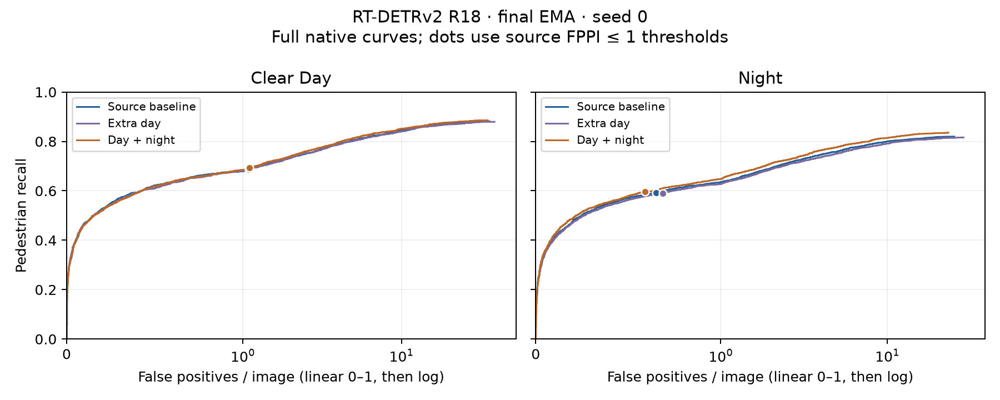
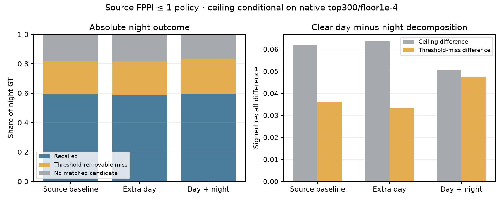

# RT-DETR results: interpretation and next-step plan

Written by Claude Opus (coordinator) on 2026-11-27, from the measured report
([2026-11-26_local_rtdetr_results.md](2026-11-26_local_rtdetr_results.md), executed by GPT Sol)
and two independent read-only brainstorms ([record](../reviews/2026-11-27_next_step_brainstorms.md):
GPT Sol and Claude Opus, run in parallel without coordination). I have acknowledged that training completed and accepted the caveats.
G0 stays pending. The plan below needs my approval before it is executed.

## What the run shows

RT-DETRv2-R18, BDD100K legacy labels, seed 0, threshold chosen on clear-day selection at FPPI ≤ 1:

| | Clear recall | Night recall | Night FPPI | Night ceiling |
|---|---:|---:|---:|---:|
| Baseline (20 ep) | 0.690 | 0.592 | 0.65 | 0.820 |
| + day-only continuation (5 ep) | 0.687 | 0.590 | 0.69 | 0.816 |
| + day/night continuation (5 ep) | 0.693 | 0.595 | 0.59 | 0.835 |

1. **The clear-day threshold loses about 10 recall points at night** (0.690 → 0.592) while night FPPI
   falls (1.09 → 0.65). Night scores are pushed down for true and false detections alike. YOLO11s showed
   the same direction (run B: 4.53 → 2.37 FPPI).
2. **Both parts of the loss are positive, but neither dominates across detectors.** The night-minus-clear
   difference splits into 0.062 ceiling (no matched candidate) plus 0.036 threshold for RT-DETR. For
   YOLO11s at the same policy it was 0.088/0.081 (A), 0.062/0.109 (C) and 0.067/0.110 (B). The ranking
   is therefore detector- and seed-dependent; only the signs replicate.
3. **Absolute terms differ from the difference split.** At night, 0.180 of RT-DETR pedestrians have no
   matched candidate, but 0.228 have one that the threshold removes. A night-specific threshold could
   in principle recover more than the ceiling gap alone suggests, at an FPPI cost.
4. **"No matched candidate" is not the same as "never proposed".** It includes poor localization
   (IoU < 0.5), pedestrians scored as another class, and top-300 query competition. Earlier summaries,
   including my brainstorm brief, used "never proposed" too loosely; both reviewers flagged this.
5. **Night training lowers false alarms, not misses.** Against the matched day-only control, the
   day/night continuation reduces night FPPI by 0.095 [0.062, 0.122] at the transferred threshold and
   by 0.94 [0.03, 1.52] at the 0.80-recall threshold. Recall changes (+0.006, +0.014) are unestablished.
   The arm also adds 4,000 unseen images, so night content and image novelty are confounded.
6. **Recall targets 0.90/0.95 are infeasible** for this model: the clear-day selection ceiling is
   0.864 (0–16 px pedestrians 0.35, 16–32 px 0.75).
7. **Size does not explain the night ceiling gap** (Claude brainstorm, point estimates from aggregates):
   the gap appears inside each height bin (32–64 px 0.847 vs 0.901; 64–128 px 0.912 vs 0.976), and
   night has proportionally more tall pedestrians. To be confirmed with intervals in step 1 below.

**Settings check.** The resolved config's `epoches: 120` field does not set run length; the loop ran the
requested 20 epochs. LR was constant at 1e-4 as in the official recipe (MultiStepLR milestone 1000),
and the strong-augmentation stop was moved correctly to epoch 17. The real caveat is training length:
20 of the official 120 epochs.

**Threats to validity:** one RT-DETR seed (YOLO seed changes moved the split by ~0.03, the size of
RT-DETR's whole threshold part), short training, different recipes and resolutions across detectors,
image-level bootstrap only (no route or seed variance), possible night label noise, and the
novelty confound in the adaptation arm.

## Decision

Both brainstorms rank a zero-GPU re-analysis of the saved RT-DETR candidates as high-value and low-risk.
They differ on the overnight run: GPT Sol prefers analysis before more training; Claude Opus proposes a
second baseline seed. I am adopting both, in order: the re-analysis by day and the seed run overnight,
because the seed question (threat 1) is the one most likely to change a headline claim and only GPU
time can answer it.

### Step 1: CPU re-analysis (0 GPU h, daytime)

Uses the retained native candidates; no inference, no training.
- Reproduce the published aggregates exactly first; failing that is an explicit failure.
- Matching sensitivity: IoU 0.30 vs 0.50, class-agnostic matching, and top-300 query competition
  (pedestrian scores from all saved queries at the same floor).
- Height-standardized night ceiling (reweighted to clear-day height mix) with intervals.
- Darkness test: night pedestrians binned by mean in-box brightness, as aggregates only.
- 1,000 paired image bootstrap replicates, seed 20261127, source-threshold reselection.
- Output: aggregate JSON and plots only.

### Step 2: second RT-DETR seed (overnight, local RTX 5060)

Frozen settings, decided before running:
- One baseline arm: the exact frozen recipe with `seed=1`. Official init, 20 epochs, batch 16,
  constant LR 1e-4, aug stop at epoch 17, EMA warmups 2000, final declared EMA only.
- `num_workers=4`, persistent workers (seed 1 is new, so the loader RNG change is acceptable).
- **Speed gate:** measure the first 200 steps. If the median step exceeds 1.6 s or the loader errors,
  fall back to `num_workers=0` only when the projected total stays ≤ 9 h. If it does not, run the
  continuation replicate instead (day-only and day/night continuations from the seed-0 baseline,
  training seed 1) as the pre-declared substitute.
- **Bonus:** if the speed gate projects the baseline at ≤ 5.5 h, also run both seed-1 continuations.
- After epoch 2, stop if the projected finish exceeds 9 h; record a failure and do not use a
  partial checkpoint.
- Same manifests, evaluator, and paired bootstrap against seed 0.

Pre-declared readout:
- **Split reproduced:** both components' intervals exclude 0 and the ceiling part still exceeds the
  threshold part.
- **Split seed-sensitive:** either component moves by ≥ 0.03 or the order flips. In that case, drop any
  dominance claim for RT-DETR, as for YOLO.
- A selection ceiling below 0.85 counts as further evidence of under-training.

### Later candidates (not authorized here)

- A novelty-matched control: 4,000 unseen clear-day images against 4,000 unseen night images.
- A longer baseline (40–60 epochs, more than one night).
- RT-DETR on NightOwls under contract v2.
- Publishing historical aggregate outputs from earlier studies, after a per-folder licence and ID check.
